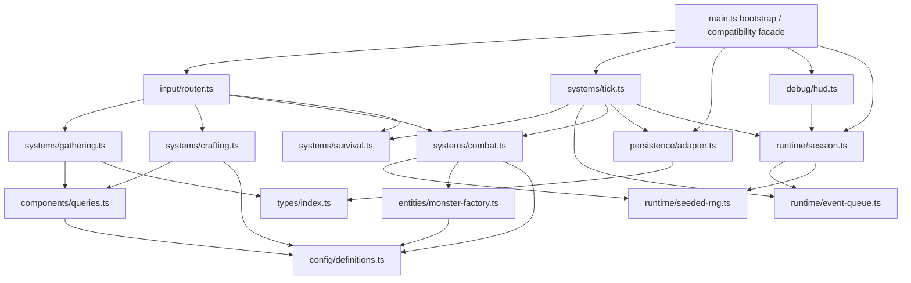

# B4-A0 — Ventralis Monolith Architecture Audit

## 1. State map

| Binding | Classification | Migration ownership / notes |
|---|---|---|
| `tickCount` (72) | Retained runtime state | `GameSession.tick`; serialized by snapshot/restore. |
| `hp` (73) | Proposed Component data | `VitalsComponent.hp`; serialized. |
| `maxHp` (74) | Proposed Component data | `VitalsComponent.maxHp`; serialized. |
| `wood` (75) | Proposed Component data | Retain as `ResourceMirrorComponent.wood`; intentionally separate from inventory. |
| `stone` (76) | Proposed Component data | Retain as `ResourceMirrorComponent.stone`; intentionally separate from inventory. |
| `inventory` (77) | Proposed Component data | `InventoryComponent`; serialized. |
| `equippedWeapon` (78) | Proposed Component data | `EquipmentComponent`; serialized. |
| `attackBonus` (79) | Proposed Component data | `CombatModifiersComponent.attackBonus`; serialized. |
| `torchBuffTicks` (80) | Proposed Component data | `CombatModifiersComponent.torchBuffTicks`; serialized. |
| `alive` (81) | Proposed Component data | `VitalsComponent.alive`; serialized. |
| `log` (82) | Proposed Component data | `EventLogComponent.entries`; last 20 entries serialized. Its length affects spawning. |
| `worldRef` (83) | Retained runtime state | `GameSession.world`; not component data and not serialized. |
| `rngState` (84) | Retained runtime state | `SeededRandomSource`; serialized to preserve replay sequence. |
| `pendingEvents` (85) | Retained runtime state | `ScheduledEventQueue`; runtime service, serialized only if future persistence requires it. Current snapshot does not include it. |
| `saveCounter` (86) | Retained runtime state | `PersistenceRuntime`; debug-visible and included in persisted payload metadata, but not snapshot state. |
| `monsters` (297) | Proposed Component data | `MonsterRosterComponent`; preserve exported live-array behavior or provide an equivalent controlled view. |

Derived values are not stored: `totalWeight`, `carryCapacity`, `canCarry`, and combat roll calculations remain derived-on-read. Static definitions and recipes are type/config modules, not state.

## 2. Function map

| Function | Proposed destination |
|---|---|
| `lcgNext` | Seeded RNG adapter |
| `rollInt` | Seeded RNG adapter |
| `say` | Event-log system |
| `emit` | Output/debug adapter |
| `emitPanel` | Debug/HUD surface |
| `totalWeight` | Inventory domain/query module |
| `carryCapacity` | Inventory domain/query module |
| `canCarry` | Inventory domain/query module |
| `attackRoll` | Combat system |
| `pickup` | Gathering/inventory system |
| `craft` | Crafting system |
| `consumeRation` | Consumption/vitals system |
| `equip` | Equipment system |
| `spawnMonster` | Monster entity factory |
| `attack` | Combat system |
| `schedule` | Scheduled-event queue adapter |
| `onKey` | Input routing/bootstrap surface |
| `tick` | Tick orchestration system |
| `runTicks` | Retained bootstrap/test runner |
| `decideUseStorage` | Persistence adapter policy |
| `persist` | Persistence adapter |
| `snapshot` | Persistence serializer |
| `restore` | Persistence deserializer |
| `debugDump` | Debug/HUD surface |
| `resetGame` | Session bootstrap/reset |
| `initGame` | Session bootstrap |
| `state` closure | Public read-only debug/test API |
| `gameLoop` export | Bootstrap API |
| `keys` export | Input API |
| `api` export | Compatibility façade |

## 3. Side effects and dependencies

| Function | Reads/writes globals | Output | Storage | RNG | Log coupling |
|---|---|---|---|---|---|
| `lcgNext` | Reads/writes `rngState` | None | None | Advances LCG | None |
| `rollInt` | Via `lcgNext` | None | None | Consumes one draw | None |
| `say` | Reads `tickCount`, writes `log` | None | None | None | Appends entries |
| `emit` | Reads `worldRef` | Writes text output | None | None | None |
| `emitPanel` | Reads `worldRef`; calls `debugDump` | Writes panel output | None | None | Indirectly exposes state |
| `totalWeight` | Reads `inventory`, `ITEM_DEFS` | None | None | None | None |
| `carryCapacity` | Reads `inventory` | None | None | None | None |
| `canCarry` | Reads inventory-derived values | None | None | None | None |
| `attackRoll` | Reads `attackBonus`, `torchBuffTicks` | None | None | Consumes one draw | None |
| `pickup` | Reads/writes `alive`, mirrors, inventory | Text on success/failure | None | None | Adds pickup/overload log |
| `craft` | Reads/writes alive, inventory, mirrors, buff, bonus | Text result | None | None | Logs failures and craft effects |
| `consumeRation` | Reads/writes alive, inventory, hp, maxHp | Text result | None | None | Logs eating/failure |
| `equip` | Reads alive/inventory; writes equipment | Text result | None | None | Logs equipment |
| `spawnMonster` | Writes `monsters`, reads definitions | None | None | None | Adds spawn log |
| `attack` | Reads/writes alive, monsters, combat state, mirrors, inventory | Attack text | None | Consumes one draw | Logs hit/miss/death |
| `schedule` | Writes `pendingEvents` | None | None | None | None |
| `onKey` | Reads alive/equipment/inventory; dispatches actions | Delegated output | None | Delegated | Delegated; `KeyH` has special coupling |
| `tick` | Reads/writes nearly all runtime state | Event output and persistence effects | Via `persist` | Spawn may consume one draw | `log.length` gates spawn |
| `runTicks` | Calls `tick` repeatedly | Delegated | Delegated | Delegated | Delegated |
| `decideUseStorage` | Reads `worldRef.storage` | None | Reads save-key existence | None | None |
| `persist` | Reads/writes `saveCounter`, tick/world | None | Writes save payload | None | None |
| `snapshot` | Reads all serializable globals and monsters | None | None | Does not consume RNG | Serializes last 20 logs |
| `restore` | Writes nearly all state except world, queue, save counter | None | Input supplied by caller | Restores RNG state | Adds `"save restored"` |
| `debugDump` | Reads all debug-visible globals | Returns string | None | None | Reads `pendingEvents.length` |
| `resetGame` | Resets all state, monsters, RNG | None | None | Seeds RNG | Clears log |
| `initGame` | Writes `worldRef`; may call restore; calls `say` | No output at boot | Reads storage | Restores RNG if save exists | Adds wake log |
| `state` closure | Reads selected state lazily | None | None | None | None |
| API exports | Expose all above | Depends on call | Depends on call | Depends on call | Compatibility boundary |

## 4. Ownership and mutation boundaries

- `GameSession` owns the world/session state: tick, vitals, mirrors, inventory, equipment, combat modifiers, alive flag, log, monsters, and seed state.
- `ScheduledEventQueue` owns pending events and provides enqueue/drain operations.
- `PersistenceAdapter` owns storage access, save-key gating, serialization, restore, and `saveCounter`.
- `Clock` is owned by the injected `World`/runtime environment. The current behavior does not read `world.clock`; do not introduce clock-driven behavior during migration.
- `SeededRandomSource` owns the LCG state and exposes `next()`/`int()`. Every current RNG call must remain in the same order.

Use controlled direct mutation inside systems, with a single `GameSession` passed to each system. This preserves the existing in-place monster array, mirror counters, exact operation ordering, and observable API behavior while avoiding command-queue timing changes. Systems should not mutate persistence, output, or RNG internals directly; those are injected services.

## 5. Not-ECS list

| Concern | Treatment |
|---|---|
| Persistence boundary | Keep as an adapter/service. Storage policy, JSON shape, save metadata, and restore compatibility are I/O concerns, not entities or systems. |
| Debug/HUD surface | Keep as a read-only presentation adapter. `debugDump` must preserve exact field order and formatting. |
| Scheduled-event queue | Keep as a temporal runtime service. Events are queued records consumed by the tick orchestrator; making the queue itself a component would obscure ordering and persistence semantics. |
| Seeded RNG | Keep as an injected deterministic service. RNG state is a replay/persistence concern, not gameplay component data. |
| World/output bridge | Keep as an environment adapter. Systems emit typed output events rather than owning browser/world objects. |
| Save counter | Keep with persistence runtime metadata, not gameplay ECS state. |
| Input routing | Keep as an input adapter translating keys into system calls. |

## 6. Hidden-coupling register

| Coupling | Evidence | Preservation rule |
|---|---|---|
| Resource mirror vs inventory double-accounting | `pickup` increments both at 162–164; `craft` decrements inventory only at 186–188; monster death increments both at 253–254. | Maintain two independent stores and their asymmetric updates. |
| Secret recipe costs | Ration crafting decrements mirror `wood` at 195–199 but not mirror `stone`; torch has a historical no-op at 190. | Preserve exact recipe side effects, including no-ops and hidden wood consumption. |
| Crafting affects combat state | Torch craft sets `torchBuffTicks` and increments `attackBonus` at 191–193. | Crafting system may mutate combat modifiers through the session boundary. |
| RNG consumption order | `attackRoll` consumes RNG at 143–148; wandering spawn consumes RNG at 345–348; snapshot/restore carries `rngState` at 381–393 and 412. | No extra RNG calls, reordered calls, or random calls in debug/persistence paths. |
| Log length affects spawning | Spawn condition checks `log.length % 2` at 345–347. | Log append timing and message count must remain identical before tick-20 checks. |
| `decideUseStorage` gates periodic saves | `persist` returns when no save key exists at 369–374; policy reads key existence at 364–366. | Preserve no-op saves without a pre-existing `"ventralis:save"` key. |
| KeyH re-equips torch | `onKey` emits panel first, then calls `equip("torch")` at 279–283. | Preserve panel-before-equipment output and resulting weapon state. |
| Tick ordering | Survival, buff decay, events, monster round, spawn, save are ordered at 303–353. | Implement as one ordered orchestration sequence. |
| Snapshot/restore asymmetry | Snapshot includes gameplay state and RNG but not `pendingEvents`, `worldRef`, or `saveCounter` at 377–394; restore writes corresponding fields at 397–413. | Preserve current serialized shape unless a compatibility extension is explicitly approved. |
| Restore log behavior | `restore` appends `"save restored"` at 413; `initGame` then appends wake log at 465. | Preserve observable log length and boot output behavior. |
| Live monster collection | `monsters` is exported and mutated in place; reset/restore use `.length = 0` and `.push` at 410–411 and 455. | Preserve identity or provide an equivalent compatibility view. |
| Torch affects carrying and healing | `carryCapacity` uses torch count at 135–137; ration healing uses torch count at 212–214. | Keep inventory-derived queries centralized but behaviorally unchanged. |
| Dead-state gating | Actions return when `alive` is false, e.g. 155–160, 169–175, 205–210, 219–220, 238–243, 271–272. | All public action paths must remain no-ops after death. |

## 7. Proposed dependency graph



All arrows point from consumers to dependencies; there are no cycles. `main.ts` depends on persistence and debug surfaces but those surfaces do not depend on `main.ts`.

## 8. Proposed file tree

Every migrated file must remain below 120 lines; `main.ts` should remain below 80 lines.

```text
src/
  main.ts                         # bootstrap and compatibility exports
  types/
    index.ts                      # shared interfaces and discriminated types
  config/
    definitions.ts                # item, recipe, monster tables
  components/
    components.ts                 # state shapes
    queries.ts                    # derived read-only calculations
  runtime/
    session.ts                    # owned mutable session state
    seeded-rng.ts                 # LCG adapter
    event-queue.ts                # scheduled events
  entities/
    monster-factory.ts
  systems/
    gathering.ts
    crafting.ts
    consumption.ts
    equipment.ts
    combat.ts
    survival.ts
    tick.ts
    input.ts
  persistence/
    adapter.ts
    snapshot.ts
  debug/
    hud.ts
    output.ts
```

The initial implementation should split by behavior while preserving the existing public exports and API façade.

## 9. Migration order

1. Add internal types/config modules without changing behavior. Run characterization tests and typecheck.
2. Introduce `GameSession`, seeded RNG, and event-queue wrappers while keeping `main.ts` behavior identical. Run tests.
3. Extract derived inventory queries. Run tests.
4. Extract output/log helpers and debug formatting. Verify exact strings and output order. Run tests.
5. Extract persistence adapter, snapshot, restore, storage gating, and save metadata. Run tests.
6. Extract gathering, crafting, consumption, and equipment systems. Run tests after each slice.
7. Extract monster factory and combat system. Verify seed-7 roll sequence and double stone drop. Run tests.
8. Extract survival and scheduled-event processing, preserving the six-step tick order. Run tests.
9. Extract input routing and compatibility façade. Run tests.
10. Reduce `main.ts` to bootstrap/export wiring, then run the full acceptance suite and typecheck.

`tests/characterization.test.ts` is the acceptance oracle and must not be edited. No implementation slice is accepted unless it remains green against that unchanged file.

## 10. Risk and verification plan

A later implementer should:

- Run `pnpm run test` after every extraction slice.
- Run `pnpm run typecheck` after every public-interface change.
- Compare exact `api.dump()` strings, output-array order, save JSON fields, save counters, and seeded attack rolls.
- Add temporary local diagnostics only outside the committed source/test scope, or inspect existing behavior manually; do not edit characterization tests.
- Compare snapshots before and after migration, especially mirror counters, RNG state, logs, monsters, and combat modifiers.
- Verify tick boundaries at 3, 5, 10, and 20 ticks.
- Verify no-save-key behavior, pre-existing-save behavior, and restore boot behavior.
- Verify `KeyH` panel-before-re-equip behavior.
- Verify that adding/removing log entries changes spawn eligibility exactly as before.

Abandon ECS treatment for a concern when component/system boundaries introduce observable ordering changes, extra RNG consumption, loss of live collection identity, altered persistence shape, or inability to preserve exact output/log timing. Persistence, debug, event queue, and seeded RNG should remain services/adapters even if gameplay state uses ECS-like components.

## Verification and handoff

- Model/provider: GPT-5 / Codex; exact provider not exposed.
- Session/thread ID: not visible in the available environment.
- Attempts: 1.
- Repairs: none required.
- Changed paths: none.
- Scope drift: none.
- Initial failures: none.
- Remaining blockers: none.

Exact verification results:

| Command | Exit code | Result |
|---|---:|---|
| `git status --short` | 0 | Empty output; clean worktree |
| `git diff --check` | 0 | Clean |
| `pnpm run test` | 0 | 1 test file passed; 21 tests passed |
| `pnpm run typecheck` | 0 | `tsc -p tsconfig.json --noEmit` passed |