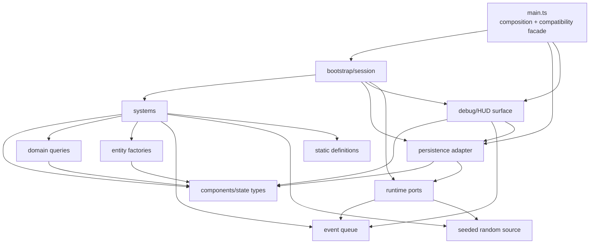

# B4-A0 — Ventralis monolith architecture audit

## Handoff metadata

- Model/provider: GPT-5 via OpenAI Codex API; provider/session ID not exposed.
- Attempts: 1.
- Repairs: none.
- Changed paths: none.
- Scope drift: none.
- Initial failures: none.
- Remaining blockers: none.
- `HEAD` differs from `master`; per packet instructions, dispatched `HEAD` is authoritative.

## 1. State map

| Binding | Evidence | Classification | Migration treatment |
|---|---:|---|---|
| `tickCount` | `src/main.ts:72` | Proposed Component data | `TimeState.tick`; owned by clock/tick system |
| `hp` | `:73` | Proposed Component data | `HealthComponent.hp` |
| `maxHp` | `:74` | Proposed Component data | `HealthComponent.maxHp` |
| `wood` | `:75` | Proposed Component data, legacy mirror | Preserve as `ResourceMirror.wood`; do not collapse into inventory |
| `stone` | `:76` | Proposed Component data, legacy mirror | Preserve independently from inventory stone |
| `inventory` | `:77` | Proposed Component data | `InventoryComponent` |
| `equippedWeapon` | `:78` | Proposed Component data | `EquipmentComponent` |
| `attackBonus` | `:79` | Proposed Component data | `CombatComponent.attackBonus` |
| `torchBuffTicks` | `:80` | Proposed Component data | `BuffComponent.torchBuffTicks` |
| `alive` | `:81` | Proposed Component data | `LifeState.alive` |
| `log` | `:82` | Retained runtime/session state | `LogStore.entries`; its length remains gameplay input |
| `worldRef` | `:83` | Retained runtime state | `RuntimeContext.world`; injected, not componentized |
| `rngState` | `:84` | Retained runtime state | Seeded `RandomSource`; snapshot/restore it |
| `pendingEvents` | `:85` | Retained runtime state | `EventQueue`; intentionally not an ECS component |
| `saveCounter` | `:86` | Retained runtime/persistence state | `PersistenceSession.saveCounter`; preserve debug visibility |
| `monsters` | `:297` | Proposed Component/entity data | Entity registry or `MonsterComponent` collection; preserve exported live-array semantics through an adapter |

Derived-on-read values are `totalWeight`, `carryCapacity`, `canCarry`, attack roll results, and the formatted debug dump. They should not become stored state.

## 2. Function map

| Function | Proposed destination |
|---|---|
| `lcgNext` | Retained random-source adapter |
| `rollInt` | Random-source utility |
| `say` | Log/debug surface adapter |
| `emit` | Output/debug surface adapter |
| `emitPanel` | Debug/HUD surface |
| `totalWeight` | Inventory query/type module |
| `carryCapacity` | Inventory query/type module |
| `canCarry` | Inventory query/type module |
| `attackRoll` | Combat system plus random-source dependency |
| `pickup` | Gathering/inventory system |
| `craft` | Crafting system |
| `consumeRation` | Survival/consumption system |
| `equip` | Equipment system |
| `spawnMonster` | Monster entity factory |
| `attack` | Combat system |
| `schedule` | Event-queue adapter |
| `onKey` | Input-routing system |
| `tick` | Retained bootstrap/orchestrator |
| `runTicks` | Retained bootstrap/test-facing runner |
| `decideUseStorage` | Persistence adapter policy |
| `persist` | Persistence adapter |
| `snapshot` | Persistence serialization adapter |
| `restore` | Persistence deserialization adapter |
| `debugDump` | Debug/HUD surface |
| `resetGame` | Bootstrap/session reset |
| `initGame` | Bootstrap composition and restore |
| `gameLoop` | Public bootstrap alias to tick |
| `keys` | Public input alias |
| `api` | Public compatibility facade |

## 3. Side effects and dependencies

| Function | Reads | Writes | Output/storage | RNG/log coupling |
|---|---|---|---|---|
| `lcgNext` | `rngState` | `rngState` | None | Defines deterministic RNG sequence |
| `rollInt` | RNG source | RNG indirectly | None | Consumes exactly one RNG value |
| `say` | `tickCount` | `log` | None | Log length later affects spawning |
| `emit` | `worldRef` | `world.output` | Emits text | No log write |
| `emitPanel` | All debug state via `debugDump` | `world.output` | Emits panel | HUD observes live state |
| `totalWeight` | `inventory`, item definitions | None | None | None |
| `carryCapacity` | `inventory.torch` | None | None | None |
| `canCarry` | Inventory queries/item definitions | None | None | None |
| `attackRoll` | Equipment buffs | None | None | Consumes RNG |
| `pickup` | `alive`, inventory, mirrors, capacity | Inventory and `wood`/`stone`, log | Text output on success/failure | Log entry per result |
| `craft` | `alive`, recipes, inventory, capacity | Inventory, mirrors, buffs, attack bonus, log | Craft result output | Secret mirror mutation preserved |
| `consumeRation` | `alive`, ration count, torch count, HP | Ration count and HP, log | Eat/failure output | None |
| `equip` | `alive`, torch inventory | Equipment, log | Equipment output | None |
| `spawnMonster` | Monster definitions | `monsters`, log | No output | Log affects future spawn parity |
| `attack` | Alive, monsters, combat state | Monster list, mirrors, inventory, log | Attack output | RNG through `attackRoll` |
| `schedule` | None | `pendingEvents` | None | None |
| `onKey` | Input and state | Delegates to actions | Panel/action output | KeyH has re-equip coupling |
| `tick` | All simulation state, queue, log, world | Time, HP, buffs, queue, monsters, persistence | Event output and persistence writes | Spawn RNG gated by `log.length` |
| `runTicks` | None directly | Delegates to `tick` | Indirect | Order-sensitive |
| `decideUseStorage` | `worldRef.storage` | None | None | Gates all saves/restores |
| `persist` | World, snapshot, tick, save counter | `saveCounter`, storage | Storage write | Gated by existing save key |
| `snapshot` | Nearly every state binding | None | Serializable record | Includes RNG and monsters, excludes queue/save counter |
| `restore` | Serialized data | Nearly every state binding, monsters, log | Adds “save restored” log entry | Restores RNG sequence |
| `debugDump` | All displayed state, queue, save counter | None | String | Exact formatting is test-visible |
| `resetGame` | Seed | Resets state and monsters | None | Resets RNG and counters |
| `initGame` | World/storage | `worldRef`, potentially all restored state, log | No output on restore path | Restore is gated by storage key |
| `api.state` getters | Selected state | None | Public state view | Must remain live, not copied |

## 4. Ownership and mutation boundaries

- `World` is an injected runtime dependency owned by bootstrap. Systems receive narrow ports for output, storage, clock, and randomness.
- Domain state is owned by a single `GameWorld`/session object containing components and entity collections.
- The event queue is owned by an `EventQueue` service. It remains an ordered runtime queue, not an ECS component.
- Persistence is owned by a `PersistenceAdapter`; systems request save/restore through the adapter but do not access `Map` directly.
- The clock is owned by the bootstrap/runtime context. Tick progression remains explicit and deterministic.
- The seeded random source is owned by the runtime context and serialized as part of the save snapshot.

Mutation strategy: controlled direct mutation through system-owned world ports. This preserves the existing synchronous API, exact mutation order, live getters, and legacy quirks without introducing a command-buffer timing change. Systems must mutate only the components they own; cross-component effects use explicit mutation methods such as `inventory.consume`, `combat.applyDamage`, or `resources.adjustMirror`.

## 5. Not-ECS list

- Persistence boundary: storage serialization and save-key policy are I/O concerns. Making them components would leak infrastructure into gameplay state.
- Debug/HUD surface: `debugDump`, panels, and output emission are presentation concerns. They observe state but do not represent entities.
- Scheduled-event queue: it is temporal infrastructure with exact-tick consumption and filtering semantics. Treating queued events as entities risks changing ordering and removal behavior.
- Seeded RNG: randomness is an injected deterministic service. A component would incorrectly model an implementation service as gameplay data and could alter consumption order.
- Clock/runtime context: the clock and `World` reference are session infrastructure, not entity state.
- Persistence `saveCounter`: it is an adapter/session metric, although it remains debug-visible.
- Log: it is a diagnostic/session stream. Its length is nevertheless a legacy gameplay input and must be exposed to the spawn system explicitly.

## 6. Hidden-coupling register

| Coupling | Evidence | Preservation rule |
|---|---:|---|
| Resource mirrors and inventory are double-accounted | `src/main.ts:155-167`, `:187-199` | Keep raw `wood`/`stone` separate from inventory. Torch craft consumes inventory only; ration craft secretly decrements mirror wood. |
| Torch craft changes combat state | `:193-195` | Preserve `torchBuffTicks = 30` and permanent `attackBonus += 1`. |
| Secret ration wood consumption | `:197-199` | Preserve `wood -= 1` while inventory wood is already consumed. |
| Monster stone drop is doubled across representations | `:252-254` | Preserve both `stone += 2` and `inventory.stone += 2`. |
| RNG consumption order is observable | `:92-95`, `:143-149`, `:346-348` | Preserve one-for-one RNG calls and action/tick ordering; snapshot/restore RNG state. |
| Spawn depends on log length | `:345-348` | Preserve `log.length % 2 === 0` gating and ensure logging occurs in the same order. |
| Periodic saves are gated by `decideUseStorage` | `:364-374`, `:350-352` | No save-key means tick-10 save is a no-op; existing key enables saves. |
| Restore is also storage-key gated | `:459-464` | Preserve boot behavior and no-output restore path. |
| KeyH re-equips torch after emitting panel | `:271-284` | Preserve panel-first, then `equip("torch")`, including emitted output order. |
| Debug dump exposes queue and save count | `:420-438` | Preserve exact field order and text format. |
| Tick phase ordering is load-bearing | `:303-353` | Keep drain, buff decay, events, monster round, spawn, then persistence order. |
| Snapshot excludes queue and save counter | `:377-394` | Preserve snapshot shape unless compatibility adapter supplies equivalent behavior. |
| Restore adds a log entry | `:397-413` | Preserve the “save restored” log mutation and its downstream effects. |
| Dead state blocks actions | `:155`, `:169`, `:205`, `:219`, `:238`, `:271` | Centralize alive guards without changing which actions are blocked. |
| Exported `monsters` is mutable/live | `:297`, `:232-234`, `:397-411` | Preserve public identity or provide a compatibility view with equivalent mutation semantics. |

## 7. Proposed dependency graph



All arrows point toward dependencies; there are no cycles. `main.ts` composes and exposes the system, persistence, and debug surfaces but is not imported by them.

## 8. Proposed file tree

Every migrated file should remain under 120 lines; `main.ts` should remain under approximately 80 lines.

```text
src/
  main.ts                         # composition and public compatibility facade
  types/
    game.ts                       # shared public/domain interfaces
    components.ts                 # component/state types
    definitions.ts                # item, recipe, monster constants
  domain/
    queries.ts                    # weight, capacity, carry, derived reads
    resources.ts                  # mirror-resource operations
    inventory.ts                  # inventory operations
    combat.ts                     # combat state and attack calculations
    life.ts                       # HP/alive transitions
  entities/
    monsterFactory.ts             # monster creation
    monsterStore.ts               # live monster collection compatibility
  systems/
    pickupSystem.ts
    craftingSystem.ts
    consumptionSystem.ts
    equipmentSystem.ts
    combatSystem.ts
    survivalSystem.ts
    eventSystem.ts
    spawnSystem.ts
    inputSystem.ts
  runtime/
    worldContext.ts               # injected World ports
    clock.ts                      # explicit tick/session clock
    random.ts                     # seeded LCG adapter
    eventQueue.ts                 # scheduled events
    logStore.ts                   # session log
  persistence/
    adapter.ts                    # storage policy and writes
    snapshot.ts                   # serialize/deserialize
  debug/
    hud.ts                        # dump/panel/output compatibility
```

## 9. Migration order

1. Extract shared types and static definitions only. Keep `main.ts` behavior unchanged; run tests and typecheck.
2. Introduce a session/world state object behind the existing module bindings. Preserve exported API and run the suite.
3. Extract derived inventory queries. Verify carry limits and dump output.
4. Extract the seeded random source and combat calculations. Verify seed-7 roll and multi-attack sequence.
5. Extract resource mirrors and inventory operations. Verify torch/ration drift and monster double-drop.
6. Extract pickup, crafting, consumption, equipment, and combat systems one at a time. Run the characterization suite after each slice.
7. Extract event queue and survival/tick phases without changing phase order. Verify exact-tick events and death blocking.
8. Extract spawn logic while explicitly injecting log length and RNG. Verify spawn behavior and RNG order.
9. Extract persistence adapter, snapshot, restore, storage gating, and save counter. Verify all persistence tests.
10. Extract debug/HUD formatting and input routing. Verify exact panel text and KeyH output order.
11. Reduce `main.ts` to composition plus compatibility exports, then confirm all migrated files are below 120 lines and the entry point is below approximately 80 lines.
12. Run the full acceptance oracle without editing it: `tests/characterization.test.ts` must remain unchanged and green.

The acceptance oracle is `tests/characterization.test.ts`; it must not be edited.

## 10. Risk and verification plan

A later implementer should:

- Run `pnpm run test` after every migration slice.
- Run `pnpm run typecheck` after every public-interface or module-boundary change.
- Compare exact `api.dump()` strings, output-array ordering, storage payloads, save counters, and public state getters.
- Add temporary implementation-side tracing only if needed, then remove it before handoff; do not modify tests.
- Verify seeded replay with seed `7`, including miss/hit/kill sequence and RNG state restoration.
- Verify mirror/inventory divergence after torch and ration crafting.
- Verify log-length-dependent spawning with and without intervening log entries.
- Verify tick phase order around survival drain, event damage, monster damage, spawning, and saving.
- Verify `KeyH` emits the panel before the re-equip output.
- Verify snapshot/restore preserves all serialized state and intentionally leaves queue/save-counter behavior compatible.

Abandon ECS for a concern if ECS introduces observable timing or ownership changes, especially for persistence, event ordering, RNG consumption, debug output, or the legacy resource mirrors. Those concerns should remain explicit services or compatibility-owned state rather than being forced into entities/components.

## Verification results

| Command | Exit code | Result |
|---|---:|---|
| `git status --short` | 0 | No output; clean |
| `git diff --check` | 0 | Clean |
| `pnpm run test` | 0 | 1 test file passed; 21 tests passed |
| `pnpm run typecheck` | 0 | TypeScript check passed |

No files were created, edited, renamed, formatted, committed, or otherwise changed.