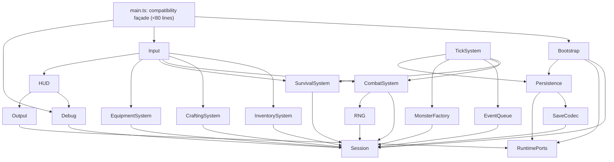

# Ventralis architecture audit and migration plan

Candidate design: a modular hybrid. Use typed domain state plus small systems with controlled direct mutation through a `SystemContext`; use entity-style records only for monsters. ECS is not appropriate for persistence, UI/debug, scheduling, RNG, or bootstrap.

`tests/characterization.test.ts` is the acceptance oracle and must not be edited.

## 1. State map

| Mutable binding | Classification | Proposed owner |
|---|---|---|
| `tickCount` | Retained runtime state (session) | `SessionState.tick` |
| `hp` | Proposed Component data | `PlayerState.hp` |
| `maxHp` | Proposed Component data | `PlayerState.maxHp` |
| `wood` | Proposed Component data | `Resources.mirrorWood` |
| `stone` | Proposed Component data | `Resources.mirrorStone` |
| `inventory` | Proposed Component data | `Inventory.items` |
| `equippedWeapon` | Proposed Component data | `Equipment.weapon` |
| `attackBonus` | Proposed Component data | `CombatStats.attackBonus` |
| `torchBuffTicks` | Proposed Component data | `StatusEffects.torchBuffTicks` |
| `alive` | Proposed Component data | `Vitality.alive` |
| `log` | Retained runtime state (session) | `SessionState.log` |
| `worldRef` | Retained runtime state (world/session) | bootstrap-owned `RuntimeServices.world` |
| `rngState` | Retained runtime state (session) | `SeededRandom.state` |
| `pendingEvents` | Retained runtime state (session) | `ScheduledEventQueue.events` |
| `saveCounter` | Retained runtime state (session) | `PersistenceRuntime.saveCounter` |
| exported `monsters` array | Proposed Component data | `MonsterStore.entities` |

No module-level mutable binding is currently derived-on-read or dead/redundant. In particular, the duplicate `wood`/`stone` mirrors are intentional observable state, not candidates for cleanup.

## 2. Function map

| Function | Destination |
|---|---|
| `lcgNext`, `rollInt` | `runtime/seeded-random.ts` |
| `say` | `runtime/log.ts` |
| `emit` | `ui/output.ts` |
| `emitPanel` | `ui/hud.ts` |
| `totalWeight`, `carryCapacity`, `canCarry` | `systems/inventory-system.ts` |
| `attackRoll` | `systems/combat-system.ts` |
| `pickup` | `systems/inventory-system.ts` |
| `craft` | `systems/crafting-system.ts` |
| `consumeRation` | `systems/survival-system.ts` |
| `equip` | `systems/equipment-system.ts` |
| `spawnMonster` | `entities/monster-factory.ts` |
| `attack` | `systems/combat-system.ts` |
| `schedule` | `runtime/event-queue.ts` |
| `onKey` | `input/key-router.ts` |
| `tick` | `systems/tick-system.ts` |
| `runTicks` | retained bootstrap/API façade |
| `decideUseStorage`, `persist` | `persistence/save-adapter.ts` |
| `snapshot`, `restore` | `persistence/save-codec.ts` |
| `debugDump` | `debug/debug-surface.ts` |
| `resetGame`, `initGame` | retained bootstrap/API façade |
| exported `gameLoop`, `keys`, `api` | retained `main.ts` compatibility façade |

## 3. Side effects and dependencies

Abbreviations: `S` = session/domain state; `W` = runtime world; `O` = output; `L` = log; `R` = RNG; `P` = storage persistence.

| Function | Reads / writes | Output, storage, RNG, log |
|---|---|---|
| `lcgNext` | R/W `rngState` | consumes RNG |
| `rollInt` | reads bounds; calls `lcgNext` | consumes RNG |
| `say` | reads `tickCount`; writes `log` | appends log |
| `emit` | reads `worldRef`; writes `world.output` | text output |
| `emitPanel` | reads `worldRef`, debug state | panel output |
| `totalWeight` | reads inventory and item definitions | none |
| `carryCapacity` | reads torch inventory | none |
| `canCarry` | reads inventory/item definitions | none |
| `attackRoll` | reads bonus/buff; calls RNG | consumes RNG |
| `pickup` | reads alive/capacity; writes mirrors and inventory | log + text output |
| `craft` | reads alive, recipe, inventory/capacity; writes inventory, wood, buff, bonus | log + text output |
| `consumeRation` | reads alive, inventory, HP; writes ration and HP | log + text output |
| `equip` | reads alive/inventory; writes weapon | log + text output |
| `spawnMonster` | reads monster definition; writes monsters | log only |
| `attack` | reads alive/monsters/combat state; writes monster HP, monsters, stone/inventory | RNG, log + text output |
| `schedule` | writes pending events | none |
| `onKey` | reads alive/equipment/inventory; dispatches systems | panel/text indirectly |
| `tick` | writes tick, HP, alive, buff, queue; reads log/monsters | RNG, log/output, periodic P |
| `runTicks` | invokes tick repeatedly | inherits tick effects |
| `decideUseStorage` | reads world/storage key | gates P |
| `persist` | reads world/tick; writes save counter and storage | storage write only when gated |
| `snapshot` | reads all serialized domain/session fields | none |
| `restore` | writes restored fields and monster contents | log append |
| `debugDump` | reads state, event count, save counter | string only |
| `resetGame` | writes all resettable state except `worldRef` | none |
| `initGame` | writes `worldRef`; may restore | storage read, log append |

## 4. Ownership and mutation boundaries

`GameSession` owns all mutable gameplay state: player components, resource mirrors, monsters, log, tick, event queue, save counter, and RNG state. Bootstrap owns the supplied `World` runtime reference. The persistence adapter owns serialization and the storage-key protocol, but not game state. The debug surface owns formatting only. The clock remains a runtime service even though current behavior does not read it.

Systems use controlled direct mutation through a narrow typed `SystemContext`, rather than returned commands. This preserves the present load-bearing sequencing—especially the tick order, output order, log order, and RNG consumption order—without an extra command-application phase that could accidentally reorder effects. Systems may mutate only the state slices supplied in their context; cross-system effects are explicit in the context type.

## 5. Not-ECS list

- Persistence boundary: not a component/system. It is an adapter around `World.storage`, with a compatibility codec and the legacy “existing key enables saves” policy.
- Debug/HUD surface: not a component/system. It is a read-only formatter plus output adapter; it must preserve exact field order and panel-before-re-equip behavior.
- Scheduled-event queue: retain as an ordered session-owned queue, not entities/components. Exact-tick filtering and post-processing removal are part of behavior.
- Seeded RNG: retain as a stateful service, not a component. Its consumption sequence is observable through combat and wandering-spawn outcomes.
- `World` canvas, storage, clock, and output: runtime ports, not game entities.
- Recipes, item definitions, and monster definitions: immutable type/data modules, not ECS state.
- Legacy mirror counters: domain fields, not derived projections; their drift is persisted and exposed by debug output.

## 6. Hidden-coupling register

| Coupling to preserve | Evidence |
|---|---|
| Resource mirrors and inventory are independently mutated and may drift. | `src/main.ts:162-164`, `186-201`, `253-254`; tests pin this at `tests/characterization.test.ts:57-72`. |
| Torch crafting consumes bag inputs but deliberately leaves mirror counters unchanged; it also sets a timed buff and permanently increments attack bonus. | `src/main.ts:187-194`; tests `57-64`. |
| Ration crafting secretly consumes one mirror wood, while mirror stone is untouched. | `src/main.ts:195-201`; tests `66-72`. |
| Monster death drops stone into both mirror and inventory. | `src/main.ts:251-255`; tests `110-120`. |
| Combat roll depends on RNG consumption plus permanent bonus and temporary torch buff. | `src/main.ts:143-148`, `245-260`; tests `100-108`. |
| RNG order is globally shared between combat and tick-20 wandering spawns. | `src/main.ts:92-99`, `345-348`. No system may introduce, remove, or reorder random draws. |
| Wandering spawn is coupled to log parity, so unrelated messages can change spawn occurrence and subsequent RNG state. | `src/main.ts:345-348`. |
| KeyH emits the HUD before conditionally equipping a torch; panel text must therefore show fists before the subsequent re-equip. | `src/main.ts:279-283`; tests `168-190`. |
| `debugDump` exposes internal mirrors, buff, queue length, and save count in exact semicolon field order. | `src/main.ts:420-435`; tests `29-49`, `57-72`. |
| Periodic saves are gated by existence of `ventralis:save`, rather than merely by a world/storage capability. | `src/main.ts:364-375`; tests `124-140`. |
| Snapshot excludes pending events and save counter but includes log (last 20), monster copies, and RNG state. | `src/main.ts:377-394`. Restore therefore cannot recreate queued events/save count. |
| Restore clears and repopulates the exported monster array rather than replacing it, preserving array identity for consumers. | `src/main.ts:410-411`. |
| `initGame` restores before appending the wake log; snapshot restore test expects no output during boot. | `src/main.ts:459-465`; tests `142-165`. |
| Death behavior is phase-dependent: survival/event/stalker paths set `alive`; crawler chip damage does not directly check death. | `src/main.ts:307-312`, `319-327`, `332-341`. |
| `resetGame` deliberately does not clear `worldRef`; `initGame` replaces it later. | `src/main.ts:441-457`, `459-460`. Preserve unless tests and compatibility requirements are intentionally revised. |

## 7. Proposed dependency graph



All arrows point toward lower-level state, runtime ports, or immutable codec/type modules; no module needs to import `main.ts`.

## 8. Proposed file tree

```text
src/
  main.ts                         # <80: legacy exports and wiring
  domain/
    types.ts                      # <120
    item-defs.ts                  # <120
    recipes.ts                    # <120
    monster-defs.ts               # <120
    session-state.ts              # <120
  entities/
    monster-factory.ts            # <120
  systems/
    inventory-system.ts           # <120
    crafting-system.ts            # <120
    equipment-system.ts           # <120
    combat-system.ts              # <120
    survival-system.ts            # <120
    tick-system.ts                # <120
  runtime/
    system-context.ts             # <120
    seeded-random.ts              # <120
    event-queue.ts                # <120
    log.ts                        # <120
    ports.ts                      # <120
  persistence/
    save-codec.ts                 # <120
    save-adapter.ts               # <120
  input/
    key-router.ts                 # <120
  ui/
    output.ts                     # <120
    hud.ts                        # <120
  debug/
    debug-surface.ts              # <120
  bootstrap/
    game-bootstrap.ts             # <120
```

If a file approaches 120 lines, split by concern rather than relaxing the budget. `main.ts` remains a compatibility composition root only.

## 9. Migration order

1. Establish a typed `GameSession` and immutable definitions while retaining the legacy façade and behavior internally. Run characterization/typecheck.
2. Extract pure inventory weight/capacity helpers and pickup logic. Preserve mirror writes exactly. Run both checks.
3. Extract crafting, equipment, ration, monster factory, and combat systems one slice at a time. Preserve output/log/RNG order. Run both checks after each.
4. Extract RNG and event queue without changing their state ownership or call ordering. Run both checks.
5. Extract tick orchestration retaining its six existing phases and exact phase order. Run both checks.
6. Extract snapshot/restore codec and persistence adapter, preserving missing-key save gating and serialization omissions. Run both checks.
7. Extract debug/HUD/output and input routing, preserving exact dump and KeyH ordering. Run both checks.
8. Reduce `main.ts` to bootstrap/API wiring; re-run characterization, typecheck, status, and diff checks.

## 10. Risk and verification plan

A follow-up implementer should use the unchanged characterization suite as the primary behavioral oracle, executing `pnpm run test` and `pnpm run typecheck` after every migration slice. They should additionally compare, without changing tests:

- exact `api.dump()` strings before/after representative action sequences;
- `world.output` ordering and contents;
- snapshots and saved storage JSON at ticks 10/20;
- seeded combat and wandering-spawn traces;
- monster array identity across restore;
- dead-state action no-ops and phase-specific death behavior.

Abandon ECS for a concern when preserving ordering or compatibility would require hidden global registries, opaque component lookups, command replay, or an adapter that is more complex than a typed session field and focused service. That threshold already excludes persistence, UI/debug, scheduling, and RNG; monsters alone are a reasonable entity collection.

## Verification and handoff

- Model/provider: Codex / OpenAI GPT-5.
- Session/thread ID: not visible in this environment.
- Attempts: 1.
- Repairs: none; audit-only task.
- Changed paths: none.
- Scope drift: none.
- Initial failures: none.

| Command | Exit code | Exact result |
|---|---:|---|
| `git status --short` | 0 | No output; no tracked changes. |
| `git diff --check` | 0 | No output; clean. |
| `pnpm run test` | 0 | Vitest: `1 passed` file; `21 passed` tests. |
| `pnpm run typecheck` | 0 | `tsc -p tsconfig.json --noEmit` completed cleanly. |
| Final `git status --short` | 0 | No output; no source/test changes. |
| Final `git diff --check` | 0 | No output; clean. |

Remaining blockers: none.