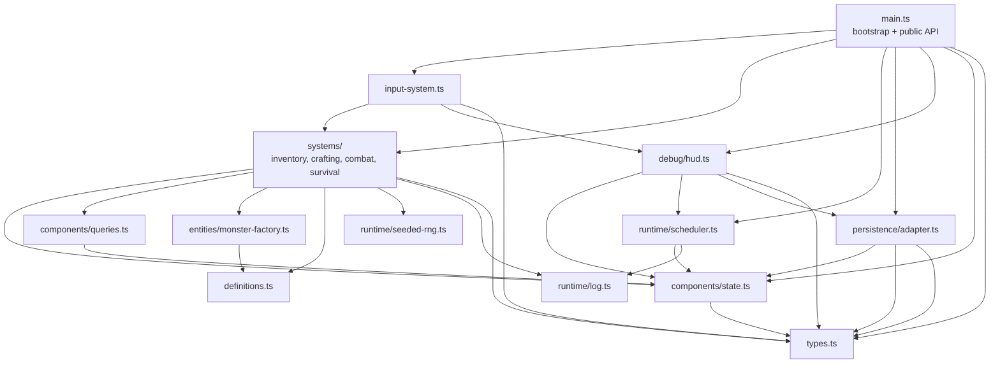

# B4-A0 — Ventralis Monolith Architecture Audit

## Handoff

- Model/provider: GPT-5 / OpenAI Codex
- Session/thread ID: not visible
- Attempts: 1
- Repairs: none
- Changed paths: none
- Scope drift: none
- Initial failures: none
- Remaining blockers: none
- Acceptance oracle: `tests/characterization.test.ts`; it must remain unedited.

## 1. State map

| Binding | Classification | Ownership / notes |
|---|---|---|
| `tickCount` | Component data | Simulation time; persisted/restored. |
| `hp` | Component data | Player health; persisted/restored. |
| `maxHp` | Component data | Player health limit; persisted/restored. |
| `wood` | Component data | Legacy resource mirror; retain separately from inventory. |
| `stone` | Component data | Legacy resource mirror; retain separately from inventory. |
| `inventory` | Component data | Bag contents; distinct from resource mirrors. |
| `equippedWeapon` | Component data | Player equipment state; persisted/restored. |
| `attackBonus` | Component data | Persistent combat modifier; persisted/restored. |
| `torchBuffTicks` | Component data | Temporary combat modifier; persisted/restored. |
| `alive` | Component data | Player lifecycle state; persisted/restored. |
| `log` | Component data | Simulation log; affects spawning and is persisted as last 20 entries. |
| `worldRef` | Retained runtime state | Session/runtime adapter reference; not game component data. |
| `rngState` | Retained runtime state | Seeded random-source state; persisted/restored, but owned by RNG service. |
| `pendingEvents` | Retained runtime state | Scheduled-event queue; owned by scheduler/session runtime, not ECS component data. |
| `saveCounter` | Retained runtime state | Persistence-session counter; exposed by debug output and written to saves. |
| `monsters` | Component data / entity store | Exported mutable entity collection; preserve stable observable array semantics. |

No module-level binding is dead or removable. Apparent no-ops such as `wood -= 0`, `inventory.stone -= 0`, and `inventory[recipe.yields] -= 0` are behavior-preservation markers and should remain represented in the migration logic.

## 2. Function map

| Function | Proposed destination |
|---|---|
| `lcgNext` | Seeded RNG service |
| `rollInt` | Seeded RNG service |
| `say` | Log/event service |
| `emit` | Output/debug adapter |
| `emitPanel` | Debug/HUD surface |
| `totalWeight` | Inventory component query |
| `carryCapacity` | Inventory component query |
| `canCarry` | Inventory component query |
| `attackRoll` | Combat system, using RNG and player components |
| `pickup` | Inventory/resource system |
| `craft` | Crafting system |
| `consumeRation` | Consumable/health system |
| `equip` | Equipment system |
| `spawnMonster` | Monster entity factory |
| `attack` | Combat system |
| `schedule` | Scheduler service |
| `onKey` | Input/router system |
| `tick` | Retained bootstrap/game-loop coordinator |
| `runTicks` | Retained bootstrap/test driver |
| `decideUseStorage` | Persistence adapter policy |
| `persist` | Persistence adapter |
| `snapshot` | Persistence serializer |
| `restore` | Persistence deserializer |
| `debugDump` | Debug/HUD surface |
| `resetGame` | Retained bootstrap/session reset |
| `initGame` | Retained bootstrap/session initialization |

Static definitions move to `types.ts`/`definitions.ts`; `RECIPES` and monster definitions remain immutable data, not runtime components.

## 3. Side effects and dependencies

| Function | Reads | Writes / side effects | Output | Storage | RNG | Log coupling |
|---|---|---|---|---|---|---|
| `lcgNext` | `rngState` | `rngState` | none | no | advances | no |
| `rollInt` | RNG | RNG state indirectly | none | no | consumes | no |
| `say` | `tickCount` | `log` | no | no | no | appends timestamped entry |
| `emit` | `worldRef` | `world.output` | text | no | no | no |
| `emitPanel` | `worldRef`, all state via `debugDump` | `world.output` | panel | no | no | indirect |
| `totalWeight` | `inventory`, item definitions | none | no | no | no | no |
| `carryCapacity` | `inventory` | none | no | no | no | no |
| `canCarry` | inventory queries, item definitions | none | no | no | no | no |
| `attackRoll` | `attackBonus`, `torchBuffTicks` | RNG state | no | no | yes | no |
| `pickup` | `alive`, inventory, mirrors | inventory, `wood`/`stone`; log/output | text on success/failure | no | no | yes |
| `craft` | `alive`, recipes, inventory | inventory, mirror wood, buffs, log/output | text | no | no | yes |
| `consumeRation` | `alive`, ration count, torch count, hp/maxHp | ration count, hp, log/output | text | no | no | yes |
| `equip` | `alive`, torch count | equipment, log/output | text | no | no | yes |
| `spawnMonster` | definitions | `monsters`, log | none | no | no | yes |
| `attack` | alive, monsters, combat state | monster HP/list, mirrors, inventory, log/output, RNG | text | no | yes | yes |
| `schedule` | none | event queue | none | no | no | no |
| `onKey` | alive, equipment, inventory | delegates; may re-equip on `KeyH` | text/panel | no | delegated | yes |
| `tick` | all simulation state, log, events | time, hp, alive, buffs, queue, monsters, RNG, persistence | event text | periodic save | spawn RNG | log length gates spawn |
| `runTicks` | none directly | delegates to `tick` | delegated | delegated | delegated | delegated |
| `decideUseStorage` | `worldRef.storage` | none | no | reads key presence | no | no |
| `persist` | world, tick, save counter | save counter and storage | no | writes JSON save | no | no |
| `snapshot` | all persisted state | returns copy | no | adapter input | no | captures log |
| `restore` | serialized state | overwrites state and monster array; logs restore | no | adapter input | restores RNG | appends log |
| `debugDump` | nearly all state | none | returned panel text | no | no | reports queue/save count |
| `resetGame` | seed | resets all state and monster array | no | no | seeds RNG | clears log |
| `initGame` | world/storage | sets session world; may restore; logs wake message | no direct output | reads save | restored indirectly | yes |

## 4. Ownership and mutation boundaries

- The `WorldState`/component store owns player components, inventory, legacy resource mirrors, combat modifiers, alive state, log, tick, and monster entities.
- The scheduler owns `pendingEvents` and exposes `schedule` plus due-event retrieval.
- The persistence adapter owns storage access, save gating, serialization format, `saveCounter`, and `savedAtTick`.
- The session/bootstrap owns the active `World` adapter reference and initialization/reset lifecycle.
- The clock remains an injected world/session dependency. Current behavior is tick-driven and does not read `world.clock`; do not introduce clock-based behavior during migration.
- The seeded RNG service owns `rngState`, exposes deterministic draws, and supports snapshot/restore.

Systems should use controlled direct mutation through a single mutable world-state context. This is preferable here to returned command batches because the legacy tick ordering, immediate output, RNG consumption order, and mirror drift are observable. Systems may mutate only the components explicitly assigned to them; persistence, debug output, scheduler, and RNG remain service boundaries.

## 5. Not-ECS list

- Persistence boundary: storage I/O, save-key gating, JSON compatibility, `saveCounter`, and restore validation are infrastructure concerns, not entities or systems.
- Debug/HUD surface: `debugDump` is a read-only projection and output adapter. Making panels components would pollute simulation state and risk changing formatting/order.
- Scheduled-event queue: it is temporal infrastructure indexed by tick, not an entity collection. Events can be represented as data internally, but ownership remains with a scheduler service.
- Seeded RNG: deterministic infrastructure with a stream/state contract. It should not become a component attached to an entity; doing so risks changing draw order and replay behavior.
- `World` session adapter: canvas, storage, clock, and output are host/runtime concerns, not simulation entities.
- Static item, recipe, and monster definitions: immutable catalogs, not components.

## 6. Hidden-coupling register

| Coupling | Evidence | Preservation requirement |
|---|---|---|
| Resource mirrors and inventory double-accounting | `src/main.ts:162-164`, `186-188` | Pickup increments both; crafting consumes inventory but intentionally leaves most mirrors unchanged. |
| Secret ration wood cost | `src/main.ts:195-199` | Ration crafting decrements mirror `wood` by one, while inventory wood was already consumed. |
| Torch side effects | `src/main.ts:189-194` | Torch sets `torchBuffTicks=30` and permanently increments `attackBonus`. |
| Stone double drop | `src/main.ts:251-255` | Monster death increments both mirror stone and inventory stone by two. |
| RNG consumption order | `src/main.ts:92-99`, `143-148`, `345-347` | Combat and wandering spawn share one LCG stream; no extra draws may be introduced. |
| Log length controls spawning | `src/main.ts:345-348` | Spawn occurs only at tick multiples of 20 with even `log.length`; logging changes gameplay. |
| `decideUseStorage` gates saves | `src/main.ts:364-375` | Tick-10 saves are no-ops unless the save key already exists. |
| Restore reads/writes almost all state | `src/main.ts:377-413` | Snapshot schema and restore semantics must remain compatible, including RNG and last-20 log entries. |
| Restore adds a log entry | `src/main.ts:409-413` | `save restored` changes subsequent log length and potentially future spawn behavior. |
| KeyH re-equips torch | `src/main.ts:279-283` | Panel emission happens first; then fists plus torch in inventory triggers `equip("torch")`. |
| Panel reads live state | `src/main.ts:114-119`, `420-434` | Panel must reflect state before the KeyH re-equip. |
| Tick order is observable | `src/main.ts:303-353` | Preserve survival drain, buff decay, events, monster round, spawn, then save order. |
| Dead state gates actions | `src/main.ts:155-157`, `169-171`, `205-207`, `219-221`, `239-240`, `271-272` | No action may mutate state after death. |
| Exported mutable monster array | `src/main.ts:297`, `410-412` | Preserve array identity and clear/refill behavior on reset/restore. |
| Save counter is runtime-visible | `src/main.ts:369-374`, `420-433` | Counter starts at zero, increments only successful gated saves, and appears in dump/save payload. |
| `world.clock` is currently unused | `src/main.ts:21-26`; no reads in implementation | Do not introduce wall-clock behavior as part of refactoring. |

## 7. Proposed dependency graph



The graph is acyclic: `main.ts` composes modules but is not imported by persistence or debug modules.

## 8. Proposed file tree

```text
src/
  main.ts                         # bootstrap/public API, <=80 lines
  types.ts                        # public/domain interfaces
  definitions.ts                  # item, recipe, monster catalogs
  components/
    state.ts                      # mutable world/player/monster state
    queries.ts                    # weight/capacity/read-only queries
  systems/
    inventory.ts                  # pickup
    crafting.ts                   # craft and legacy side effects
    consumables.ts                # ration healing
    equipment.ts                  # equip
    combat.ts                     # rolls, attacks, drops
    survival.ts                   # tick phases and death rules
  entities/
    monster-factory.ts            # spawn construction
  runtime/
    seeded-rng.ts                 # LCG and integer rolls
    scheduler.ts                  # pending events
    log.ts                        # ordered log append
  persistence/
    adapter.ts                    # storage gating, save counter, JSON I/O
    schema.ts                     # snapshot shape and conversion
  debug/
    hud.ts                        # dump and panel emission
  input/
    keyboard.ts                   # GameInput routing
```

Each migrated implementation file should remain under 120 lines. `main.ts` should remain under approximately 80 lines.

## 9. Migration order

1. Extract immutable `types.ts` and `definitions.ts`; leave behavior and exports unchanged. Run characterization tests and typecheck.
2. Extract seeded RNG and log services without changing call order or state schema. Run tests.
3. Extract component state and read-only queries, preserving the exported `monsters` array identity. Run tests.
4. Extract persistence serialization/restore with byte-compatible field names and save gating. Run tests.
5. Extract scheduler and event processing while preserving exact tick phase order. Run tests.
6. Extract inventory and crafting, explicitly retaining mirror drift, secret wood consumption, and no-op statements where needed. Run tests.
7. Extract consumable and equipment systems, including the KeyH re-equip behavior. Run tests.
8. Extract combat and monster factory, preserving RNG draws, damage, stone double-drop, and log messages. Run tests.
9. Extract debug/HUD projection and output emission, preserving panel string order and output ordering. Run tests.
10. Extract keyboard routing and reduce `main.ts` to composition/bootstrap/public exports. Run tests.
11. Perform only read-only final verification; do not edit `tests/characterization.test.ts`.

At every slice, `tests/characterization.test.ts` is the acceptance oracle and must not be changed.

## 10. Risk and verification plan

A later implementer should:

- Run the characterization suite after every extraction slice.
- Compare `api.dump()`, output arrays, storage payloads, monster counts, HP, inventory, mirrors, and save counters at each step.
- Use seeded scenarios, especially seed `7`, to verify exact attack-roll sequence.
- Verify snapshots before and after restore, including RNG state, log tail, monsters, and legacy mirrors.
- Add temporary local diagnostics only outside the committed source/test scope if needed, then remove them before delivery.
- Confirm `git diff --check`, typecheck, and the characterization suite after the final slice.
- Treat any changed output ordering, log count, RNG draw count, save gating, or snapshot field as a migration failure.

Abandon ECS for a concern when the component/system decomposition changes ownership or ordering in a way that cannot preserve the observable contract—for example, if making the scheduler or RNG entity-based changes draw timing, or if persistence/debug concerns require importing simulation internals cyclically. Retain those concerns as explicit adapters/services while using ECS only for mutable simulation state and systems.

## Verification results

- `git status --short` — exit code `0`; no output.
- `git diff --check` — exit code `0`; clean.
- `pnpm run test` — exit code `0`; 1 test file passed, 21 tests passed.
- `pnpm run typecheck` — exit code `0`; clean.

No files were edited, created, renamed, formatted, or deleted.