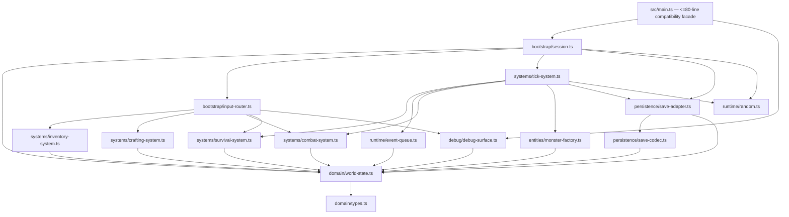

# Ventralis architecture audit and migration plan

Audit only: no files were edited, created, renamed, or formatted. The recommended design is a small **hybrid ECS/session architecture**: player and monsters are component data; deterministic services and integration surfaces remain explicit session-owned concerns.

## 1. State map

| Current binding | Evidence | Classification | Migration owner |
|---|---:|---|---|
| `tickCount` | `src/main.ts:72` | Proposed Component data | `TimeComponent` on singleton player/session entity |
| `hp` | `:73` | Proposed Component data | `VitalsComponent` |
| `maxHp` | `:74` | Proposed Component data | `VitalsComponent` |
| `wood` | `:75` | Proposed Component data | `ResourceMirrorComponent` |
| `stone` | `:76` | Proposed Component data | `ResourceMirrorComponent` |
| `inventory` | `:77` | Proposed Component data | `InventoryComponent` |
| `equippedWeapon` | `:78` | Proposed Component data | `EquipmentComponent` |
| `attackBonus` | `:79` | Proposed Component data | `CombatComponent` |
| `torchBuffTicks` | `:80` | Proposed Component data | `TorchBuffComponent` |
| `alive` | `:81` | Proposed Component data | `VitalsComponent` |
| `log` | `:82` | Proposed Component data | `LogComponent` |
| `worldRef` | `:83` | Retained runtime state | `GameSession.world`; integration-only, not serializable |
| `rngState` | `:84` | Retained runtime state | seeded `RandomSource` owned by `GameSession` |
| `pendingEvents` | `:85` | Retained runtime state | `ScheduledEventQueue` owned by `GameSession` |
| `saveCounter` | `:86` | Retained runtime state | `PersistenceRuntime` owned by `GameSession` |
| exported `monsters` array | `:297` | Proposed Component data | entities with `MonsterComponent`; preserve the exported live-array compatibility facade if required |

There are no dead/redundant mutable module bindings. Some fields are presently underused—`MonsterInstance.attack`, `World.canvas`, and `World.clock`—but removing them would be an observable/API change outside this preservation-focused migration.

## 2. Function map

| Current function | Destination |
|---|---|
| `lcgNext`, `rollInt` | `runtime/random.ts` |
| `say` | `systems/log-system.ts` |
| `emit`, `emitPanel` | `debug/output-surface.ts` |
| `totalWeight`, `carryCapacity`, `canCarry` | `systems/inventory-system.ts` |
| `attackRoll` | `systems/combat-system.ts` |
| `pickup` | `systems/inventory-system.ts` |
| `craft` | `systems/crafting-system.ts` |
| `consumeRation` | `systems/survival-system.ts` |
| `equip` | `systems/equipment-system.ts` |
| `spawnMonster` | `entities/monster-factory.ts` |
| `attack` | `systems/combat-system.ts` |
| `schedule` | `runtime/event-queue.ts` |
| `onKey` | retained bootstrap/input router |
| `tick` | `systems/tick-system.ts` orchestrating the fixed phase order |
| `runTicks` | retained bootstrap/API facade |
| `decideUseStorage`, `persist` | `persistence/save-adapter.ts` |
| `snapshot`, `restore` | `persistence/save-codec.ts` |
| `debugDump` | `debug/debug-surface.ts` |
| `resetGame`, `initGame` | retained bootstrap/session lifecycle |
| `gameLoop`, `keys`, `api`, `api.state()` | retained `main.ts` compatibility facade |

## 3. Side effects and dependencies

Abbreviations: `R/W` = state reads/writes; `O` = output; `S` = storage; `RNG` = random consumption; `L` = log interaction.

| Function | Global/state R/W | O | S | RNG | L |
|---|---|---|---|---|---|
| `lcgNext` | W `rngState` | — | — | consumes once | — |
| `rollInt` | — | — | — | delegates once | — |
| `say` | R `tickCount`; W `log` | — | — | — | append |
| `emit` | R `worldRef` | text append | — | — | — |
| `emitPanel` | R `worldRef`, debug state | panel append | — | — | indirect read |
| `totalWeight` | R `inventory`, `ITEM_DEFS` | — | — | — | — |
| `carryCapacity` | R `inventory.torch` | — | — | — | — |
| `canCarry` | R inventory/definitions | — | — | — | — |
| `attackRoll` | R `attackBonus`, `torchBuffTicks` | — | — | one roll | — |
| `pickup` | R/W `alive`, mirrors, inventory | text | — | — | success/failure append |
| `craft` | R/W `alive`, inventory, mirrors, bonus, buff | text | — | — | result append |
| `consumeRation` | R/W alive, inventory, hp/maxHp | text | — | — | result append |
| `equip` | R/W alive, inventory, equipment | text | — | — | result append |
| `spawnMonster` | W monsters | — | — | — | append |
| `attack` | R/W alive, monsters, stone/inventory, bonus/buff | text | — | one roll when target exists | result append |
| `schedule` | W event queue | — | — | — | — |
| `onKey` | R alive/equipment/inventory; delegates mutations | panel/text indirectly | — | indirect | indirect |
| `tick` | R/W all simulation state, queue, saves | event output indirectly | periodic indirect write | possible spawn roll | survival/event/monster/spawn logs |
| `runTicks` | delegates to `tick` | indirect | indirect | indirect | indirect |
| `decideUseStorage` | R `worldRef` | — | storage get | — | — |
| `persist` | R world/tick; W `saveCounter` | — | conditional set | — | — |
| `snapshot` | R all serialized fields | — | — | — | copies last 20 logs |
| `restore` | W serialized fields and live monster array | — | — | — | appends restore log |
| `debugDump` | R debug-visible state | returns text | — | — | does not expose log |
| `resetGame` | W all reset fields except `worldRef` | — | — | seeds | clears log |
| `initGame` | W `worldRef`; may restore | — | storage get | indirect only through restore state | appends wake log |

## 4. Ownership and mutation boundaries

`GameSession` owns the world reference, the `ScheduledEventQueue`, `PersistenceRuntime.saveCounter`, and the seeded `RandomSource`. The ECS-like `WorldState` owns player singleton components and monster entities.

Systems use **controlled direct mutation**, not returned commands. Each system receives an internal `MutableSession` capability; public callers receive only read views and façade functions. This fits the current behavior because tick-phase ordering and interleaved output/log/RNG effects are load-bearing. Command-returning systems would add ordering machinery while making preservation of such sequencing more fragile.

The fixed tick sequence remains exactly:

1. advance time and survival drain;
2. torch decay;
3. exact-tick scheduled events and queue removal;
4. monster phase;
5. conditional wandering spawn;
6. conditional persistence.

## 5. Not-ECS list

- **Persistence boundary:** not a component/system. It is an adapter around `World.storage`, serialization compatibility, and a legacy “only save if key already exists” policy.
- **Debug/HUD/output surface:** not a component/system. It is a presentation/integration adapter reading a stable debug projection; it must preserve panel-before-re-equip output ordering.
- **Scheduled-event queue:** not an entity component. It is a session runtime queue with exact-time dispatch and must remain separate from serialized state.
- **Seeded RNG:** not a component. It is a deterministic service whose state is serialized, but its consumption ordering is an execution concern.
- **`World` browser-ish integration (`storage`, `output`, `clock`, `canvas`):** not ECS. It is injected runtime infrastructure.
- **Static definitions and recipes:** not components. They are immutable domain data tables.
- **Public compatibility façade:** not ECS. `main.ts` must retain its existing exports and delegate inward.

## 6. Hidden-coupling register

| Coupling to preserve | Evidence | Migration treatment |
|---|---|---|
| Resource mirrors and inventory intentionally drift | pickup increments both at `src/main.ts:162-164`; torch consumes only inventory at `:186-193`; tests pin it at `tests/characterization.test.ts:66-75` | Separate `InventoryComponent` and `ResourceMirrorComponent`; never “normalize” them. |
| Ration secretly consumes mirror wood, not mirror stone | `src/main.ts:195-198`; test `:77-83` | Preserve exact branch-specific mirror mutation. |
| Crafting a torch changes combat permanently and temporarily | `src/main.ts:191-193`; combat reads both at `:143-148`; test `tests/characterization.test.ts:73-74` | Preserve `attackBonus += 1` and buff reset to 30. |
| Monster kill double-drops stone | `src/main.ts:252-255`; test `tests/characterization.test.ts:147-156` | Combat system updates both stores. |
| RNG stream order is behavioral | LCG mutates state `src/main.ts:92-98`; attack consumes it `:245-246`; spawn consumes it `:345-348`; seed pin `tests/characterization.test.ts:139-145` | One session RNG, no extra probes/retries/random calls. |
| Spawn eligibility depends on log length | `src/main.ts:345-348` | Tick system reads the log component’s current length at this exact phase. |
| Log entries include the current tick | `src/main.ts:105-107` | Log system must receive time state, not wall-clock time. |
| Scheduled events fire only at exact equality; overdue events are removed only when their exact tick occurs | `src/main.ts:319-329` | Preserve equality semantics and queue filtering. |
| Periodic save is gated by pre-existing storage key | `src/main.ts:364-374`; tests `tests/characterization.test.ts:160-175` | `SaveAdapter.decideUseStorage` remains explicit and is called before increment/write. |
| Snapshot is selective | snapshot omits pending events/save counter/world but includes RNG and only last 20 logs at `src/main.ts:377-394` | Preserve schema and omissions exactly. |
| Restore appends a log after assigning serialized log, but does not restore events/save count | `src/main.ts:397-413` | Preserve ordering and omissions. |
| `resetGame` does not clear `worldRef` | reset list `src/main.ts:441-456`; world assignment only at `:459-460` | Preserve unless a separately authorized behavior change is made. |
| KeyH emits panel before a side-effectful re-equip | `src/main.ts:279-283`; ordering pin `tests/characterization.test.ts:201-220` | Input router must render first, then equip only if fists plus torch. |
| Weapon selection is presentation/input state, while attack damage ignores weapon | equipment is changed at `src/main.ts:219-229`; attack uses bonus/buff at `:245-250` | Do not infer conventional weapon mechanics. |
| Death blocks actions, but tick lacks an early `alive` return | action guards e.g. `src/main.ts:155-156`; tick starts unguarded at `:303` | Preserve this asymmetry. |
| Stalker death check differs from crawler chip damage | crawler at `src/main.ts:332-335`; stalker checks death at `:336-341` | Preserve phase-specific condition placement. |
| `MonsterInstance.attack` is stored but unused for damage | definition `src/main.ts:291-295`; fixed damage at `:333-337` | Retain schema/field; do not substitute it into combat. |
| HUD/debug string is a stable output contract | `src/main.ts:420-435`; exact pin `tests/characterization.test.ts:26-30` | Preserve field order, delimiters, and omission of logs/RNG. |
| Boot logs but emits no text | `src/main.ts:459-465`; test `tests/characterization.test.ts:33-35` | Keep log and output surfaces separate. |
| Healing scales with torch inventory, not torch buff/equipment | `src/main.ts:212-214`; test `tests/characterization.test.ts:224-232` | Preserve formula exactly. |

## 7. Proposed dependency graph



All arrows point inward/downward; no domain module imports bootstrap, persistence, debug, or `main.ts`.

## 8. Proposed file tree

```text
src/
  main.ts                         # <=80: retained public exports/facade
  domain/
    types.ts                      # interfaces/unions, <=120
    definitions.ts                # item/recipe/monster static tables, <=120
    world-state.ts                # state constructors/read views, <=120
    components.ts                 # component shapes, <=120
  entities/
    monster-factory.ts            # <=80
  systems/
    inventory-system.ts           # <=120
    crafting-system.ts            # <=120
    combat-system.ts              # <=120
    survival-system.ts            # <=100
    log-system.ts                 # <=60
    tick-system.ts                # <=120
  runtime/
    random.ts                     # <=60
    event-queue.ts                # <=100
  persistence/
    save-codec.ts                 # <=120
    save-adapter.ts               # <=100
  debug/
    debug-surface.ts              # <=100
    output-surface.ts             # <=80
  bootstrap/
    session.ts                    # <=120
    input-router.ts               # <=100
```

## 9. Migration order

1. Establish a no-behavior-change façade boundary in `main.ts`; retain every current export/signature and run the unchanged characterization suite.
2. Extract domain types/static definitions and state construction only. Preserve live `monsters` compatibility behavior.
3. Extract random source, logging/output, inventory, crafting, equipment, combat, and monster factory one at a time; run the suite after each extraction.
4. Extract scheduled-event queue and survival/tick phases without reordering phase calls; verify seed-7 combat and tick-sensitive tests after each slice.
5. Extract save codec and save adapter, preserving the precise snapshot schema, key-gate, counter behavior, and restore log behavior.
6. Extract debug projection and input router; explicitly verify KeyH output ordering and exact dump string.
7. Reduce `main.ts` to delegates/exports under approximately 80 lines. Run the full unchanged characterization suite and typecheck after every slice.

`tests/characterization.test.ts` is the acceptance oracle and must not be edited.

## 10. Risk and verification plan

A later implementer should run the unchanged characterization test file after every migration slice, then compare:

- exact `api.dump()` values and field ordering;
- output array order/content, especially KeyH;
- serialized save payload fields, omissions, `savedAtTick`, and `saveCounter`;
- deterministic seed traces for attack and tick-20 spawn behavior;
- snapshot/restore round trips;
- source and test diffs, which must remain restricted to implementation only.

Add no tests and edit no existing tests during the migration; use the existing suite as the behavioral oracle. ECS should be abandoned for a concern if it requires exposing integration infrastructure as components, changes deterministic call order, forces serialization of runtime-only queues/world handles, or makes the compatibility façade/line budget less clear than ordinary typed session modules.

## Handoff

- Model/provider: Codex / OpenAI.
- Session/thread ID: not visible in this environment.
- Attempts: 1 audit pass; no repair attempts.
- Approved evaluation HEAD: `727609cc0975c839c7a99ee6392d384cfc0be98e`.
- Observed local `master`: `db804e1a188134210f1884cc850a42ecc37e7250`; HEAD was treated as authoritative per operator instruction.
- Initial failures: none.
- Changed paths: none.
- Repairs: none.
- Scope drift: none.
- Remaining blockers: none.

Verification results:

| Command | Exit code | Result |
|---|---:|---|
| `git status --short` | 0 | empty output; no changes under `src/` or `tests/` |
| `git diff --check` | 0 | clean |
| `pnpm run test` | 0 | 1 test file passed; 21 tests passed |
| `pnpm run typecheck` | 0 | clean |