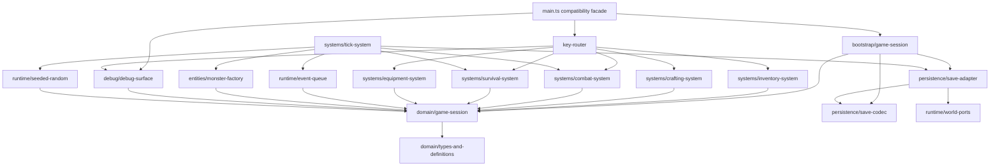

## B4-A0 — Ventralis architecture audit and migration plan

Comparison route: this is the judgment/audit arm, evaluated against the same owner rubric as the comparison arm. No comparison-arm implementation or findings were provided in this worktree, so this audit makes no unsupported quality comparison.

Recommendation: use a small, explicit session-owned domain model with systems operating through controlled direct mutation. ECS is useful for player/monster state and combat/tick processing, but persistence, HUD/debug, RNG, output, and scheduled events should remain non-ECS services.

`tests/characterization.test.ts` is the acceptance oracle and must not be edited.

### 1. State map

| Current binding | Evidence | Proposed classification | Migration owner |
|---|---:|---|---|
| `tickCount` | `src/main.ts:72` | Proposed Component data | `SessionState.tickCount` |
| `hp` | `src/main.ts:73` | Proposed Component data | `PlayerState.hp` |
| `maxHp` | `src/main.ts:74` | Proposed Component data | `PlayerState.maxHp` |
| `wood` | `src/main.ts:75` | Proposed Component data | `PlayerState.woodMirror` |
| `stone` | `src/main.ts:76` | Proposed Component data | `PlayerState.stoneMirror` |
| `inventory` | `src/main.ts:77` | Proposed Component data | `InventoryComponent` |
| `equippedWeapon` | `src/main.ts:78` | Proposed Component data | `EquipmentComponent` |
| `attackBonus` | `src/main.ts:79` | Proposed Component data | `CombatStatsComponent` |
| `torchBuffTicks` | `src/main.ts:80` | Proposed Component data | `TorchBuffComponent` |
| `alive` | `src/main.ts:81` | Proposed Component data | `LifeStateComponent` |
| `log` | `src/main.ts:82` | Retained runtime state (world/session) | `SessionState.log` |
| `worldRef` | `src/main.ts:83` | Retained runtime state (world/session) | bootstrap-owned `RuntimeContext.world` |
| `rngState` | `src/main.ts:84` | Retained runtime state (world/session) | `SeededRandom` service, serializable state |
| `pendingEvents` | `src/main.ts:85` | Retained runtime state (world/session) | `EventQueue` service |
| `saveCounter` | `src/main.ts:86` | Retained runtime state (world/session) | `SessionState.saveCounter` |
| exported `monsters` array | `src/main.ts:297` | Proposed Component data | monster entities: `MonsterComponent` |

No binding is safely dead or derived-on-read. In particular, the mirror counters are intentionally distinct persisted state, despite appearing redundant.

### 2. Function map

| Function | Destination |
|---|---|
| `lcgNext`, `rollInt` | `runtime/seeded-random.ts` |
| `say` | `runtime/session-log.ts` |
| `emit` | `runtime/output.ts` |
| `emitPanel` | retained bootstrap/input façade, calling debug surface |
| `totalWeight`, `carryCapacity`, `canCarry` | `systems/inventory-system.ts` |
| `attackRoll` | `systems/combat-system.ts` |
| `pickup` | `systems/inventory-system.ts` |
| `craft` | `systems/crafting-system.ts` |
| `consumeRation` | `systems/survival-system.ts` |
| `equip` | `systems/equipment-system.ts` |
| `spawnMonster` | `entities/monster-factory.ts` |
| `attack` | `systems/combat-system.ts` |
| `schedule` | `runtime/event-queue.ts` |
| `onKey` | `input/key-router.ts` |
| `tick` | `systems/tick-system.ts` |
| `runTicks` | retained bootstrap/API façade |
| `decideUseStorage`, `persist` | `persistence/save-adapter.ts` |
| `snapshot`, `restore` | `persistence/save-codec.ts` |
| `debugDump` | `debug/debug-surface.ts` |
| `resetGame`, `initGame` | retained bootstrap/API façade |
| exported aliases/API | `main.ts` compatibility façade |

### 3. Side effects and dependencies

`R`/`W` denote session or component reads/writes; output means `World.output`; storage means `World.storage`.

| Function | Global/session dependencies and effects |
|---|---|
| `lcgNext` | R/W `rngState`; consumes one RNG value. |
| `rollInt` | Calls `lcgNext`; consumes one RNG value. |
| `say` | R `tickCount`; W `log`; no emitted output. |
| `emit` | R `worldRef`; W output text. |
| `emitPanel` | R `worldRef`; W panel output; calls `debugDump`. |
| `totalWeight` | R `inventory`, `ITEM_DEFS`; pure result. |
| `carryCapacity` | R `inventory.torch`; pure result. |
| `canCarry` | R inventory/definitions through helpers; pure result. |
| `attackRoll` | R `attackBonus`, `torchBuffTicks`; consumes RNG via `rollInt`. |
| `pickup` | R `alive`, capacity, definitions; W mirror counters/inventory/log; emits text. |
| `craft` | R `alive`, `RECIPES`, inventory/capacity; W inventory, `wood`, `attackBonus`, `torchBuffTicks`, log; emits text. |
| `consumeRation` | R `alive`, inventory, `maxHp`, `hp`; W inventory/hp/log; emits text. |
| `equip` | R `alive`, inventory; W `equippedWeapon`/log; emits text. |
| `spawnMonster` | R `MONSTER_DEFS`; W `monsters`/log; no output. |
| `attack` | R `alive`, monsters, definitions, combat state; W monster hp/list, `stone`, inventory/log; consumes RNG if target exists; emits text. |
| `schedule` | W `pendingEvents`; no log/output. |
| `onKey` | R `alive`, equipment, inventory; routes actions; KeyH emits panel before possible equip output. |
| `tick` | R/W tick, hp/alive, buff, queue, monsters, log, RNG, persistence/save counter; emits event text; may write storage. |
| `runTicks` | Repeats `tick`; inherits all tick effects. |
| `decideUseStorage` | R `worldRef.storage`; no mutation. |
| `persist` | R world/session/storage gate; W `saveCounter` and storage; serializes supplied snapshot. |
| `snapshot` | R all persisted gameplay state, log, monsters, RNG; clones objects; pure externally. |
| `restore` | Parses input; W all snapshot fields except queue/save counter/world reference; appends log entry. |
| `debugDump` | R all displayed state including queue/save counter; pure string output. |
| `resetGame` | W all resettable game/session state, monster array, RNG; deliberately does not clear `worldRef`. |
| `initGame` | W `worldRef`; may restore state; W log; no emitted output. |

### 4. Ownership and mutation boundaries

`GameSession` owns all mutable game data: player components, monster entity collection, tick/log/save-counter session fields, and references to runtime services.

- World state: owned by `GameSession`; bootstrap installs its `World` once through `initGame`.
- Event queue: owned by a session-scoped `EventQueue`, not an entity component.
- Persistence: owned by `SaveAdapter`; it receives a snapshot DTO and `StoragePort`, never entity internals.
- Clock: retained as a `World` runtime dependency; presently unused, so do not invent time behavior.
- Random source: session-scoped `SeededRandom`; only systems receive it, and its state is included in save DTOs.

Systems should use controlled direct mutation of a single `GameSession` passed explicitly, rather than returned commands. This fits synchronous, order-sensitive behavior and prevents command-application order from accidentally changing RNG consumption, logs, output ordering, death checks, or persistence timing. TypeScript interfaces make the mutation surface narrow: systems receive only the component/service capabilities they need.

### 5. Not-ECS list

- Persistence boundary: not a component/system. It is an I/O adapter with an intentional key-existence gate; keep it at the edge.
- Debug/HUD surface: not a component. It is a stable read-only projection and output formatting contract used by tests.
- Scheduled-event queue: not entity data. It is a time-indexed session service; entity modeling adds no value and risks ordering changes.
- Seeded RNG: not a component. It is a stateful deterministic service whose draw order is observable.
- `World.output`, `World.storage`, and `World.clock`: runtime ports, not gameplay data.
- Static item/recipe/monster definitions: immutable type/catalog modules, not components.
- Keyboard routing/API compatibility: boundary adapters, not game systems.

### 6. Hidden-coupling register

| Coupling to preserve | Evidence | Preservation requirement |
|---|---|---|
| Resource mirror versus bag double-accounting | pickup updates both at `src/main.ts:162-164`; crafting selectively changes mirrors at `187-201`; snapshot persists both at `381-386` | Preserve independent mirror fields; do not normalize them from inventory. |
| Torch crafting permanently raises attack and starts timed buff | `src/main.ts:191-193`; attack reads both at `143-148` | Preserve `attackBonus += 1`, `torchBuffTicks = 30`, and combat calculation. |
| Ration secretly consumes mirror wood but not mirror stone | `src/main.ts:195-199` | Preserve exactly, including `inventory.stone -= 0`. |
| Monster death double stone drop | `src/main.ts:251-255` | Add two stone to both mirror and inventory. |
| RNG order is replayable and load-bearing | LCG mutation `92-98`; combat draw `143-148`; spawn draw `345-348`; persisted state `393`, restored `412` | Preserve exact LCG arithmetic and draw order; no speculative/random calls. |
| Spawn depends on log length parity | `src/main.ts:345-347` | Keep log append timing and use current log length before spawning. |
| Tick phase order is behavior | ordered sequence `303-353` | Preserve survival, buff decay, events, monster round, spawn, then persistence. |
| Save is gated by pre-existing storage key | `src/main.ts:364-375`; periodic invocation `350-352` | Save remains a no-op without `"ventralis:save"`; increment counter only after gate passes. |
| Snapshot intentionally omits queue and save counter | `src/main.ts:377-395` | Preserve DTO shape and restore behavior; do not “improve” completeness. |
| Restore appends a log entry after loaded log | `src/main.ts:409-413` | Preserve post-restore `say("save restored")`; init’s later wake log remains log-only. |
| KeyH panel-before-re-equip quirk | `src/main.ts:279-283` | Emit panel showing fists first; then equip torch and emit its text. |
| `resetGame` retains current world reference | reset fields `441-456`; world set only by `459-460` | Preserve lifecycle semantics unless explicitly versioned and accepted. |
| Ration healing depends on torch inventory count | `src/main.ts:212-214` | Preserve `15 + inventory.torch`, capped at max HP. |
| Output and log are separate channels | `say` `105-107`, `emit` `109-112`, boot log only `465` | Do not replace logs with output or vice versa. |

### 7. Proposed acyclic dependency graph



All arrows point from higher-level orchestration or consumers toward lower-level domain/runtime modules; no module needs to import `main.ts`.

### 8. Proposed migration file tree

```text
src/
  main.ts                         # compatibility façade, target <80 lines
  bootstrap/
    game-session.ts               # <120
  domain/
    types.ts                      # <120
    definitions.ts                # <120
    game-session.ts               # <120
    player-state.ts               # <120
  entities/
    monster-factory.ts            # <120
  systems/
    inventory-system.ts           # <120
    crafting-system.ts            # <120
    combat-system.ts              # <120
    survival-system.ts            # <120
    equipment-system.ts           # <120
    tick-system.ts                # <120
  input/
    key-router.ts                 # <120
  runtime/
    seeded-random.ts              # <120
    event-queue.ts                # <120
    output.ts                     # <120
    session-log.ts                # <120
    world-ports.ts                # <120
  persistence/
    save-codec.ts                 # <120
    save-adapter.ts               # <120
  debug/
    debug-surface.ts              # <120
```

The proposed entry façade re-exports the existing public API and delegates into one session instance, retaining external compatibility.

### 9. Migration order

1. Introduce types, definitions, `GameSession`, and runtime interfaces while retaining the legacy façade. Move no behavior yet.
2. Extract `SeededRandom`, session log, output port, and debug projection; verify dump strings and RNG characterization tests.
3. Extract inventory, crafting, equipment, and ration systems. Preserve mirror mutations and output/log sequence exactly.
4. Extract monster factory and combat system; verify seeded attack sequence and double-stone drop.
5. Extract event queue and tick system without changing phase order; verify survival, events, monster timing, and log-dependent spawn behavior.
6. Extract save codec and persistence adapter; verify gate, DTO field set, restore log effects, and save counter.
7. Extract key router and shrink `main.ts` to compatibility/bootstrap only.
8. After every slice, run the unchanged characterization suite and typecheck; do not batch semantic changes across slices.

### 10. Risk and verification plan

A later implementer should treat unchanged `tests/characterization.test.ts` as the acceptance oracle, run it after every migration slice, and run `pnpm run typecheck`. They should additionally compare, without altering tests, scripted traces for:

- `api.dump()` strings at each tick boundary;
- ordered `World.output` values;
- serialized save payloads;
- RNG state and monster outcomes for fixed seeds;
- log lengths around ticks 20/40;
- KeyH’s panel-before-equip ordering.

Abandon ECS for any concern where an entity/component representation obscures an externally observable ordering rule, requires global queries to reproduce a session service, or makes snapshot compatibility less direct. This already applies to persistence, debug rendering, output, event queue, and RNG.

## Handoff and verification

- Model/provider: Codex / GPT-5.
- Session/thread ID: not exposed in this environment.
- Attempts: 1 audit pass; 0 implementation attempts.
- Repairs: none.
- Changed paths: none.
- Scope drift: none; no files created, edited, renamed, formatted, deleted, committed, reset, stashed, or cleaned.
- Initial failures: none.
- Remaining blockers: none.

| Command | Exit code | Exact result |
|---|---:|---|
| `git status --short` | 0 | No output; worktree clean. |
| `git diff --check` | 0 | No output; clean. |
| `pnpm run test` | 0 | Vitest: 1 test file passed; 21 tests passed. |
| `pnpm run typecheck` | 0 | `tsc -p tsconfig.json --noEmit` completed successfully. |