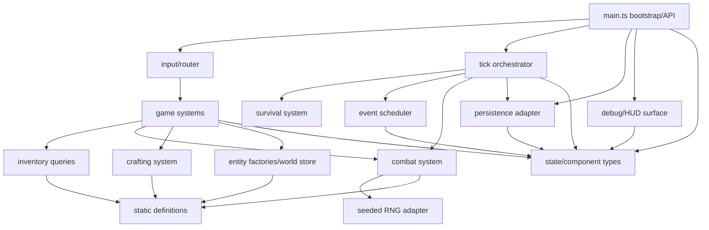

# B4-A0 — Ventralis monolith architecture audit

## 1. State map

| Binding | Classification | Proposed ownership / notes |
|---|---|---|
| `tickCount` | Component data | `TimeState`; serialized and restored |
| `hp` | Component data | `HealthComponent`; serialized |
| `maxHp` | Component data | `HealthComponent`; serialized |
| `wood` | Component data | Retain as legacy resource mirror; distinct from inventory |
| `stone` | Component data | Retain as legacy resource mirror; distinct from inventory |
| `inventory` | Component data | `InventoryComponent`; authoritative for carry/crafting checks |
| `equippedWeapon` | Component data | `EquipmentComponent` |
| `attackBonus` | Component data | Combat progression component; craftable torch mutates it |
| `torchBuffTicks` | Component data | Temporary-effect component |
| `alive` | Component data | `Health/StatusComponent` |
| `log` | Component data | `LogComponent`; log length affects spawning |
| `worldRef` | Retained runtime state | Session/runtime context; not component data |
| `rngState` | Retained runtime state | Seeded random-source state; persisted for replay |
| `pendingEvents` | Retained runtime state | Scheduled-event queue owned by runtime scheduler |
| `saveCounter` | Retained runtime state | Persistence adapter/session metadata; included in debug output but not snapshot |
| exported `monsters` | Component data | World entity collection; preserve exported live-array behavior |

Derived-on-read values are `totalWeight`, `carryCapacity`, attack-roll result, debug dump text, and output panels. No module-level binding is dead or redundant; even the apparent no-ops and mirrors preserve pinned behavior.

## 2. Function map

| Function | Proposed destination |
|---|---|
| `lcgNext` | Retained RNG adapter |
| `rollInt` | RNG adapter / combat utility |
| `say` | Logging system |
| `emit` | Output/debug surface adapter |
| `emitPanel` | Debug/HUD surface |
| `totalWeight` | Inventory query/type module |
| `carryCapacity` | Inventory query/type module |
| `canCarry` | Inventory query/type module |
| `attackRoll` | Combat system |
| `pickup` | Resource/inventory system |
| `craft` | Crafting system |
| `consumeRation` | Consumption/health system |
| `equip` | Equipment system |
| `spawnMonster` | Monster entity factory |
| `attack` | Combat system |
| `schedule` | Scheduler adapter |
| `onKey` | Input/router system |
| `tick` | Retained bootstrap/orchestration loop |
| `runTicks` | Retained bootstrap/test clock runner |
| `decideUseStorage` | Persistence adapter |
| `persist` | Persistence adapter |
| `snapshot` | Persistence serializer |
| `restore` | Persistence deserializer |
| `debugDump` | Debug/HUD surface |
| `resetGame` | Session/bootstrap reset |
| `initGame` | Retained bootstrap |
| `monsters` | World/entity store |

## 3. Side effects and dependencies

| Function | Reads/writes | Output / storage | RNG / logging |
|---|---|---|---|
| `lcgNext` | Reads/writes `rngState` | None | Consumes RNG state |
| `rollInt` | Calls `lcgNext` | None | Consumes RNG |
| `say` | Reads `tickCount`, writes `log` | None | Log coupling |
| `emit` | Reads `worldRef` | Appends text output | None |
| `emitPanel` | Reads `worldRef`, calls `debugDump` | Appends panel output | None |
| `totalWeight` | Reads `inventory`, item definitions | None | None |
| `carryCapacity` | Reads `inventory.torch` | None | None |
| `canCarry` | Reads inventory/definitions | None | None |
| `attackRoll` | Reads `attackBonus`, `torchBuffTicks` | None | Consumes combat RNG |
| `pickup` | Reads/writes alive, mirrors, inventory | Emits success/failure | Logs success/failure |
| `craft` | Reads/writes inventory, mirrors, buffs | Emits success/failure | Logs; secret resource mutation |
| `consumeRation` | Reads/writes inventory, HP, max HP | Emits result | Logs |
| `equip` | Reads inventory/alive; writes equipment | Emits equipment result | Logs |
| `spawnMonster` | Writes exported monster array | None | Logs |
| `attack` | Reads monsters/equipment/buffs; writes HP, mirrors, inventory, monsters | Emits roll | Consumes RNG; logs |
| `schedule` | Writes pending-event queue | None | None |
| `onKey` | Routes to actions; reads equipment/inventory | Delegated output | KeyH has extra coupling |
| `tick` | Writes time, HP, alive, buffs, events, monsters, persistence | Event/save output | Spawn consumes RNG; logs affect spawn |
| `runTicks` | Calls `tick` repeatedly | Delegated | Order-sensitive |
| `decideUseStorage` | Reads `worldRef.storage` | None | None |
| `persist` | Reads state and tick; writes `saveCounter` | Storage write | None |
| `snapshot` | Reads nearly all gameplay globals | Returns serialized data | Captures RNG/log/monsters |
| `restore` | Writes nearly all gameplay globals and monsters | None; calls `say` | Adds restore log entry |
| `debugDump` | Reads all visible state, queue length, save counter | Returns text | No mutation |
| `resetGame` | Resets gameplay/session globals and monsters | None | Does not clear `worldRef` |
| `initGame` | Writes `worldRef`; may restore; logs wake message | May read storage | Restore and boot log coupling |

## 4. Ownership and mutation boundaries

- The world/session owns the component store, monster collection, clock, output sink, and storage handle.
- The event scheduler owns `pendingEvents` and exposes schedule/due-event operations.
- The persistence adapter owns storage access, `saveCounter`, snapshot serialization, and restoration. It receives a state façade rather than importing systems.
- The clock is injected through the session/world boundary. Tick progression remains deterministic for tests.
- The seeded RNG is owned by a dedicated RNG adapter, but its state remains serializable and restored.
- Systems use controlled direct mutation of a passed state/context object. This is preferable here to command queues because the legacy behavior depends on exact intra-tick ordering, immediate mirror drift, immediate logging, and direct live-array mutation. Systems should be isolated by interface and invoked in a documented order; only the scheduler and bootstrap orchestrator may sequence them.

## 5. Not-ECS list

- Persistence boundary: storage, JSON shape, save gating, `savedAtTick`, and `saveCounter` are infrastructure concerns, not gameplay components or systems.
- Debug/HUD surface: `debugDump`, panel formatting, and output emission are presentation/adapter concerns. They may read a state view but should not become entities.
- Scheduled-event queue: it is a runtime temporal queue with delivery semantics, not a component attached to every entity.
- Seeded RNG: it is an injected deterministic service. Treating RNG state as an ECS component would spread replay mechanics through unrelated systems.
- Input routing: key-to-action translation is an adapter, not an entity/system concern.
- Static definitions and recipes: immutable catalog data should remain type/data modules.
- Serialization format: persistence schema should not dictate component decomposition.

## 6. Hidden-coupling register

| Evidence | Coupling to preserve |
|---|---|
| `src/main.ts:155-166` | Pickup increments both resource mirrors and inventory. |
| `src/main.ts:181-202` | Crafting consumes inventory but usually leaves mirrors unchanged; ration secretly decrements raw `wood`; torch mutates `attackBonus` and `torchBuffTicks`. |
| `src/main.ts:248-254` | Monster death adds stone to both mirror and inventory, preserving double accounting. |
| `src/main.ts:92-99`, `src/main.ts:143-151` | Combat and spawn consume the same RNG stream; consumption order is observable. |
| `src/main.ts:345-347` | Spawn depends on `log.length % 2`, so logging changes gameplay. |
| `src/main.ts:352-354`, `src/main.ts:364-374` | Periodic persistence is gated by the pre-existing `ventralis:save` key through `decideUseStorage`. |
| `src/main.ts:281-285` | KeyH emits the panel first, then re-equips a torch when fists are equipped. |
| `src/main.ts:303-354` | Tick phase order is load-bearing: drain, buff decay, events, monsters, spawn, save. |
| `src/main.ts:377-395` | Snapshot includes mirrors, inventory, log tail, monsters, and RNG state, but not pending events or save counter. |
| `src/main.ts:397-417` | Restore overwrites live state, rebuilds the exported monster array, restores RNG, and adds a log entry. |
| `src/main.ts:459-464` | `initGame` restores before the wake log; existing saves can therefore alter subsequent log-dependent behavior. |
| `src/main.ts:441-457` | Reset clears gameplay state but leaves `worldRef`, making session lifetime distinct from game-state lifetime. |
| `src/main.ts:420-438` | Debug output exposes queue length and save counter, making runtime bookkeeping externally observable. |

These quirks are behavior to preserve, not defects to correct.

## 7. Proposed dependency graph



The graph is acyclic. `persistence` and `debug` depend on state views, not on `main.ts`; `main.ts` is the composition root.

## 8. Proposed file tree

Every migrated file should remain under 120 lines, with `main.ts` under approximately 80 lines.

```text
src/
  main.ts                    # composition root, exports, API wiring
  state/
    types.ts                 # component/session/world interfaces
    createState.ts            # initial state and reset helpers
  data/
    items.ts                 # item definitions
    monsters.ts              # monster definitions
    recipes.ts               # recipe definitions
  systems/
    pickup.ts
    crafting.ts
    consumption.ts
    equipment.ts
    combat.ts
    survival.ts
    input.ts
    logging.ts
  entities/
    monsterFactory.ts
  runtime/
    tick.ts
    scheduler.ts
    rng.ts
    session.ts
  persistence/
    snapshot.ts
    adapter.ts
  debug/
    dump.ts
    output.ts
```

The exact split may be adjusted during implementation if line budgets require it, but dependency direction must remain equivalent.

## 9. Migration order

1. Introduce internal state/context interfaces and static data modules without changing behavior. Run characterization tests and typecheck.
2. Extract pure inventory queries and static definitions. Preserve mirror counters and capacity calculations exactly.
3. Extract logging/output adapters while preserving output ordering and log mutation timing.
4. Extract pickup, crafting, consumption, and equipment systems. Preserve secret wood consumption, torch buff, attack bonus, and failure messages.
5. Extract the monster factory and combat system. Preserve live monster-array behavior, double stone drops, and RNG call order.
6. Extract the scheduler and survival/tick phases without changing phase ordering.
7. Extract the RNG adapter while preserving one shared stream and serialized `rngState`.
8. Extract snapshot/restore and persistence adapter. Preserve save-key gating, omitted fields, save counter behavior, and restore log timing.
9. Extract debug/HUD formatting. Preserve exact `api.dump()` strings and panel-before-re-equip ordering.
10. Rebuild `main.ts` as the composition root and compatibility API façade.
11. Run the complete characterization suite after every slice; `tests/characterization.test.ts` is the acceptance oracle and must not be edited.

## 10. Risk and verification plan

A later implementer should:

- Run `pnpm run test` and `pnpm run typecheck` after every migration slice.
- Compare exact output arrays, dump strings, storage payloads, RNG-derived attack rolls, monster counts, and state snapshots.
- Use the existing tests as the acceptance oracle without modifying them.
- Add temporary local probes only outside the repository deliverable if needed, then remove them before handoff.
- Verify no migrated file exceeds 120 lines and that `main.ts` remains below approximately 80 lines.
- Check that save/restore round trips preserve RNG, mirrors, inventory, logs, monsters, and equipment.
- Specifically replay seed `7`, tick-10 persistence, KeyH behavior, ration crafting, torch crafting, monster drops, and log-sensitive spawn scenarios.
- Abandon ECS decomposition for a concern when it introduces duplicated state, changes mutation order, requires systems to know storage/presentation details, or changes deterministic RNG/log behavior. Keep that concern as a service, adapter, or runtime-owned structure.

## Verification and handoff

| Command | Exit code | Result |
|---|---:|---|
| `git status --short` | 0 | Clean; no output |
| `git diff --check` | 0 | Clean |
| `pnpm run test` | 0 | 21 tests passed |
| `pnpm run typecheck` | 0 | Passed |

- Model/provider: GPT-5 / OpenAI
- Session/thread ID: not visible
- Attempts: 1
- Repairs: none
- Changed paths: none
- Scope drift: none
- Initial failures: none
- Remaining blockers: none
- `HEAD` and `master` differed; per operator instruction, the current operator-certified HEAD was treated as authoritative.