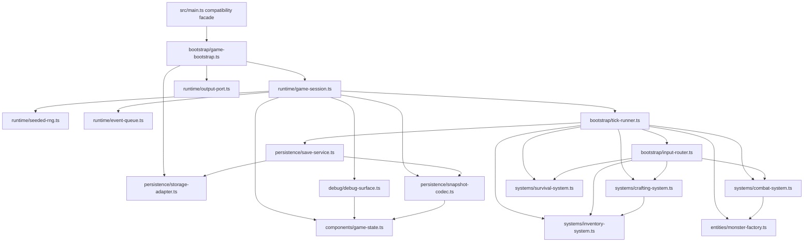

## Ventralis architecture audit and migration plan

### 1. State map

| Binding in `src/main.ts` | Classification | Proposed owner/module |
|---|---|---|
| `tickCount` (72) | Proposed Component data | `components/actor.ts` → `PlayerState.tick` |
| `hp` (73) | Proposed Component data | `components/actor.ts` → `PlayerState.hp` |
| `maxHp` (74) | Proposed Component data | `components/actor.ts` → `PlayerState.maxHp` |
| `wood` (75) | Proposed Component data | `components/resources.ts` → `LegacyResourceMirrors.wood` |
| `stone` (76) | Proposed Component data | `components/resources.ts` → `LegacyResourceMirrors.stone` |
| `inventory` (77) | Proposed Component data | `components/inventory.ts` |
| `equippedWeapon` (78) | Proposed Component data | `components/equipment.ts` |
| `attackBonus` (79) | Proposed Component data | `components/combat.ts` |
| `torchBuffTicks` (80) | Proposed Component data | `components/combat.ts` |
| `alive` (81) | Proposed Component data | `components/actor.ts` |
| `log` (82) | Proposed Component data | `components/log.ts`; gameplay-visible because spawn logic reads its length |
| `worldRef` (83) | Retained runtime state (world/session) | `runtime/session.ts`; injected dependency, never a component |
| `rngState` (84) | Retained runtime state (world/session) | `runtime/seeded-rng.ts`; stateful seeded service |
| `pendingEvents` (85) | Retained runtime state (world/session) | `runtime/event-queue.ts`; ordered session queue, intentionally outside ECS |
| `saveCounter` (86) | Retained runtime state (world/session) | `persistence/save-service.ts` or session-owned persistence state |
| exported `monsters` (297) | Proposed Component data | `components/monsters.ts`; monster entity collection, while preserving exported-array compatibility through the facade |

`ITEM_DEFS`, `RECIPES`, and `MONSTER_DEFS` are immutable definitions, not mutable state. `canvas` and `clock` are world-provided runtime dependencies; current gameplay does not read either, but their public shape must remain intact.

### 2. Function map

| Function | Destination |
|---|---|
| `lcgNext` | `runtime/seeded-rng.ts` |
| `rollInt` | `runtime/seeded-rng.ts` |
| `say` | `systems/log-system.ts` |
| `emit` | `runtime/output-port.ts` |
| `emitPanel` | `debug/hud-surface.ts` |
| `totalWeight` | `systems/inventory-system.ts` |
| `carryCapacity` | `systems/inventory-system.ts` |
| `canCarry` | `systems/inventory-system.ts` |
| `attackRoll` | `systems/combat-system.ts` |
| `pickup` | `systems/inventory-system.ts` |
| `craft` | `systems/crafting-system.ts` |
| `consumeRation` | `systems/survival-system.ts` |
| `equip` | `systems/equipment-system.ts` |
| `spawnMonster` | `entities/monster-factory.ts` |
| `attack` | `systems/combat-system.ts` |
| `schedule` | `runtime/event-queue.ts` facade method |
| `onKey` | `bootstrap/input-router.ts` |
| `tick` | `bootstrap/tick-runner.ts` |
| `runTicks` | retained bootstrap/API facade |
| `decideUseStorage` | `persistence/storage-adapter.ts` |
| `persist` | `persistence/save-service.ts` |
| `snapshot` | `persistence/snapshot-codec.ts` |
| `restore` | `persistence/snapshot-codec.ts` |
| `debugDump` | `debug/debug-surface.ts` |
| `resetGame` | retained bootstrap/API facade |
| `initGame` | retained bootstrap/API facade |

The exported `gameLoop`, `keys`, and `api` remain a compatibility facade in the rewritten `main.ts`, delegating to a constructed session.

### 3. Side effects and dependencies

`R/W` below refer to mutable module state in the current design. “Log” means direct or indirect log coupling.

| Function | Global reads / writes | Output / storage | RNG | Log coupling |
|---|---|---|---|---|
| `lcgNext` | R/W `rngState` | — | consumes one value | — |
| `rollInt` | indirect `rngState` | — | one `lcgNext` | — |
| `say` | R `tickCount`; W `log` | — | — | writes |
| `emit` | R `worldRef` | appends text output | — | — |
| `emitPanel` | R `worldRef`; calls dump | appends panel output | — | indirect read through dump |
| `totalWeight` | R `inventory` | — | — | — |
| `carryCapacity` | R `inventory.torch` | — | — | — |
| `canCarry` | R `inventory`, definitions | — | — | — |
| `attackRoll` | R `attackBonus`, `torchBuffTicks` | — | one roll | — |
| `pickup` | R `alive`, inventory; W mirror/resource/inventory state | text output | — | writes through `say` |
| `craft` | R `alive`, inventory, recipes; W inventory, `wood`, buff, bonus | text output | — | writes through `say` |
| `consumeRation` | R `alive`, inventory, `hp`, `maxHp`; W inventory, `hp` | text output | — | writes through `say` |
| `equip` | R `alive`, inventory; W `equippedWeapon` | text output | — | writes through `say` |
| `spawnMonster` | W `monsters`; R definitions | — | — | writes through `say` |
| `attack` | R `alive`, monsters, bonus; W monsters, `stone`, inventory | text output | one attack roll when target exists | writes through `say` |
| `schedule` | W `pendingEvents` | — | — | — |
| `onKey` | R `alive`, equipment, inventory | panel/text indirectly | indirect through attack | indirect; KeyH panel snapshots state before re-equip log |
| `tick` | R/W nearly all gameplay/session state | periodic persistence and event output | one spawn roll only if tick/log predicate passes | reads `log.length`; writes log |
| `runTicks` | invokes `tick` repeatedly | indirect | indirect | indirect |
| `decideUseStorage` | R `worldRef` | reads save-key existence | — | — |
| `persist` | R `worldRef`, `tickCount`; W `saveCounter` | writes storage conditionally | — | — |
| `snapshot` | R all serialized gameplay state, including monsters/RNG/log | — | — | serializes last 20 log entries |
| `restore` | W serialized gameplay state and monsters/RNG/log | reads parsed string | — | appends “save restored” after replacement |
| `debugDump` | R gameplay state, events, save counter, monsters | returns HUD text | — | no log content, but reports gameplay-relevant counts |
| `resetGame` | W all resettable state except `worldRef` | — | sets seed | clears log |
| `initGame` | W `worldRef`; may invoke restore | reads storage; no output | — | logs wake message |

### 4. Ownership and mutation boundaries

`GameSession` owns the world reference, player state, monster collection, log, and compatibility facade. Its constructor receives an `OutputPort`, `PersistenceAdapter`, `SeededRng`, and `ScheduledEventQueue`.

Systems use controlled direct mutation of a session-owned `GameState` object, not returned command objects. This is the better fit for preserving the current observable ordering: a single tick mutates survival state, buff state, due events, monsters, spawn state, and persistence in a fixed sequence. Command-returning systems would add an interpreter and risk reordering mutations, log writes, output writes, and RNG draws. Direct mutation is constrained by:

- Systems receive only the state slices they require plus explicit ports.
- Only `tick-runner.ts` coordinates cross-system sequence.
- The persistence and debug surfaces receive read-only snapshot views.
- The event queue, RNG, output port, and storage adapter are injected services rather than components.

Ownership after migration:

- World/session: `runtime/game-session.ts`
- Event queue: `runtime/event-queue.ts`, owned by the session
- Persistence adapter: `persistence/storage-adapter.ts`, owned/injected by bootstrap
- Clock: remains an injected `World.clock` dependency, retained even though presently unused
- Random source: `runtime/seeded-rng.ts`, owned by session and serialized via its state

### 5. Not-ECS list

- Persistence boundary: not a component or system. It is an external adapter with a compatibility-sensitive storage-key policy and serialization contract.
- Debug/HUD surface: not a component. It is a read-only presentation adapter that formats a stable public string and emits a panel.
- Scheduled-event queue: not an ECS component. It is an ordered temporal runtime service. Events are not entities and exact-tick removal semantics must be retained.
- Seeded RNG: not a component. It is a stateful deterministic service; random-draw count and order are part of behavior.
- `World` / output collection / storage / clock: integration ports, not domain data.
- Static item, recipe, and monster definitions: immutable catalogs, not runtime components.
- Input routing: retained bootstrap concern. It translates public key strings to system calls and preserves the KeyH ordering quirk.

I would reject ECS for any concern where it obscures serialization, temporal ordering, external I/O, or deterministic RNG consumption. ECS is useful here only as a disciplined layout for mutable gameplay data and narrow logic systems, not as an ideological replacement for all abstractions.

### 6. Hidden-coupling register

| Coupling / preserved behavior | Evidence |
|---|---|
| Resource mirrors and inventory are distinct balances, not duplicate representations to reconcile. Pickup increments both only for wood/stone. | `src/main.ts:162-164` |
| Torch crafting removes inventory ingredients but deliberately leaves mirror counts unchanged via `wood -= 0`; it also gives a permanent attack bonus and a 30-tick buff. | `src/main.ts:186-193` |
| Ration crafting has an asymmetric hidden raw-wood cost: it removes inventory wood/stone, then additionally decrements mirror wood, while mirror stone remains unchanged. | `src/main.ts:187-198` |
| A monster death adds two stone to both mirror and inventory, despite the comment implying a mirror-only drop. Preserve the resulting double accounting. | `src/main.ts:251-255` |
| Attack outcome depends on exact RNG state, permanent bonus, and temporary torch buff; changing any prior random draw changes combat replay. | `src/main.ts:143-148`, `238-260` |
| Wandering spawn consumes RNG only if both tick divisibility and log parity pass. A log-message change can therefore alter all later combat randomness. | `src/main.ts:345-348` |
| Log emission is gameplay state: spawn reads `log.length`, while snapshot persists only the final 20 entries. | `src/main.ts:105-107`, `345-347`, `391` |
| KeyH emits the old HUD panel before implicitly equipping a torch. The output order and displayed “fists” state are observable. | `src/main.ts:279-283` |
| Periodic saving is gated by pre-existing storage-key presence, not merely availability of storage/world. No key means no write and no save-counter increment. | `src/main.ts:364-375` |
| `snapshot` omits `pendingEvents` and `saveCounter`; restoring intentionally loses queued events and resets persistence-count state established by reset. Do not silently “improve” this. | `src/main.ts:377-394`, `397-413`, `441-456` |
| `restore` mutates state then appends “save restored,” which can change future spawn parity while leaving the debug dump unchanged. | `src/main.ts:397-413`, `345-347` |
| `initGame` restores before adding the wake log entry and emits no output. | `src/main.ts:459-465` |
| `resetGame` does not clear `worldRef`; before a subsequent `initGame`, direct API calls can still emit to the prior world. Preserve or explicitly characterize before changing. | `src/main.ts:109-112`, `441-457` |
| Scheduled events fire only when `at === tickCount`; events scheduled in the past remain queued forever, and all due events are processed before queue removal. | `src/main.ts:319-329` |
| Tick phase order is behavior: survival drain, torch decay, events, monster round, spawn, then persistence. Death does not short-circuit later phases. | `src/main.ts:303-353` |
| Stalker attack uses hard-coded 3 damage rather than `MonsterInstance.attack`; crawler attacks only on every third tick. | `src/main.ts:332-342` |
| Carry capacity grows with torch count, so crafting can alter future capacity even though ingredients were consumed. | `src/main.ts:135-140`, `189-192` |
| Ration healing is `15 + inventory.torch`, not based on equipped torch or buff; it is capped at `maxHp`. | `src/main.ts:212-214` |
| `debugDump` exposes event and save counts that snapshots do not serialize, making it a broader runtime inspection surface than persistence. | `src/main.ts:420-435`, `377-394` |

### 7. Proposed acyclic dependency graph



All arrows point toward lower-level state, definitions, or ports. `main.ts` depends on bootstrap; persistence and debug depend on state contracts but do not depend on `main.ts`.

### 8. Proposed file tree

Each migrated source file should target 40–110 lines; `main.ts` should remain below 80 lines.

```text
src/
  main.ts                         # public compatibility facade, <80 lines
  types/
    contracts.ts                  # public types and port interfaces
    definitions.ts                # item/monster/recipe definitions
  components/
    game-state.ts
    actor.ts
    inventory.ts
    resources.ts
    equipment.ts
    combat.ts
    log.ts
    monsters.ts
  entities/
    monster-factory.ts
  systems/
    log-system.ts
    inventory-system.ts
    crafting-system.ts
    equipment-system.ts
    combat-system.ts
    survival-system.ts
  runtime/
    game-session.ts
    seeded-rng.ts
    event-queue.ts
    output-port.ts
  persistence/
    storage-adapter.ts
    snapshot-codec.ts
    save-service.ts
  debug/
    debug-surface.ts
    hud-surface.ts
  bootstrap/
    game-bootstrap.ts
    input-router.ts
    tick-runner.ts
```

### 9. Migration order

1. Extract types and immutable definitions without changing ownership or exports; run the characterization suite.
2. Introduce `GameState` and a session factory internally, retaining `main.ts` exported API and using a single state object; verify.
3. Extract pure inventory helpers, then pickup; verify.
4. Extract logging/output port and debug formatter while preserving exact text/order; verify.
5. Extract seeded RNG and combat/monster factory together; verify seed-7 attack behavior and monster drop drift.
6. Extract crafting, equipment, and survival systems; verify counter drift, torch bonus/buff, healing, and KeyH ordering.
7. Extract event queue and tick runner without altering phase ordering; verify scheduled events, death sequencing, and spawn parity.
8. Extract snapshot/restore and save adapter; verify restoration, key-gated save behavior, serialized fields, and omitted queue/counter semantics.
9. Reduce `main.ts` to the compatibility facade; run the untouched characterization suite and typecheck after every slice.

`tests/characterization.test.ts` is the acceptance oracle and must not be edited.

### 10. Risk and verification plan

A later implementer should run the unmodified characterization suite after every migration slice, then add no tests unless separately authorized. Verification should specifically compare:

- exact `api.dump()` strings;
- exact output array ordering and contents;
- seed-7 combat roll sequence;
- snapshots before/after direct restore and storage restore;
- tick-10 behavior with and without a pre-existing save key;
- resource mirror/inventory drift after crafting and kills;
- KeyH panel-before-equip behavior;
- spawn behavior under controlled log parity.

Abandon ECS for a concern if its representation forces event ordering through an unordered query, hides random draws, folds persistence or I/O into data components, requires duplicate state reconciliation, or cannot preserve the existing public array/facade behavior without compatibility leakage. The hybrid above uses ECS-style state/system isolation only where it improves boundaries without changing the temporal model.

## Handoff

- Model/provider: Codex / OpenAI.
- Session/thread ID: not visible in this environment.
- Attempts: 1.
- Repairs: none; audit-only task.
- Changed paths: none.
- Scope drift: none.
- Initial failures: none observed.
- Remaining blockers: none.

Verification results:

| Command | Exit code | Result |
|---|---:|---|
| `git status --short` | 0 | Empty output; no changes under `src/` or `tests/` |
| `git diff --check` | 0 | Clean |
| `pnpm run test` | 0 | 1 test file passed; 21 tests passed |
| `pnpm run typecheck` | 0 | Clean (`tsc -p tsconfig.json --noEmit`) |