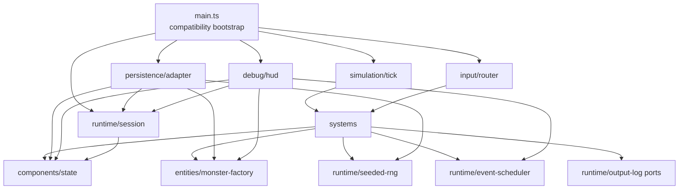

# B4-A0 — Ventralis monolith architecture audit

## 1. State map

| Binding | Evidence | Classification | Migration ownership |
|---|---:|---|---|
| `tickCount` | `src/main.ts:72` | Component data | `ClockState` / world simulation state |
| `hp` | 73 | Component data | `PlayerVitals` |
| `maxHp` | 74 | Component data | `PlayerVitals` |
| `wood` | 75 | Component data, but legacy resource mirror | `PlayerResources.mirrorWood`; preserve separately from inventory |
| `stone` | 76 | Component data, but legacy resource mirror | `PlayerResources.mirrorStone`; preserve separately from inventory |
| `inventory` | 77 | Component data | `Inventory` component |
| `equippedWeapon` | 78 | Component data | `Equipment` component |
| `attackBonus` | 79 | Component data | `CombatModifiers` component |
| `torchBuffTicks` | 80 | Component data | `CombatModifiers` component |
| `alive` | 81 | Component data | `LifeState` component |
| `log` | 82 | Retained runtime state | `LogState`; its length affects spawning |
| `worldRef` | 83 | Retained runtime state | Bootstrap-owned `WorldSession`; not a component |
| `rngState` | 84 | Retained runtime state | Seeded RNG service; serialized for replay |
| `pendingEvents` | 85 | Retained runtime state | Event scheduler/queue; not an ECS component |
| `saveCounter` | 86 | Retained runtime state | Persistence-session metadata; serialized only through save payload metadata |
| `monsters` | 297 | Component/entity data collection | Entity store containing monster `Health`, `MonsterKind`, and `Attack` data |

Derived-on-read values are `totalWeight`, `carryCapacity`, attack roll calculation, and debug text. They must not become duplicated mutable state.

## 2. Function map

| Function | Proposed destination |
|---|---|
| `lcgNext` | Seeded RNG service |
| `rollInt` | Seeded RNG service |
| `say` | Logging system / log port |
| `emit` | Output port adapter |
| `emitPanel` | Debug/HUD surface |
| `totalWeight` | Inventory capacity query |
| `carryCapacity` | Inventory capacity query |
| `canCarry` | Inventory capacity query |
| `attackRoll` | Combat system using RNG service |
| `pickup` | Gathering/inventory system |
| `craft` | Crafting system |
| `consumeRation` | Consumption/vitals system |
| `equip` | Equipment system |
| `spawnMonster` | Monster entity factory |
| `attack` | Combat system |
| `schedule` | Event scheduler adapter/service |
| `onKey` | Input router |
| `tick` | Retained bootstrap orchestration plus systems pipeline |
| `runTicks` | Retained bootstrap/test-driving adapter |
| `decideUseStorage` | Persistence policy adapter |
| `persist` | Persistence adapter |
| `snapshot` | Persistence serializer |
| `restore` | Persistence deserializer |
| `debugDump` | Debug/HUD presenter |
| `resetGame` | Bootstrap/session reset |
| `initGame` | Bootstrap/session initialization |

Exported `gameLoop`, `keys`, and `api` remain compatibility façades in the entry point. They delegate to typed modules rather than owning logic.

## 3. Side effects and dependencies

| Function | Reads | Writes | Output/storage | RNG | Log coupling |
|---|---|---|---|---|---|
| `lcgNext` | `rngState` | `rngState` | None | Consumes one value | None |
| `rollInt` | RNG service | RNG service indirectly | None | Consumes one value | None |
| `say` | `tickCount` | `log` | None | No | Appends timestamped log |
| `emit` | `worldRef` | `world.output` | Emits text | No | None |
| `emitPanel` | `worldRef`, all debug state | `world.output` | Emits panel | No | Reads state via `debugDump` |
| `totalWeight` | Inventory, item definitions | None | None | No | None |
| `carryCapacity` | Inventory | None | None | No | None |
| `canCarry` | Inventory and definitions | None | None | No | None |
| `attackRoll` | Equipment modifiers, torch buff | None except RNG | None | Yes | None |
| `pickup` | Life state, capacity | Mirrors and inventory | Emits/logs | No | Logs success/failure |
| `craft` | Recipes, inventory, capacity, life | Inventory, mirror wood, buffs | Emits/logs | No | Logs branch outcome |
| `consumeRation` | Life, ration count, torch count, HP | Inventory, HP | Emits/logs | No | Logs branch outcome |
| `equip` | Life, inventory | Equipped weapon | Emits/logs | No | Logs branch outcome |
| `spawnMonster` | Monster definitions | `monsters`, log | No output | No | Adds spawn log |
| `attack` | Monsters, life, combat state | Monster list, mirror stone, inventory | Emits/logs | Yes | Log changes can affect future spawn |
| `schedule` | None | Event queue | None | No | None |
| `onKey` | Life, equipment, inventory | Delegates; H may equip | Delegated output/log | Indirect | H ordering is observable |
| `tick` | All simulation state, log | HP, buffs, queue, monsters, RNG, saves | Events/output/storage | At spawn only | Log length gates spawn |
| `runTicks` | None directly | Delegates to `tick` | Indirect | Indirect | Indirect |
| `decideUseStorage` | `worldRef.storage` | None | Reads storage | No | None |
| `persist` | World, tick, save counter | `saveCounter`, storage | Writes JSON storage | No | None |
| `snapshot` | Nearly every gameplay binding | None | Produces persistence data | No | Serializes last 20 logs |
| `restore` | Serialized data | Nearly every gameplay binding and monsters | None; calls `say` | Restores RNG state | Adds “save restored” log |
| `debugDump` | All displayed state, queue, save counter | None | Returns HUD text | No | Exposes state formatting |
| `resetGame` | Seed | Resets all gameplay state and monsters | None | Initializes RNG | Does not reset `worldRef` |
| `initGame` | World/storage | `worldRef`, potentially restored state | May read storage; log only | Restored indirectly | Restore log is suppressed from output |

## 4. Ownership and mutation boundaries

- The world/session owns the current `World` reference, canvas, clock, output sink, and storage handle.
- Components own mutable gameplay state: vitals, inventory, mirror resources, equipment, modifiers, life, and monster entity data.
- The event scheduler owns `pendingEvents` and is responsible for due-event selection and removal.
- The persistence adapter owns serialization, storage reads/writes, `saveCounter`, and the legacy `decideUseStorage` gate.
- The clock is owned by the session/bootstrap layer. Tick progression remains deterministic and explicit; `World.clock` is dependency-injected but is not currently used by gameplay.
- The seeded RNG service owns `rngState`, exposes `next()`/`int()`, and preserves exact call order.

Systems should use controlled direct mutation through a typed `SimulationContext`, not returned commands. The existing code is synchronous, order-sensitive, and exposes mutable state through `api`, `snapshot`, `restore`, and the exported monster array. Direct mutation behind narrow system interfaces preserves sequencing and minimizes accidental changes. Systems must not mutate persistence, output, or RNG state except through injected ports.

## 5. Not-ECS list

- Persistence boundary: storage format, save gating, `savedAtTick`, and `saveCounter` are I/O/session concerns, not entities or systems.
- Debug/HUD surface: `debugDump` is a presentation contract. Making each displayed field a system would create artificial coupling and make the string format harder to preserve.
- Scheduled-event queue: this is an ordered temporal service. It is not an entity collection; event timing and exact-tick removal are the abstraction.
- Seeded RNG: this is an infrastructure service with replay semantics. It must preserve consumption order and serialized state, not become a component attached to arbitrary entities.
- Input routing: key-to-action translation belongs at the boundary, not in ECS data.
- Output/logging: output ports and log sinks are adapters; log length is nevertheless an input to spawn behavior and must remain observable.

## 6. Hidden-coupling register

| Coupling | Evidence | Preservation requirement |
|---|---:|---|
| Resource mirrors and inventory are independently mutated | `src/main.ts:163`, `187-199` | Pickup increments both; crafting consumes inventory but leaves torch mirror counters unchanged; ration secretly decrements mirror wood only. |
| Monster stone drop is double-accounted | `238-254` | Killing a monster increments both `stone` and `inventory.stone` by two. |
| Torch crafting changes combat state | `190-192` | Preserve `attackBonus += 1` and `torchBuffTicks = 30`. |
| Secret ration wood consumption | `196-199` | Preserve `wood -= 1` and no mirror-stone decrement. |
| RNG consumption order is behavior | `92-99`, `143-148`, `346-347` | Preserve one LCG step per attack roll and one per eligible spawn, including ordering relative to other operations. |
| Log length affects spawning | `345-347` | Preserve `log.length % 2 === 0` as a spawn gate; logging changes can alter future monsters. |
| Periodic save is gated by existing save key | `364-375` | `decideUseStorage` must run before incrementing `saveCounter` or writing storage. |
| `snapshot`/`restore` cover hidden state | `377-413` | Preserve all serialized fields, including RNG, mirrors, modifiers, logs, and monsters. |
| Restore appends a log entry | `397-413` | Preserve `say("save restored")`; initialization output must remain empty. |
| KeyH re-equips torch | `271-284` | Panel emits first, then H may call `equip("torch")`; preserve output order. |
| `worldRef` survives reset | `441-460` | Do not implicitly clear the session reference unless compatibility behavior is intentionally changed and justified. |
| Tick phase order is load-bearing | `303-354` | Keep survival drain, buff decay, events, monster round, spawn, then persistence in that order. |
| Stalker/crawler damage differs | `323-341` | Preserve per-monster iteration and exact damage conditions. |
| Debug output exposes queue/save counts | `420-434` | Preserve field order and formatting for the characterization oracle. |
| Carry capacity depends on torch count | `126-141` | Preserve derived capacity calculation from inventory torch count. |
| Ration healing depends on torch count | `205-216` | Preserve `15 + inventory.torch`, capped by max HP. |

## 7. Proposed dependency graph



All arrows point from consumers to dependencies; there are no cycles. Persistence and debug are siblings of the simulation pipeline and are reached through `main.ts`, not imported by components.

## 8. Proposed file tree

Every migrated file should remain below 120 lines; `main.ts` should remain below 80 lines.

```text
src/
  main.ts                         # exports compatibility API; <80 lines
  domain/
    types.ts                      # shared interfaces and item/monster types
    definitions.ts                # item, recipe, monster tables
  state/
    components.ts                 # player, inventory, vitals, modifiers
    world-state.ts                # world/session state
    entity-store.ts               # monster collection
  runtime/
    seeded-rng.ts                 # LCG and integer rolls
    event-scheduler.ts             # scheduled-event queue
    session.ts                     # world reference, clock, output ports
  systems/
    pickup-system.ts
    crafting-system.ts
    consumption-system.ts
    equipment-system.ts
    combat-system.ts
    survival-system.ts
    monster-system.ts
    input-system.ts
    tick-pipeline.ts
  persistence/
    snapshot.ts
    restore.ts
    storage-adapter.ts
  debug/
    debug-dump.ts
    hud-surface.ts
  entities/
    monster-factory.ts
```

The split is by responsibility rather than by blindly converting every function into an ECS system.

## 9. Migration order

1. Add typed domain definitions and state interfaces without changing behavior. Keep `main.ts` as the only implementation and run the characterization suite.
2. Extract item/monster/recipe constants and pure capacity queries. Verify all 21 tests.
3. Extract the seeded RNG behind an injected interface; preserve LCG arithmetic and call sites. Verify attack-roll and spawn behavior.
4. Extract components/state storage while retaining direct compatibility accessors. Verify debug strings, snapshots, and state getters.
5. Extract inventory, crafting, ration, and equipment systems. Preserve mirror drift, secret wood consumption, torch buffs, and KeyH behavior.
6. Extract monster factory and combat system. Verify double stone drops, attack damage, and RNG sequences.
7. Extract event scheduler and survival/tick systems without changing phase order. Verify exact-tick events and death blocking.
8. Extract logging/output ports and debug/HUD rendering. Verify output order and exact `debugDump` text.
9. Extract persistence serialization, restore, storage gating, and save counter. Verify all snapshot/restore and periodic-save tests.
10. Replace the old body of `main.ts` with the compatibility bootstrap and façades. Run the full suite after each slice and leave `tests/characterization.test.ts` untouched.

The characterization suite is the acceptance oracle and must not be edited.

## 10. Risk and verification plan

A later implementer should:

- Run `pnpm run test` after every extraction slice.
- Run `pnpm run typecheck` after every public-interface change.
- Compare exact output arrays, debug strings, serialized JSON fields, monster counts, HP, mirror counters, inventory counters, save counters, and RNG replay results.
- Add temporary local instrumentation only outside `src/` and `tests/`, if needed, then remove it before handoff.
- Use the existing tests as the behavioral contract; do not “correct” pinned quirks.
- Verify state transition order at ticks 3, 5, 10, 20, and exact scheduled-event ticks.
- Verify save behavior both with and without a pre-existing `"ventralis:save"` key.
- Verify restore does not emit output and that `save restored` affects subsequent log-dependent behavior exactly as before.
- Confirm `git diff --check`, `git status --short`, test, and typecheck remain clean.

ECS should be abandoned for a specific concern if it causes any of the following:

- nondeterministic RNG consumption;
- loss of ordered tick-phase semantics;
- inability to preserve mirror/inventory divergence;
- persistence or debug code acquiring ownership of gameplay state;
- event timing becoming entity-update-order dependent;
- compatibility façades requiring broad unsafe casts or duplicated mutable state.

A hybrid architecture is therefore recommended: ECS-like component storage for gameplay state and entities, with explicit services for persistence, RNG, scheduling, logging, debug presentation, and bootstrap orchestration.

## Verification and handoff

- `git status --short` — exit code `0`; no output.
- `git diff --check` — exit code `0`; clean.
- `pnpm run test` — exit code `0`; 1 test file passed, 21 tests passed.
- `pnpm run typecheck` — exit code `0`; clean.

Model/provider: GPT-5 via OpenAI Codex; exact provider metadata is not exposed in-session.  
Session/thread ID: not visible.  
Attempts: 1.  
Repairs: none required.  
Changed paths: none.  
Scope drift: none.  
Initial failures: none.  
Remaining blockers: none for the audit. The approved HEAD differs from local `master`; no history was altered, and current HEAD was treated as authoritative per the packet.