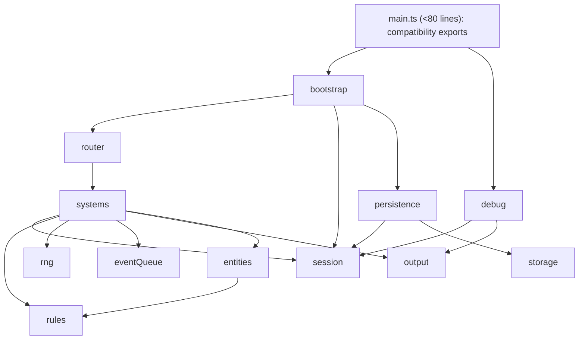

# Ventralis architecture audit and migration plan

Recommendation: use a small, explicit ECS-style simulation core for game state and systems, with non-ECS adapters for persistence, HUD/output, event scheduling, and RNG. This preserves the stated separation of state and logic without forcing infrastructure into components.

`tests/characterization.test.ts` is the acceptance oracle and must not be edited.

## 1. State map

| Current binding | Evidence | Classification | Proposed owner |
|---|---:|---|---|
| `tickCount` | `main.ts:72` | Retained runtime state | `SessionState.tick` |
| `hp` | `main.ts:73` | Proposed Component data | `PlayerVitals.hp` |
| `maxHp` | `main.ts:74` | Proposed Component data | `PlayerVitals.maxHp` |
| `wood` | `main.ts:75` | Proposed Component data | `ResourceMirror.wood` |
| `stone` | `main.ts:76` | Proposed Component data | `ResourceMirror.stone` |
| `inventory` | `main.ts:77` | Proposed Component data | `Inventory.counts` |
| `equippedWeapon` | `main.ts:78` | Proposed Component data | `Equipment.weapon` |
| `attackBonus` | `main.ts:79` | Proposed Component data | `CombatStats.attackBonus` |
| `torchBuffTicks` | `main.ts:80` | Proposed Component data | `TorchEffect.remainingTicks` |
| `alive` | `main.ts:81` | Proposed Component data | `PlayerVitals.alive` |
| `log` | `main.ts:82` | Retained runtime state | `SessionState.log` |
| `worldRef` | `main.ts:83` | Retained runtime state | `RuntimePorts` owned by bootstrap |
| `rngState` | `main.ts:84` | Retained runtime state | `SeededRandom.state` |
| `pendingEvents` | `main.ts:85` | Retained runtime state | `ScheduledEventQueue` |
| `saveCounter` | `main.ts:86` | Retained runtime state | `SessionState.saveCounter` |
| exported `monsters` | `main.ts:297` | Proposed Component data | monster entities with `Monster` component |

No binding is dead/redundant. In particular, `wood` and `stone` look duplicative but are intentionally independent resource mirrors, serialized and exposed through debug/state surfaces.

## 2. Function map

| Function | Proposed destination |
|---|---|
| `lcgNext` | `runtime/seeded-random.ts` |
| `rollInt` | `runtime/seeded-random.ts` |
| `say` | `systems/log-system.ts` |
| `emit` | `ports/output-port.ts` adapter helper |
| `emitPanel` | `debug/hud-surface.ts` |
| `totalWeight` | `systems/inventory-system.ts` |
| `carryCapacity` | `systems/inventory-system.ts` |
| `canCarry` | `systems/inventory-system.ts` |
| `attackRoll` | `systems/combat-system.ts` |
| `pickup` | `systems/inventory-system.ts` |
| `craft` | `systems/crafting-system.ts` |
| `consumeRation` | `systems/survival-system.ts` |
| `equip` | `systems/equipment-system.ts` |
| `spawnMonster` | `entities/monster-factory.ts` |
| `attack` | `systems/combat-system.ts` |
| `schedule` | `runtime/scheduled-event-queue.ts` |
| `onKey` | `bootstrap/input-router.ts` |
| `tick` | `systems/tick-runner.ts` |
| `runTicks` | retained bootstrap/API façade |
| `decideUseStorage` | `persistence/storage-save-adapter.ts` |
| `persist` | `persistence/storage-save-adapter.ts` |
| `snapshot` | `persistence/save-codec.ts` |
| `restore` | `persistence/save-codec.ts` |
| `debugDump` | `debug/debug-surface.ts` |
| `resetGame` | retained bootstrap/API façade |
| `initGame` | retained bootstrap/API façade |

Types and immutable definitions move to `types/` and `rules/`: `ItemKind`, `MonsterKind`, `GameInput`, `World`, output/log/event interfaces, item definitions, recipes, and monster definitions.

## 3. Side effects and dependencies

Abbreviations: `R/W` means read/write. “Output” is `world.output`; “log” is the game log.

| Function | Global reads / writes | Output/storage/RNG/log coupling |
|---|---|---|
| `lcgNext` | W `rngState` | consumes seeded RNG |
| `rollInt` | none directly | consumes RNG through `lcgNext` |
| `say` | R `tickCount`; W `log` | appends log entry |
| `emit` | R `worldRef` | appends text output |
| `emitPanel` | R `worldRef`, debug state | appends panel output |
| `totalWeight` | R `inventory` | none |
| `carryCapacity` | R `inventory.torch` | none |
| `canCarry` | R definitions/inventory | none |
| `attackRoll` | R `attackBonus`, `torchBuffTicks` | consumes RNG |
| `pickup` | R `alive`; W `wood`/`stone`, `inventory` | appends log and text output |
| `craft` | R `alive`, inventory, recipes; W inventory, `wood`, `attackBonus`, `torchBuffTicks` | appends log and text output |
| `consumeRation` | R `alive`, inventory, `maxHp`; W inventory, `hp` | appends log and text output |
| `equip` | R `alive`, inventory; W `equippedWeapon` | appends log and text output |
| `spawnMonster` | W `monsters`; R definitions | appends log |
| `attack` | R `alive`, monsters, definitions, bonus/buff; W monster HP/list, `stone`, inventory stone | consumes RNG; appends log and text output |
| `schedule` | W `pendingEvents` | none |
| `onKey` | R `alive`, equipment, inventory | dispatches side-effecting actions; KeyH emits panel then can equip |
| `tick` | R/W tick, HP, alive, buff, events, monsters, log; invokes persistence | may consume RNG; appends log/output; may write storage |
| `runTicks` | delegates to `tick` | repeats all tick effects |
| `decideUseStorage` | R `worldRef` | reads storage key |
| `persist` | R `worldRef`, tick; W `saveCounter` | conditionally writes storage |
| `snapshot` | R all serialized game state | no external emission; clones/caps log at 20 |
| `restore` | W serialized state and monster array | parses input; appends “save restored” log |
| `debugDump` | R tick, vitals, mirrors, inventory, equipment, combat, events, saves, monsters | produces exact debug string |
| `resetGame` | W all resettable game/session state except `worldRef` | seeds RNG; preserves current world reference |
| `initGame` | W `worldRef`; conditionally writes state via restore | reads storage; appends boot log only |

## 4. Ownership and mutation boundaries

`GameSession` owns all simulation state: the player entity/components, monster entity collection, tick/log/save counter, and scheduled-event queue. It exposes controlled mutable stores only to systems.

Systems use controlled direct mutation through a narrow `SessionMutator` interface, rather than returned command objects. This is appropriate here because exact ordering is behavior: a command queue would add a second temporal protocol and make it easier to accidentally reorder log, RNG, death, spawn, and persistence effects. The mutator exposes named operations such as `damagePlayer`, `appendLog`, `addInventory`, `setTorchTicks`, and `removeMonster`; systems cannot mutate arbitrary records.

Bootstrap owns `RuntimePorts`, containing:

- `OutputPort`, backed by `World.output`;
- `StorageSaveAdapter`, backed by `World.storage`;
- `Clock`, retained as a port even though the current gameplay does not consume it;
- `SeededRandom`, session-owned state with an injected algorithm.

The scheduled-event queue remains a retained runtime service, not entities/components. Persistence owns serialization and storage gating. Debug/HUD is a read-only projection of `GameSession`.

## 5. Not-ECS list

- Persistence boundary: not a component/system. It is I/O and serialization policy; its save-key existence gate must remain exact.
- Debug/HUD surface: not a component/system. It is a read-only compatibility projection whose exact string ordering is externally tested.
- Scheduled-event queue: not a component. Events are deferred control flow, not world entities; retain a queue with explicit `drainDue(tick)`.
- Seeded RNG: not a component. It is a deterministic runtime service with serializable state and order-sensitive consumption.
- `World` canvas/storage/output/clock: not components. These are host ports.
- Static item, recipe, and monster definitions: not components. They are immutable rules/data tables.
- Input routing: not a system. It is an adapter from browser keys to actions and preserves the KeyH ordering quirk.

## 6. Hidden-coupling register

| Coupling to preserve | Evidence |
|---|---|
| Resource mirrors and inventory deliberately double-account pickups, but their craft behavior differs. | Pickup increments mirror and bag at `main.ts:162-164`; crafting removes only inventory at `186-188`; torch leaves mirror values unchanged at `190`; ration secretly decrements mirror wood at `198`. |
| Torch crafting permanently increases attack bonus and resets a finite torch buff. | `main.ts:191-193`; combat combines both in `143-148`. |
| Ration healing is coupled to torch inventory count, not equipped state or buff. | `main.ts:212-214`. |
| Monster death drops stone to both mirror and bag. | `main.ts:251-255`. |
| RNG consumption order is replay-critical across attack and wandering spawn. | LCG mutation at `92-98`; attack uses it through `246`; spawn uses it at `345-347`. Do not add random calls or reorder systems. |
| Wandering-spawn eligibility depends on log parity. | `main.ts:345-347`; log-producing behavior therefore changes spawn/RNG evolution. |
| Tick sequence is load-bearing: drain, buff decay, due events, monster round, spawn, save. | `main.ts:303-353`. Preserve this order exactly. |
| Event removal is equality-based and occurs after handling, including all same-tick events. | `main.ts:319-329`. |
| Periodic saves occur only when the save key already exists. | `decideUseStorage` at `364-367`; called by `persist` at `369-375`; tick invokes persistence at `350-353`. |
| Snapshot excludes pending events and `saveCounter`, truncates log to 20, but restore adds a new log entry. | snapshot `377-395`; restore `397-413`. Do not “complete” the save format without a compatibility decision. |
| `resetGame` does not clear `worldRef`; `initGame` replaces it. | `main.ts:441-457` versus `459-466`. |
| KeyH emits the old HUD panel before auto-equipping a carried torch. | `main.ts:279-283`. This must remain a deliberate compatibility branch. |
| HUD text is an exact semicolon-separated projection, including event and save counts. | `main.ts:420-435`. |
| Boot adds only a log entry, not output; restore’s output behavior is likewise log-only. | `initGame` `459-466`; `say` only mutates log at `105-107`. |
| `MonsterInstance.attack` is stored but unused in combat; retain in snapshots/entity shape for compatibility. | definition `291-295`, factory `232-235`, snapshot `392`, restore `410-411`. |
| `World.clock` and `canvas` are presently unused; retain them in the host interface rather than inventing behavior. | `main.ts:21-26`. |

## 7. Proposed acyclic dependency graph



Arrows point from dependent to dependency. `main.ts` only composes retained bootstrap/API exports and exposes the debug façade; it does not depend directly on storage implementation details.

## 8. Proposed migration file tree

Every listed migrated implementation file is budgeted below 120 lines; `main.ts` remains below approximately 80 lines.

```text
src/
  main.ts                         # compatibility composition/exports, <80
  types/
    game.ts                       # public types, <120
    state.ts                      # session/component types, <120
  rules/
    items.ts                      # item defs/recipes, <120
    monsters.ts                   # monster defs, <120
  entities/
    player-factory.ts             # <120
    monster-factory.ts            # <120
  session/
    game-session.ts               # controlled state/mutator, <120
  runtime/
    seeded-random.ts              # <120
    scheduled-event-queue.ts      # <120
    ports.ts                      # <120
  systems/
    log-system.ts                 # <120
    inventory-system.ts           # <120
    crafting-system.ts            # <120
    equipment-system.ts           # <120
    combat-system.ts              # <120
    survival-system.ts            # <120
    monster-system.ts             # <120
    tick-runner.ts                # ordered orchestration, <120
  persistence/
    save-codec.ts                 # <120
    storage-save-adapter.ts       # <120
  debug/
    debug-surface.ts              # <120
    hud-surface.ts                # <120
  bootstrap/
    input-router.ts               # <120
    game-bootstrap.ts             # <120
```

## 9. Migration order

1. Introduce types/rules/session structures behind existing `main.ts` exports, retaining one behaviorally identical state representation.
2. Extract seeded RNG and pure inventory-derived calculations; run characterization suite.
3. Extract logging/output ports and debug/HUD projection, preserving exact output order/string format; run suite.
4. Extract inventory, crafting, equipment, and survival systems; specifically verify mirror drift and ration/torch side effects; run suite.
5. Extract monster factory/combat/monster tick behavior; verify replay seeds and double stone drops; run suite.
6. Extract scheduled-event queue and ordered tick runner without changing the six-step tick order; run suite.
7. Extract save codec and storage adapter; verify gating, snapshot omissions/truncation, restore log behavior, and save counter; run suite.
8. Reduce `main.ts` to compatibility composition and preserve public exports; run characterization suite and typecheck after each slice.

## 10. Risk and verification plan

A follow-up implementer should treat the unmodified characterization suite as the primary oracle, run it after every slice, and add no test edits. They should also compare:

- `api.dump()` at key action/tick boundaries;
- exact `world.output` sequence and panel-before-equip behavior;
- serialized save payload shape, including omitted fields, `savedAtTick`, and `saveCounter`;
- seeded traces for combat and tick-20 wandering spawns;
- snapshot/restore round trips and reset/boot lifecycle behavior.

Use ECS only for player/monster state and gameplay transformations. Abandon ECS for any concern where preserving order requires hidden cross-system reads, where it produces components that are merely wrappers for I/O/control flow, or where compatibility requires an aggregate-level invariant such as save serialization or exact HUD rendering.

## Handoff and verification record

- Model/provider: Codex / OpenAI (model identifier not exposed).
- Session/thread ID: not visible.
- Attempts: 1.
- Initial failures: none.
- Repairs: none; audit-only task.
- Changed paths: none.
- Scope drift: none.
- Baseline check: `HEAD` was `727609cc0975c839c7a99ee6392d384cfc0be98e`; `master` was `db804e1a188134210f1884cc850a42ecc37e7250`. Per operator authorization, HEAD was used as authoritative.
- `git status --short`: exit code 0; empty output.
- `git diff --check`: exit code 0; empty output.
- `pnpm run test`: exit code 0; 1 test file passed, 21 tests passed.
- `pnpm run typecheck`: exit code 0.
- Remaining blockers: none.