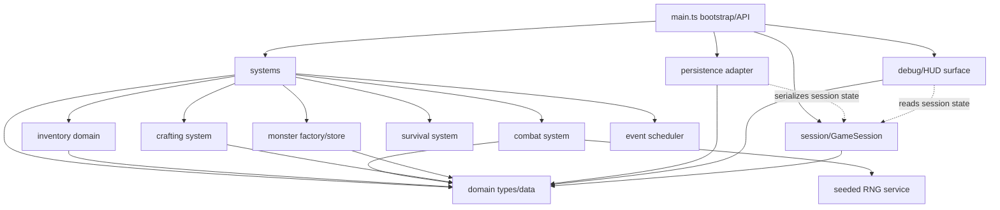

# B4-A0 — Ventralis monolith architecture audit

## Route and baseline

- Intended route: judgment/audit slice.
- Comparison route: audit packet HEAD against the source baseline/tag and characterization behavior. Packet HEAD is authoritative where it differs from `master`.
- `HEAD`: `727609cc0975c839c7a99ee6392d384cfc0be98e`
- `master`: `db804e1a188134210f1884cc850a42ecc37e7250`
- HEAD and `master` differ; no history was altered.

`tests/characterization.test.ts` is the acceptance oracle and must not be edited.

## 1. State map

| Binding | Classification | Proposed ownership |
|---|---|---|
| `tickCount` | Component data | `TimeState` |
| `hp` | Component data | `HealthComponent` |
| `maxHp` | Component data | `HealthComponent` |
| `wood` | Retained runtime state / legacy mirror | `ResourceMirrorState` |
| `stone` | Retained runtime state / legacy mirror | `ResourceMirrorState` |
| `inventory` | Component data | `InventoryComponent` |
| `equippedWeapon` | Component data | `EquipmentComponent` |
| `attackBonus` | Component data | `CombatModifierComponent` |
| `torchBuffTicks` | Component data | `StatusEffectComponent` |
| `alive` | Component data | `LifeState` |
| `log` | Retained runtime state | `LogState` |
| `worldRef` | Retained runtime state | Bootstrap/session context |
| `rngState` | Retained runtime state | Seeded RNG service |
| `pendingEvents` | Retained runtime state | Event scheduler, not ECS |
| `saveCounter` | Retained runtime state | Persistence session metadata |
| `monsters` | Component/entity collection | `MonsterStore` / monster entities |

Derived on read:

- `totalWeight()`
- `carryCapacity()`
- `canCarry()`
- `debugDump()` output
- `api.state()` getter values

Dead/redundant state: none should be removed during the compatibility migration. The zero-effect statements and mirror counters are behaviorally observable through saves, dumps, and tests.

## 2. Function map

| Function | Proposed destination |
|---|---|
| `lcgNext` | Retained RNG service |
| `rollInt` | Combat system utility using RNG service |
| `say` | Log/debug surface adapter |
| `emit` | Output/debug surface adapter |
| `emitPanel` | Debug/HUD surface |
| `totalWeight` | Inventory domain query |
| `carryCapacity` | Inventory domain query |
| `canCarry` | Inventory domain query |
| `attackRoll` | Combat system |
| `pickup` | Gathering/inventory system |
| `craft` | Crafting system |
| `consumeRation` | Consumption/health system |
| `equip` | Equipment system |
| `spawnMonster` | Monster entity factory/store |
| `attack` | Combat system |
| `schedule` | Event scheduler |
| `onKey` | Input routing system |
| `tick` | Retained bootstrap/orchestration loop |
| `runTicks` | Retained bootstrap/test harness API |
| `decideUseStorage` | Persistence adapter policy |
| `persist` | Persistence adapter |
| `snapshot` | Persistence serializer |
| `restore` | Persistence deserializer |
| `debugDump` | Debug surface |
| `resetGame` | Session/bootstrap lifecycle |
| `initGame` | Bootstrap lifecycle |
| `gameLoop` | Public bootstrap API alias |
| `keys` | Public input API alias |
| `api.state` getters | Read-only public state API |

## 3. Side effects and dependencies

| Function | Reads/writes | Output/storage | RNG/log coupling |
|---|---|---|---|
| `lcgNext` | Reads/writes `rngState` | None | Determines future combat/spawn results |
| `rollInt` | Calls `lcgNext` | None | Consumes one RNG value |
| `say` | Reads `tickCount`, writes `log` | None | Log length affects spawning |
| `emit` | Reads `worldRef`, writes `world.output` | Output emission | No RNG |
| `emitPanel` | Reads all debug state | Writes panel output | Calls `debugDump` |
| `totalWeight` | Reads inventory and item definitions | None | Capacity behavior |
| `carryCapacity` | Reads torch inventory | None | Inventory-dependent |
| `canCarry` | Reads inventory/capacity | None | Gates pickup/crafting |
| `attackRoll` | Reads equipment modifiers | None | Consumes RNG |
| `pickup` | Writes mirrors, inventory, log | Emits pickup/overload text | Capacity and log coupling |
| `craft` | Writes inventory, mirrors, buffs, attack bonus, log | Emits success/failure | Preserves secret wood consumption |
| `consumeRation` | Writes inventory and HP | Emits eat/failure text | Torch count affects healing |
| `equip` | Writes equipped weapon | Emits equipment text | Used by KeyH quirk |
| `spawnMonster` | Writes `monsters`, log | None | Spawn caller consumes RNG |
| `attack` | Reads/writes monsters, combat state, mirrors, inventory, log | Emits roll | RNG order is load-bearing |
| `schedule` | Writes pending event queue | None | Queue is tick-driven |
| `onKey` | Routes actions; reads equipment/inventory | Delegates output | KeyH emits panel before re-equip |
| `tick` | Writes time, HP, buffs, alive, queue, monsters, saves | Events/spawns/persistence | Ordering, log length, RNG, save gating |
| `runTicks` | Calls `tick` repeatedly | Indirect | Exact repeated ordering |
| `decideUseStorage` | Reads `worldRef.storage` | None | Gates periodic saves |
| `persist` | Reads snapshot/session state; writes storage/save counter | Storage write | Adds tick and counter |
| `snapshot` | Reads nearly every state binding | None | Persistence contract |
| `restore` | Writes nearly every state binding and monsters | Emits restore log | Restores RNG state |
| `debugDump` | Reads all state including pending events/save counter | None | Exact string is tested |
| `resetGame` | Resets all state except `worldRef` | None | Seed initializes RNG |
| `initGame` | Writes `worldRef`; may restore | Indirect storage and log | Existing save changes startup behavior |

## 4. Ownership and mutation boundaries

- World/session state is owned by a `GameSession` created by bootstrap. It contains component stores, log state, save metadata, and references to external services.
- The event queue is owned exclusively by `EventScheduler`; systems can schedule events through its API, while the tick coordinator drains due events.
- The persistence adapter owns storage access and serialization transport. It must not own gameplay state.
- The clock is owned by the injected `World`/session context. Current behavior does not use `world.clock`, so introducing clock-driven behavior would be a compatibility change.
- The random source is owned by a seeded `RngService`, with explicit snapshot/restore support.

Mutation model: controlled direct mutation inside systems, with each system receiving a narrow mutable state façade. This preserves exact legacy ordering, mirror drift, array identity behavior for `monsters`, and test-visible side effects. Returned command/event architectures would add ordering and batching semantics that could change RNG consumption, log length, and persistence timing.

## 5. Not-ECS list

- Persistence boundary: storage serialization and `decideUseStorage` are infrastructure concerns, not gameplay components or systems.
- Debug/HUD surface: `debugDump`, panel formatting, and output emission are presentation contracts. Turning them into ECS entities would make formatting state part of the simulation.
- Scheduled-event queue: it is an infrastructure scheduler with exact-tick semantics, not an entity/component relationship.
- Seeded RNG: it is a deterministic service whose consumption order is part of the behavior contract, not component data.
- `World` session context: it represents external capabilities—storage, output, canvas, and clock—not an in-world entity.
- Persistence metadata such as `saveCounter`: it is adapter/session state, not gameplay state.

## 6. Hidden-coupling register

| Coupling | Evidence | Migration requirement |
|---|---|---|
| Resource mirrors and inventory are double-accounted | `src/main.ts:166-167`, `src/main.ts:185-188`, `src/main.ts:201-202` | Preserve separate mirror counters and inventory mutation paths. |
| Torch crafting leaves mirrors unchanged | `src/main.ts:186` | Preserve the historical no-op and resulting drift. |
| Ration crafting secretly consumes mirror wood | `src/main.ts:196` | Preserve `wood -= 1`; do not normalize resources. |
| Monster death double-drops stone | `src/main.ts:253-254` | Preserve both mirror and inventory increments. |
| Crafting changes combat state | `src/main.ts:188-189` | Preserve `attackBonus += 1` and `torchBuffTicks = 30`. |
| RNG consumption order affects combat and spawn behavior | `src/main.ts:94-95`, `src/main.ts:147`, `src/main.ts:348` | Centralize RNG but preserve call order exactly. |
| Log length affects wandering spawns | `src/main.ts:347-349` | Spawn logic must read the same log length at the same point. |
| `decideUseStorage` gates periodic saves | `src/main.ts:364-367`, `src/main.ts:352-353` | Preserve no-op saves when the key is absent. |
| Save counter is not reset by persistence itself but is reset by game reset | `src/main.ts:373-375`, `src/main.ts:455` | Keep counter in session metadata and snapshot-visible debug state. |
| Snapshot/restore touch nearly all state | `src/main.ts:377-418` | Version or validate carefully, but retain all current fields and RNG state. |
| Restore emits a log entry | `src/main.ts:417` | Preserve post-restore logging and its effect on later spawn parity. |
| KeyH re-equips a torch after emitting the panel | `src/main.ts:276-280` | Preserve panel-first, equipment-output-second ordering. |
| KeyH behavior depends on fists plus torch inventory | `src/main.ts:278` | Keep routing condition and ordering unchanged. |
| Tick phase order is observable | `src/main.ts:303-354` | Preserve drain, buff decay, events, monster round, spawn, save sequence. |
| Dead state blocks actions | `src/main.ts:156`, `src/main.ts:170`, `src/main.ts:206`, `src/main.ts:220`, `src/main.ts:239`, `src/main.ts:272` | Gate all action systems consistently. |
| Torch inventory changes carry capacity and ration healing | `src/main.ts:136-137`, `src/main.ts:210` | Keep these reads tied to inventory, not mirror counters. |
| `worldRef` survives `resetGame` | `src/main.ts:441-457` | Avoid silently clearing the session/world binding unless explicitly required. |

## 7. Proposed dependency graph



The graph is acyclic: `main.ts` orchestrates systems and adapters; persistence and debug do not import the bootstrap module.

## 8. Proposed file tree

```text
src/
  main.ts                         # bootstrap/API, target under ~80 lines
  domain/
    types.ts                      # interfaces and public types
    definitions.ts                # item, recipe, monster tables
    components.ts                 # component/state shapes
  runtime/
    session.ts                    # GameSession and world context
    rng.ts                        # seeded LCG service
    events.ts                     # scheduled-event queue
    log.ts                        # log state and append operations
  entities/
    monsters.ts                   # MonsterStore and factory
  systems/
    inventory.ts                  # weight, capacity, pickup
    crafting.ts                   # craft behavior and legacy quirks
    combat.ts                     # rolls, attack, drops
    survival.ts                   # drain, buffs, scheduled damage
    input.ts                      # keyboard routing
    tick.ts                       # phase coordinator
  adapters/
    persistence.ts                # snapshot, restore, storage policy
    debug.ts                      # dump and panel output
    output.ts                     # text output adapter
```

The implementation should keep individual migrated files below 120 lines where practical and keep `main.ts` below approximately 80 lines.

## 9. Migration order

1. Add type and definition modules without changing behavior. Run characterization tests and typecheck.
2. Extract seeded RNG behind an equivalent service. Verify seed 7 attack behavior and full suite.
3. Extract log/output/debug helpers while preserving exact strings and output ordering. Run suite.
4. Introduce `GameSession` as a façade over existing state. Keep public exports unchanged. Run suite.
5. Extract inventory queries and pickup. Verify capacity and mirror behavior.
6. Extract crafting. Verify torch buffs, attack bonus, secret wood consumption, and failed recipes.
7. Extract monster factory and combat. Verify RNG sequence and double stone drop.
8. Extract event scheduling and survival tick phases. Verify exact event timing and death gating.
9. Extract persistence snapshot/restore and save policy. Verify missing-key no-op, save counter, and restore round trips.
10. Extract input routing, retaining KeyH panel/re-equip ordering.
11. Extract the tick coordinator and reduce `main.ts` to bootstrap/API wiring.
12. After every slice, run `pnpm run test` and `pnpm run typecheck`; do not edit `tests/characterization.test.ts`.

## 10. Risk and verification plan

Behavioral verification must use the unchanged characterization suite as the acceptance oracle. The implementer should additionally compare:

- exact `api.dump()` strings;
- output array order and payloads;
- snapshots before and after restore;
- RNG-dependent attack rolls;
- tick-by-tick HP and event behavior;
- save payloads, `savedAtTick`, and `saveCounter`;
- resource mirror versus inventory values;
- KeyH panel/re-equip ordering.

No test edits are permitted. Any new tests must be external to the protected characterization file and must not replace it as the acceptance oracle.

Abandon ECS for a concern when ECS introduces observable semantic changes, especially if it alters:

- RNG consumption order;
- log insertion timing or log length;
- event queue ordering;
- persistence serialization shape;
- debug output formatting;
- aliasing or mutation behavior of the exported `monsters` array.

Those concerns should remain services, adapters, or session-owned infrastructure.

## Verification and handoff

| Command | Exit code | Result |
|---|---:|---|
| `git status --short` | 0 | Empty |
| `git diff --check` | 0 | Clean |
| `pnpm run test` | 0 | 1 file passed, 21 tests passed |
| `pnpm run typecheck` | 0 | TypeScript check passed |

- Model/provider: GPT-5 / OpenAI Codex API agent.
- Session/thread ID: not exposed.
- Attempts: 1.
- Repairs: none required.
- Changed paths: none.
- Scope drift: none.
- Initial failures: none.
- Remaining blockers: none.
