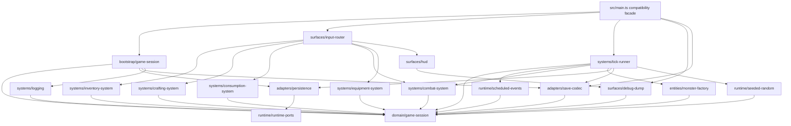

# Ventralis architecture audit and migration plan

This is an audit-only result. No files were changed. `tests/characterization.test.ts` is the acceptance oracle and must not be edited.

## 1. State map

| Module binding | Classification | Proposed owner / representation |
|---|---|---|
| `tickCount` | Retained runtime state (world/session) | `GameSession.tick` |
| `hp` | Proposed Component data | `PlayerVitals.hp` |
| `maxHp` | Proposed Component data | `PlayerVitals.maxHp` |
| `wood` | Proposed Component data | `ResourceMirrors.wood` |
| `stone` | Proposed Component data | `ResourceMirrors.stone` |
| `inventory` | Proposed Component data | `Inventory.counts` |
| `equippedWeapon` | Proposed Component data | `Equipment.weapon` |
| `attackBonus` | Proposed Component data | `CombatModifiers.attackBonus` |
| `torchBuffTicks` | Proposed Component data | `TorchEffect.remainingTicks` |
| `alive` | Proposed Component data | `PlayerVitals.alive` |
| `log` | Proposed Component data | `GameLog.entries`; preserve append order and `tick` stamps |
| `worldRef` | Retained runtime state (world/session) | `RuntimePorts` held by bootstrap/session, not gameplay components |
| `rngState` | Retained runtime state (world/session) | Stateful `SeededRandom` owned by session |
| `pendingEvents` | Retained runtime state (world/session) | Ordered `ScheduledEventQueue` owned by session |
| `saveCounter` | Retained runtime state (world/session) | `PersistenceState.saveCounter` |
| exported `monsters` array | Proposed Component data | Ordered monster entity collection, each entity carrying `MonsterStats` |

No mutable binding is dead or merely derived-on-read. `totalWeight` and `carryCapacity` remain derived selectors, rather than stored state.

## 2. Function map

| Existing function | Proposed destination |
|---|---|
| `lcgNext`, `rollInt` | `runtime/seeded-random.ts` |
| `say` | `systems/logging.ts` |
| `emit`, `emitPanel` | `surfaces/output.ts` and `surfaces/hud.ts` |
| `totalWeight`, `carryCapacity`, `canCarry` | `domain/inventory-selectors.ts` |
| `attackRoll` | `systems/combat-system.ts` |
| `pickup` | `systems/inventory-system.ts` |
| `craft` | `systems/crafting-system.ts` |
| `consumeRation` | `systems/consumption-system.ts` |
| `equip` | `systems/equipment-system.ts` |
| `spawnMonster` | `entities/monster-factory.ts` |
| `attack` | `systems/combat-system.ts` |
| `schedule` | `runtime/scheduled-events.ts` |
| `onKey` | `surfaces/input-router.ts` |
| `tick` | `systems/tick-runner.ts` |
| `runTicks` | `systems/tick-runner.ts` |
| `decideUseStorage`, `persist` | `adapters/persistence.ts` |
| `snapshot`, `restore` | `adapters/save-codec.ts` |
| `debugDump` | `surfaces/debug-dump.ts` |
| `resetGame`, `initGame` | `bootstrap/game-session.ts` |
| `api.state` and its five getters | Retained compatibility façade in `main.ts`, delegated to read-only selectors |
| `gameLoop`, `keys`, `api` exports | Retained compatibility façade in `main.ts` |

## 3. Side effects and dependencies

`R`/`W` below mean module-global reads/writes in the current implementation.

| Function | Globals R/W | Output / storage | RNG | Log coupling |
|---|---|---|---|---|
| `lcgNext` | W `rngState` | none | consumes one | none |
| `rollInt` | indirect W `rngState` | none | consumes one | none |
| `say` | R `tickCount`; W `log` | none | none | appends |
| `emit` | R `worldRef` | writes `world.output` | none | none |
| `emitPanel` | R `worldRef`, indirect all dump fields | writes panel output | none | none |
| `totalWeight` | R `inventory` | none | none | none |
| `carryCapacity` | R `inventory.torch` | none | none | none |
| `canCarry` | R inventory/definitions via selectors | none | none | none |
| `attackRoll` | R `attackBonus`, `torchBuffTicks` | none | one `rollInt` | none |
| `pickup` | R `alive`; W mirrors/inventory | emits text | none | appends success/failure |
| `craft` | R `alive`, inventory; W inventory, `wood`, buffs | emits text | none | appends branch-specific text |
| `consumeRation` | R `alive`, inventory, `hp`, `maxHp`; W inventory/`hp` | emits text | none | appends |
| `equip` | R `alive`, inventory; W weapon | emits text | none | appends |
| `spawnMonster` | W `monsters` | none | none | appends |
| `attack` | R `alive`, monsters, modifiers; W monsters, `stone`, inventory | emits attack/air text | one attack roll when target exists | appends hit/miss/death |
| `schedule` | W `pendingEvents` | none | none | none |
| `onKey` | R `alive`, weapon, inventory; delegates mutations | KeyH panel plus possible equip text | indirect for attack | indirect; KeyH order matters |
| `tick` | R/W session/player/monsters/events/log | emits due-event text; may write save | one draw only on qualifying tick-20 spawn | spawn gate reads `log.length` |
| `runTicks` | indirect tick state | indirect | indirect | indirect |
| `decideUseStorage` | R `worldRef` | reads storage key | none | none |
| `persist` | R `tickCount`, `worldRef`; W `saveCounter` | writes JSON storage only if gated | none | none |
| `snapshot` | R all serialized gameplay fields | none | none | copies last 20 log entries |
| `restore` | W all restored fields and monster contents | none | none | replaces saved log, then appends restore entry |
| `debugDump` | R player/session/event/monster/save fields | none | none | does not render log content |
| `resetGame` | W all reset fields except `worldRef` | none | none | clears log |
| `initGame` | W `worldRef`; may indirectly restore | reads storage; no output | none | appends wake log |
| `api.state` getters | R selected fields | none | none | none |

## 4. Ownership and mutation boundaries

Use a justified hybrid, not a general-purpose ECS framework:

- `GameSession` owns the complete mutable game model: one player’s component bundle, ordered monster entity collection, log, tick, scheduled-event queue, RNG, and persistence counter.
- The bootstrap owns injected runtime ports: `World`, output sink, storage adapter, and clock. The current `clock` and `canvas` remain ports even though fixture behavior does not consume them.
- `ScheduledEventQueue` remains a session runtime service, preserving insertion order and exact-tick filtering.
- `SeededRandom` is a session-owned stateful service. Its serialized state is part of save compatibility.
- The persistence adapter owns storage I/O and JSON encoding boundaries; it does not own gameplay state.
- The debug/HUD surface receives a read-only session view and formats it. It must not mutate state.

Systems use controlled direct mutation: each system receives an internal mutable `GameSession` and explicit ports, while the public façade exposes only commands and read-only selectors. This is preferable here to returned command objects because the existing tick is deliberately temporal: event emission, death checks, RNG draws, monster iteration, queue removal, and persistence occur in a load-bearing sequence. A command queue would add another ordering mechanism that itself could drift. Direct mutation is acceptable because mutation is restricted to system modules and no component is exported mutable.

## 5. Not-ECS list

| Concern | Decision | Reason |
|---|---|---|
| Persistence boundary | Not ECS | Storage existence gating, JSON shape, snapshot trimming, and save counter are adapter/session concerns, not per-entity behavior. |
| Debug/HUD surface | Not ECS | It is a formatting/output adapter over a read-only view; making it a system risks giving presentation authority over gameplay state. |
| Scheduled-event queue | Not a component | It is an ordered temporal service with exact-tick semantics, not entity-attached data. |
| Seeded RNG | Not a component | It is a single shared sequence whose consumption order is observable and persisted. |
| Input routing | Not ECS | Keyboard translation is an external boundary; it should invoke application commands. |
| Static item/recipe/monster definitions | Not ECS | Immutable domain catalog data. |
| `World` canvas/clock/storage/output | Not ECS | Platform/runtime ports. |
| Single player | Hybrid component bundle, not entity-manager ceremony | Components clarify data ownership, but a full generic entity registry for one player would add complexity without isolation value. |

Abandon ECS for any concern when it requires global ordering, a single sequence, external I/O, or presentation adaptation. In particular, do not turn save handling, RNG, the event queue, or HUD formatting into generic systems just for architectural uniformity.

## 6. Hidden-coupling register

| Coupling to preserve | Evidence | Migration constraint |
|---|---|---|
| Resource mirrors and inventory double-account independently | `src/main.ts:162-164`, `186-201`, `253-254` | Keep `wood`/`stone` mirrors distinct from inventory; never derive one from the other. |
| Torch crafting preserves mirror drift and changes combat permanently | `src/main.ts:187-194` | Preserve `wood -= 0`, inventory-only costs, `torchBuffTicks = 30`, and cumulative `attackBonus += 1`. |
| Ration craft secretly consumes raw mirror wood but not mirror stone | `src/main.ts:195-201` | Preserve this non-recipe-visible side effect exactly. |
| Ration healing depends on torch count | `src/main.ts:212-214` | Keep recovery as `15 + inventory.torch`, capped at `maxHp`. |
| Monster kill grants stone to both representations | `src/main.ts:251-255` | Preserve the double stone drop. |
| Combat roll depends on equipment-adjacent permanent bonus and temporary torch effect | `src/main.ts:143-148`, `245-260` | Keep attack RNG draw and modifier sequencing. `equippedWeapon` is read by HUD/input but does not currently alter roll math. |
| RNG sequence is globally shared and order-dependent | `src/main.ts:92-99`, `143-148`, `345-348`, `377-394` | Preserve one LCG stream, exact arithmetic, save/restore state, and whether a branch consumes a draw. |
| Spawn depends on log length, not only game state/tick | `src/main.ts:345-348` | Preserve log append order and test parity at tick 20 before consuming spawn RNG. |
| Tick phase order is observable | `src/main.ts:303-354` | Keep survival, torch decay, due events, monster round, spawn, then persistence in that exact order. |
| Scheduled events fire only at equality, then are removed | `src/main.ts:319-329` | Do not change to `<=`, sorting, or delayed removal. |
| Stalker and crawler death handling differs | `src/main.ts:331-343` | Preserve crawler chip damage without its own death check and stalker’s immediate death/log behavior. |
| Periodic saving is gated by pre-existing save key | `src/main.ts:364-375`, `350-353` | `decideUseStorage` must remain the gate; tick 10 is a no-op without the key. |
| Snapshot is not complete session serialization | `src/main.ts:377-395` | Preserve last-20 log truncation and omission of pending events, `saveCounter`, and `worldRef`; do not “improve” compatibility. |
| Restore mutates the exported monster array in place | `src/main.ts:397-413` | Clear/repopulate the same collection abstraction; preserve aliases if any emerge. |
| Restore appends a post-restore log entry | `src/main.ts:409-413` | Retain this append even though debug output omits log content. |
| Reset does not clear `worldRef` | `src/main.ts:441-457` | Preserve unless a separately authorized behavior change updates characterization evidence. |
| Initialization can restore before appending wake log, with no output | `src/main.ts:459-466` | Preserve storage-read/restore/wake-log order and output silence. |
| KeyH emits HUD before re-equipping torch | `src/main.ts:279-284` | Retain both the legacy re-equip quirk and panel-first ordering. |
| HUD includes queue/save counts and reads current fields directly | `src/main.ts:420-435` | Keep exact field order, separators, and values. |
| `api.state()` returns a getter view, not a copied snapshot | `src/main.ts:481-497` | Preserve live read behavior and exported compatibility shape. |

## 7. Proposed acyclic dependency graph



All arrows point from an orchestration, system, surface, or adapter module to lower-level state/contracts. Domain contracts and session state import no systems, adapters, surfaces, or `main.ts`.

## 8. Proposed file tree

Every proposed migrated implementation file is budgeted below 120 lines; `main.ts` is budgeted at approximately 55–75 lines.

```text
src/
  main.ts                         # compatibility exports; ~70
  domain/
    contracts.ts                  # types/interfaces; ~85
    catalogs.ts                   # ITEM_DEFS, recipes, monster defs; ~45
    game-session.ts               # session/component shapes + creation; ~105
    inventory-selectors.ts        # derived selectors; ~45
  entities/
    monster-factory.ts            # ~35
  runtime/
    runtime-ports.ts              # World/output/storage contracts; ~45
    seeded-random.ts              # LCG state and roll; ~35
    scheduled-events.ts           # queue operations; ~55
  systems/
    logging.ts                    # ~25
    inventory-system.ts           # pickup; ~55
    crafting-system.ts            # craft; ~80
    consumption-system.ts         # ration; ~45
    equipment-system.ts           # equip; ~40
    combat-system.ts              # attack/attackRoll; ~85
    tick-runner.ts                # ordered tick/run; ~115
  adapters/
    save-codec.ts                 # snapshot/restore compatibility; ~115
    persistence.ts                # gate/write behavior; ~60
  surfaces/
    output.ts                     # text emission; ~25
    debug-dump.ts                 # exact dump formatter; ~55
    hud.ts                        # panel emission; ~30
    input-router.ts               # keyboard routing; ~75
  bootstrap/
    game-session.ts               # reset/init wiring; ~90
```

## 9. Migration order

1. Freeze the oracle: run the unmodified characterization suite and typecheck; capture current debug/output/save examples. No behavior changes.
2. Extract contracts and immutable catalogs without changing runtime ownership; re-export types/constants through `main.ts`.
3. Introduce `GameSession` as a structural container while retaining the existing public façade and state getter semantics. Move only state construction/reset logic.
4. Extract pure inventory selectors and seeded RNG. Verify seeded attack behavior and no altered RNG consumption.
5. Extract logging/output/debug surfaces, preserving exact output ordering and `debugDump` string layout.
6. Extract player action systems one at a time: pickup, equip, consumption, craft, then combat. Run the suite after every individual extraction.
7. Extract monster factory and scheduled-event queue, preserving array order, exact tick equality, and in-place restore behavior.
8. Extract ordered tick runner without rearranging the six current phases. Verify after this slice, especially periodic persistence and spawn behavior.
9. Extract save codec and persistence adapter, retaining snapshot omissions, log truncation, restore append, and `decideUseStorage` gating.
10. Reduce `main.ts` to the compatibility façade only. Run the unchanged characterization suite and typecheck after every slice and at final handoff.

## 10. Risk and verification plan

The later implementer should use the existing, unedited `tests/characterization.test.ts` as the acceptance oracle after each migration slice. It pins the known public behavior: exact debug strings, output ordering, resource mirror drift, secret recipe costs, double monster stone drops, replayable seed-7 combat, scheduled-event timing, persistence gating, restore behavior, and KeyH re-equip.

Add no test edits. A later implementation may run additional read-only probes using the existing public API, particularly for:

- Tick-20 spawn parity after different log histories.
- Exact LCG state across attack and spawn sequences, including save/restore.
- Save payload field presence/absence, last-20-log truncation, and `saveCounter`.
- Reset followed by initialization to ensure the retained runtime-port behavior is intentional.
- Multiple due events and monster ordering, while retaining the original phase sequence.

Abandon ECS for a concern if preserving its observable semantics would require a global coordinator or would obscure order-sensitive state mutation. Specifically, keep persistence, the event queue, RNG, debug/HUD, and runtime ports outside component/system abstraction if an extraction changes serialization shape, output timing, RNG draw count, or phase order.

## Handoff record

| Item | Result |
|---|---|
| Model/provider | Codex / OpenAI; exact model identifier unavailable in this session |
| Session/thread ID | Not visible |
| Attempts | 1 |
| Repairs | None; audit-only packet |
| Changed paths | None |
| Scope drift | None |
| Baseline observation | `HEAD` `727609cc0975c839c7a99ee6392d384cfc0be98e`; local `master` `db804e1a188134210f1884cc850a42ecc37e7250`. Per operator instruction, HEAD was treated as authoritative. |
| Initial failures | None |
| `git status --short` | Exit code 0; no output (clean) |
| `git diff --check` | Exit code 0; no output |
| `pnpm run test` | Exit code 0; 1 test file passed, 21 tests passed |
| `pnpm run typecheck` | Exit code 0 |
| Remaining blockers | None |