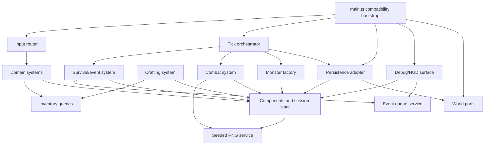

# B4-A0 — Ventralis Monolith Architecture Audit

## 1. State map

| Binding | Evidence | Classification | Migration treatment |
|---|---:|---|---|
| `tickCount` | `main.ts:72` | Component data | `TimeState.tick` |
| `hp` | `main.ts:73` | Component data | `Vitals.hp` |
| `maxHp` | `main.ts:74` | Component data | `Vitals.maxHp` |
| `wood` | `main.ts:75` | Component data, legacy mirror | Preserve separately from inventory |
| `stone` | `main.ts:76` | Component data, legacy mirror | Preserve separately from inventory |
| `inventory` | `main.ts:77` | Component data | `InventoryComponent` |
| `equippedWeapon` | `main.ts:78` | Component data | `EquipmentComponent` |
| `attackBonus` | `main.ts:79` | Component data | `CombatComponent` |
| `torchBuffTicks` | `main.ts:80` | Component data | `BuffComponent` |
| `alive` | `main.ts:81` | Component data | `Vitals.alive` |
| `log` | `main.ts:82` | Component data | `LogComponent`; log length remains spawn input |
| `worldRef` | `main.ts:83` | Retained runtime state | `RuntimeContext.world`; not a component |
| `rngState` | `main.ts:84` | Retained runtime state | Seeded RNG service; snapshot/restore state |
| `pendingEvents` | `main.ts:85` | Retained runtime state | Event queue service; not ECS data |
| `saveCounter` | `main.ts:86` | Retained runtime state | Persistence adapter/session state |
| `monsters` | `main.ts:297` | Component/entity data | Entity collection or `MonsterComponent`; preserve exported observable array semantics |

Derived values are not stored as state:

- `totalWeight()` — derived from inventory and item definitions.
- `carryCapacity()` — derived from torch count.
- `canCarry()` — derived capacity check.
- `debugDump()` — derived presentation output.

No module-level mutable binding is classified as dead. The `wood`/`stone` mirrors and `saveCounter` look redundant but are behaviorally observable.

## 2. Function map

| Function | Proposed destination |
|---|---|
| `lcgNext` | Retained RNG service |
| `rollInt` | Retained RNG service |
| `say` | Logging system/service |
| `emit` | Debug/output surface adapter |
| `emitPanel` | Debug/HUD surface |
| `totalWeight` | Inventory domain/query module |
| `carryCapacity` | Inventory domain/query module |
| `canCarry` | Inventory domain/query module |
| `attackRoll` | Combat system, using RNG service |
| `pickup` | Inventory/action system |
| `craft` | Crafting system |
| `consumeRation` | Consumption/system |
| `equip` | Equipment system |
| `spawnMonster` | Monster entity factory |
| `attack` | Combat system |
| `schedule` | Event queue adapter/service |
| `onKey` | Input routing system |
| `tick` | Tick orchestration/system pipeline |
| `runTicks` | Retained bootstrap/runtime facade |
| `decideUseStorage` | Persistence adapter policy |
| `persist` | Persistence adapter |
| `snapshot` | Persistence serializer |
| `restore` | Persistence deserializer |
| `debugDump` | Debug/HUD surface |
| `resetGame` | Retained bootstrap/session reset |
| `initGame` | Retained bootstrap |
| `api.state` getters | Public compatibility facade |

The `api` object itself remains a compatibility facade, not a domain module.

## 3. Side effects and dependencies

| Function | Reads | Writes | Output/storage | RNG/log coupling |
|---|---|---|---|---|
| `lcgNext` | `rngState` | `rngState` | None | Defines replay sequence |
| `rollInt` | RNG service | RNG service | None | Consumes one RNG value |
| `say` | `tickCount` | `log` | None | Log length affects spawning |
| `emit` | `worldRef` | `world.output` | Emits text | No log itself |
| `emitPanel` | `worldRef`, all debug state | `world.output` | Emits panel | Calls `debugDump` |
| `totalWeight` | `inventory`, item definitions | None | None | None |
| `carryCapacity` | `inventory.torch` | None | None | None |
| `canCarry` | Inventory queries | None | None | None |
| `attackRoll` | `attackBonus`, `torchBuffTicks` | RNG state | None | RNG consumption order load-bearing |
| `pickup` | `alive`, inventory, mirrors | Inventory, `wood`/`stone`, log | Text output | Logs successful and failed pickup |
| `craft` | `alive`, recipes, inventory, mirrors | Inventory, `wood`, buffs, bonus, log | Text output | Secret mirror mutation and combat coupling |
| `consumeRation` | `alive`, inventory, torch count, HP | Inventory, HP, log | Text output | Healing depends on torch count |
| `equip` | `alive`, inventory | Equipment, log | Text output | KeyH invokes it indirectly |
| `spawnMonster` | Monster definitions | `monsters`, log | No output | Log length changes future spawn gate |
| `attack` | `alive`, monsters, combat state | Monster HP, mirrors, inventory, log | Text output | Consumes RNG through `attackRoll` |
| `schedule` | None | `pendingEvents` | None | Queue timing is exact |
| `onKey` | `alive`, equipment, inventory | Delegates to actions | Panel/text output | KeyH has re-equip side effect |
| `tick` | All runtime state | HP, alive, buffs, queue, monsters, RNG, saves | Events/output/storage | Ordering is load-bearing |
| `runTicks` | None directly | Delegates to `tick` | Indirect | Repeats all tick effects |
| `decideUseStorage` | `worldRef.storage` | None | None | Gates all periodic saves |
| `persist` | World, tick, save counter | `saveCounter`, storage | Storage write | Save counter included in payload |
| `snapshot` | All persisted state | None | Serializable object | Must include RNG and monsters |
| `restore` | Serialized state | All persisted state, monsters, log | Adds “save restored” log entry | Restores RNG sequence |
| `debugDump` | All state plus event/monster counts | None | String | Exact formatting is test-visible |
| `resetGame` | Seed | All session state | None | Clears monsters and queue |
| `initGame` | World/storage | `worldRef`, possibly all restored state | May restore; boot log only | Storage presence controls restore |
| `api.state` | Selected state | None | Public values | Compatibility surface |

## 4. Ownership and mutation boundaries

- World state is owned by a single `GameSession`/world context containing components and entity collections.
- The event queue is owned by an `EventQueue` service. It is scheduled and drained by the tick pipeline; it is not a component.
- Persistence is owned by a `PersistenceAdapter` receiving an explicit session snapshot and runtime context.
- The clock is owned by the injected `World.clock`; the current behavior does not use it for tick progression, so migration must not introduce clock-based behavior.
- Randomness is owned by an injected seeded `RandomSource`, with serializable state.

Systems will use controlled direct mutation through a `GameSession` mutation API. This preserves the monolith’s exact operation order, avoids reconstructing every legacy side effect as command interpretation, and keeps mutation centralized. Systems must not mutate arbitrary modules or persistence/debug adapters directly. The mutation API should expose intentional operations such as `addMirrorResource`, `addInventory`, `setHp`, and `appendLog`, including legacy asymmetries.

## 5. Not-ECS list

| Concern | Treatment and rationale |
|---|---|
| Persistence boundary | Keep as an adapter/service. Storage availability, JSON shape, `savedAtTick`, and `saveCounter` are infrastructure concerns, not entity data. |
| Debug/HUD surface | Keep as a presentation/debug module. `debugDump()` is a read-only projection with an exact compatibility string; making it a system would obscure its side-effect-free role. |
| Scheduled-event queue | Keep as a runtime queue. Events are temporal infrastructure and are drained by tick; turning each event into an entity adds lifecycle complexity without benefit. |
| Seeded RNG | Keep as a runtime service. RNG state must serialize and consumption order must remain globally deterministic; it is not game-world component data. |
| `World`/storage/output | Keep as injected runtime ports. They represent host capabilities, not game entities. |
| Compatibility API | Keep as a facade at the boundary so tests and callers do not depend on internal module layout. |

ECS remains useful for mutable domain state and monsters, but a hybrid architecture is preferable for these concerns.

## 6. Hidden-coupling register

| Coupling | Evidence | Preservation requirement |
|---|---|---|
| Resource mirror vs inventory double-accounting | `main.ts:162-164`, `186-188`, `253-254`; tests “resource mirrors” and “BOTH bag and mirror counter” | Pickup increments both; crafting consumes inventory but generally leaves mirrors; monster death increments both. |
| Torch craft side effects | `main.ts:189-194` | Crafting a torch sets `torchBuffTicks=30` and increments permanent `attackBonus`. |
| Secret wood consumption for ration | `main.ts:195-199` | Ration crafting decrements mirror `wood` by one, while inventory consumption follows recipe values. |
| RNG consumption order | `main.ts:92-99`, `143-148`, `246`, `345-347`; characterization seed 7 test | Preserve one shared deterministic stream and call order. Do not introduce independent per-system RNG streams. |
| Log-length-dependent spawning | `main.ts:345-348` | Spawn occurs only at tick multiples of 20 when `log.length % 2 === 0`; logging changes gameplay. |
| `decideUseStorage` gates periodic saves | `main.ts:364-375`, `350-353`; persistence tests | Tick-10 persistence is a no-op unless the storage key already exists. Preserve the unusual existence check. |
| KeyH re-equip quirk | `main.ts:279-283`; legacy KeyH test | H emits the panel first, then equips torch when fists are active and a torch is in inventory. |
| Snapshot/restore coverage | `main.ts:377-414` | Snapshot must include mirrors, inventory, buffs, equipment, log tail, monsters, and RNG. Restore must repopulate the exported monster collection and append “save restored”. |
| Tick phase ordering | `main.ts:303-354` | Preserve survival drain → buff decay → events → monster round → spawn → save. |
| Event exact-tick behavior | `main.ts:318-329`; scheduled-event test | Process events where `at === tickCount`, emit `"event"`, apply damage, then remove them. |
| Dead-state action gating | `main.ts:155-156`, `169-170`, `205-206`, `219-220`, `238-239`, `271-272` | All actions and key routing must remain no-ops after death. |
| Debug string format | `main.ts:420-434`; boot/debug tests | Preserve field order, separators, mirror values, event count, monster count, and save count. |
| Log tail persistence | `main.ts:391`, `409` | Persist only the last 20 entries, then restore copied entries. |
| Carry calculation | `main.ts:126-140` | Weight uses inventory only; torch inventory increases capacity by two. |
| Boot output behavior | `main.ts:459-466`; boot tests | `initGame` writes the wake log but emits no output; restored boot must remain output-free. |

## 7. Proposed dependency graph



The graph is acyclic. `main.ts` depends on persistence and debug surfaces; neither depends on `main.ts`.

## 8. Proposed file tree

Every migrated file should remain below 120 lines, with the entry point below approximately 80 lines.

```text
src/
  main.ts                    # <=80: composition, exports, compatibility facade
  domain/
    types.ts                 # types and interfaces
    definitions.ts            # item, recipe, monster tables
    components.ts             # component/session state types
    inventory.ts              # weight/capacity queries
    monsters.ts               # monster factory and entity helpers
  systems/
    pickup.ts                # pickup system
    crafting.ts              # crafting system and legacy mirror effects
    consumption.ts            # ration consumption
    equipment.ts              # equip behavior
    combat.ts                 # rolls, attacks, drops
    survival.ts               # starvation and death transitions
    events.ts                 # scheduled-event processing
    input.ts                  # keyboard routing, including KeyH quirk
    tick.ts                   # ordered phase orchestration
  runtime/
    session.ts                # world/session ownership and mutation API
    rng.ts                    # seeded LCG adapter
    event-queue.ts            # queue ownership and drain operations
  persistence/
    adapter.ts                # storage policy and writes
    codec.ts                  # snapshot/restore serialization
  debug/
    hud.ts                    # debugDump and panel emission
```

A follow-up implementation should split further if any file approaches 120 lines rather than relaxing the budget.

## 9. Migration order

1. Establish characterization snapshots and inventory the public exports. Run the suite unchanged.
2. Extract `types.ts` and static definitions with no behavior change.
3. Introduce a `GameSession` container while retaining the existing API and preserving all state values.
4. Extract the seeded RNG service and serialize its state. Verify seed 7 attack output.
5. Extract inventory queries and pickup logic. Verify weight limits and mirror increments.
6. Extract crafting and consumption. Verify torch buffs, attack bonus, secret wood consumption, and failure output.
7. Extract equipment and combat. Verify KeyH behavior, attack rolls, monster damage, and double stone drops.
8. Extract the event queue and survival/tick phases without changing order. Verify exact event ticks and death gating.
9. Extract the monster factory and spawn logic. Verify log-length gating and RNG consumption.
10. Extract persistence codec and adapter. Verify storage-key gating, save counter, snapshot fields, restore behavior, and restored RNG.
11. Extract debug/HUD projection. Compare exact `api.dump()` strings and panel ordering.
12. Reduce `main.ts` to composition, compatibility exports, and bootstrap.
13. After every slice, run `pnpm run test` and `pnpm run typecheck`. Never edit `tests/characterization.test.ts`; it is the acceptance oracle.

## 10. Risk and verification plan

Behavioral preservation must be demonstrated solely against the existing characterization suite and typecheck. The suite must remain untouched.

Verification should include:

- `pnpm run test`
- `pnpm run typecheck`
- Exact comparisons of `api.dump()` before and after each migration slice.
- Seeded replay checks, especially seed 7’s attack sequence.
- Snapshot/restore comparisons including RNG continuation.
- Storage tests with and without the pre-existing save key.
- Output sequence checks for KeyH, attacks, failed actions, and scheduled events.
- Manual inspection of tick phase order and all hidden-coupling register entries.

Do not “fix” a legacy quirk merely because it looks incorrect. A concern should be abandoned as ECS-managed when componentization would:

- alter mutation order;
- change RNG calls or split the random stream;
- hide or normalize mirror-counter drift;
- make log emission occur at a different point;
- turn persistence/debug/runtime infrastructure into domain entities;
- make exact compatibility output difficult to preserve.

The implementation should use ECS only where it clarifies state ownership and system behavior. Persistence, debug, scheduling, RNG, and host-world integration remain explicit services.

## Verification report

- `git status --short` — exit code `0`; no output.
- `git diff --check` — exit code `0`; clean.
- `pnpm run test` — exit code `0`; 1 test file passed, 21 tests passed.
- `pnpm run typecheck` — exit code `0`; clean.

Initial failures: none.

Changed paths: none.

Repairs: none.

Scope drift: none. No files were edited, created, renamed, formatted, committed, reset, stashed, or deleted.

Model/provider: GPT-5 via Codex API.

Session/thread ID: not exposed in the available runtime.

Attempts: 1.

Remaining blockers: none. `HEAD` differs from `master`; per the packet, dispatched `HEAD` was treated as the authoritative evaluation baseline.