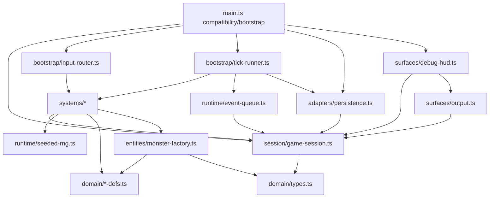

# Ventralis architecture audit and migration plan

Recommendation: use a small explicit `GameSession` aggregate with thin domain systems, not a general ECS. The game has one player and one ordered monster list; ECS adds indirection without solving the important boundaries. Preserve the observable API through a compatibility façade in `main.ts` (<80 lines).

`tests/characterization.test.ts` is the acceptance oracle and must not be edited.

## 1. State map

| Binding | Classification | Proposed owner |
|---|---|---|
| `tickCount` | Proposed Component data | `SessionState.tickCount` |
| `hp` | Proposed Component data | `PlayerState.hp` |
| `maxHp` | Proposed Component data | `PlayerState.maxHp` |
| `wood` | Proposed Component data — legacy resource mirror | `PlayerState.resourceMirrors.wood` |
| `stone` | Proposed Component data — legacy resource mirror | `PlayerState.resourceMirrors.stone` |
| `inventory` | Proposed Component data | `InventoryState.counts` |
| `equippedWeapon` | Proposed Component data | `PlayerState.equippedWeapon` |
| `attackBonus` | Proposed Component data | `PlayerState.attackBonus` |
| `torchBuffTicks` | Proposed Component data | `PlayerState.torchBuffTicks` |
| `alive` | Proposed Component data | `PlayerState.alive` |
| `log` | Retained runtime/session state | `GameSession.log` |
| `worldRef` | Retained runtime/session state | `GameSession.world` host reference |
| `rngState` | Retained runtime/session state | seeded `RandomSource` |
| `pendingEvents` | Retained runtime/session state | `EventQueue` |
| `saveCounter` | Retained runtime/session state | `PersistenceState.saveCounter` |
| exported `monsters` array | Proposed Component data | `GameSession.monsters: MonsterInstance[]` |

No module-level binding is dead. `wood`/`stone` appear redundant with inventory, but are intentionally divergent compatibility data.

## 2. Function map

| Function | Destination |
|---|---|
| `lcgNext`, `rollInt` | `runtime/seeded-rng.ts` |
| `say` | `runtime/log.ts` |
| `emit`, `emitPanel` | `surfaces/output.ts` / HUD adapter |
| `totalWeight`, `carryCapacity`, `canCarry` | `systems/inventory-system.ts` |
| `attackRoll` | `systems/combat-system.ts` |
| `pickup` | `systems/inventory-system.ts` |
| `craft` | `systems/crafting-system.ts` |
| `consumeRation` | `systems/consumption-system.ts` |
| `equip` | `systems/equipment-system.ts` |
| `spawnMonster` | `entities/monster-factory.ts` |
| `attack` | `systems/combat-system.ts` |
| `schedule` | `runtime/event-queue.ts` |
| `onKey` | retained bootstrap/input router |
| `tick` | retained bootstrap/tick orchestrator |
| `runTicks` | retained API façade |
| `decideUseStorage`, `persist` | `adapters/persistence.ts` |
| `snapshot`, `restore` | `adapters/persistence.ts` with serializer/rehydrator |
| `debugDump` | `surfaces/debug-hud.ts` |
| `resetGame`, `initGame` | retained bootstrap/session lifecycle |
| exported `gameLoop`, `keys`, `api`, `api.state` getters | retained compatibility façade in `main.ts` |

Types and immutable data move to `domain/types.ts`, `domain/item-defs.ts`, `domain/recipes.ts`, and `domain/monster-defs.ts`.

## 3. Side effects and dependencies

| Function | State reads/writes | Output/log/storage/RNG |
|---|---|---|
| `lcgNext` | writes `rngState` | consumes RNG |
| `rollInt` | indirect `rngState` | consumes RNG |
| `say` | reads `tickCount`; writes `log` | log append |
| `emit` | reads `worldRef` | appends text output |
| `emitPanel` | reads `worldRef`, debug state | appends panel output |
| `totalWeight` | reads `inventory`, `ITEM_DEFS` | none |
| `carryCapacity` | reads `inventory.torch` | none |
| `canCarry` | reads inventory/item definitions | none |
| `attackRoll` | reads `attackBonus`, `torchBuffTicks` | consumes RNG |
| `pickup` | reads `alive`; writes mirrors/inventory | log + text output |
| `craft` | reads `alive`, recipe, inventory; writes inventory, `wood`, buff, bonus | log + text output |
| `consumeRation` | reads `alive`, inventory, hp/maxHp; writes inventory/hp | log + text output |
| `equip` | reads `alive`, inventory; writes weapon | log + text output |
| `spawnMonster` | reads definitions; writes `monsters` | log append |
| `attack` | reads `alive`, monsters, bonus/buff; writes monsters, stone mirror, inventory | log + text output; RNG |
| `schedule` | writes `pendingEvents` | none |
| `onKey` | reads `alive`, weapon, inventory | delegates; KeyH emits panel then may log/output |
| `tick` | writes tick/hp/alive/buff/events/monsters/save counter indirectly | logs, outputs, RNG, storage attempt |
| `runTicks` | delegates to tick | inherits tick effects |
| `decideUseStorage` | reads `worldRef.storage` | storage read |
| `persist` | reads world, tick/save state; writes `saveCounter` | storage write, gated by storage read |
| `snapshot` | reads all serialised gameplay state | none |
| `restore` | writes serialised gameplay state and monsters | JSON parse; log append |
| `debugDump` | reads gameplay/event/save state | string construction only |
| `resetGame` | writes all resettable state except `worldRef` | none |
| `initGame` | writes `worldRef`; may restore | storage read, log append |
| API state getters | read selected session state | none |

## 4. Ownership and mutation boundaries

`GameSession` owns gameplay state, log, monster list, and the injected runtime ports. `EventQueue` owns scheduled events as an ordered session service. `PersistenceAdapter` owns JSON/storage mechanics and receives a snapshot; it does not own game state. `Clock` remains an injected host capability, although it is currently unused. `SeededRandomSource` owns RNG state and exposes `next()`/`int()`.

Choose controlled direct mutation: systems receive one typed `GameSession` plus narrow ports, mutate only the state they own, and return `void`. This best preserves load-bearing intra-tick ordering, exact log/output order, RNG-consumption order, and mutable exported-monster compatibility. Commands would add dispatch/reduction ordering risk with no current need for replay, concurrency, or multi-entity scheduling.

## 5. Not-ECS list

- Persistence boundary: adapter/serializer, not a component or system; it crosses host storage and has save-key gating.
- Debug/HUD surface: a projection of session state, not domain state; panel ordering is observable.
- Scheduled-event queue: ordered temporal control structure, not an entity/component collection.
- Seeded RNG: runtime service; consuming it is an ordered side effect, not entity data.
- `World` host port: injected environment, not a component.
- Log/output: append-only observability channels; preserve ordering, but do not turn messages into entities.
- Static definitions/recipes: immutable catalog data, not runtime components.
- `main.ts` API compatibility: bootstrap boundary, not a gameplay system.

## 6. Hidden-coupling register

| Coupling to preserve | Evidence |
|---|---|
| Resource mirrors double-account with inventory: pickup increments both only for wood/stone. | `src/main.ts:162-164` |
| Torch craft consumes inventory but deliberately leaves mirrors drifted; it also grants permanent `attackBonus` and a 30-tick buff. | `src/main.ts:186-193` |
| Ration craft secretly decrements mirror wood, does not decrement mirror stone. | `src/main.ts:195-201` |
| Monster death adds two stone to both mirror and inventory. | `src/main.ts:251-255` |
| Ration healing includes current torch count. | `src/main.ts:212-214` |
| Combat result depends on exact RNG stream order plus bonus and temporary torch buff. | `src/main.ts:143-148`, `src/main.ts:246` |
| Wandering spawn consumes RNG only if tick is divisible by 20 and current log length is even. | `src/main.ts:345-348` |
| Tick phase order is semantic: survival, buff decay, events, monster round, spawn, then save. | `src/main.ts:303-353` |
| Event removal is exact-tick only; past-due events remain queued. | `src/main.ts:319-329` |
| Periodic saves occur only when a save key already exists; no key means no write and no counter bump. | `src/main.ts:364-374`, `src/main.ts:350-353` |
| Snapshot omits pending events and `saveCounter`; restore correspondingly does not restore them. | `src/main.ts:377-395`, `src/main.ts:397-413` |
| Restore appends “save restored” after loading, affecting future log-length-based spawning. | `src/main.ts:409-413` |
| `resetGame` does not clear `worldRef`; output can remain connected until `initGame` overwrites it. | `src/main.ts:441-460` |
| `initGame` logs after restore, creating another log entry without output. | `src/main.ts:459-465` |
| KeyH emits its pre-equip HUD panel first, then re-equips a torch when fists plus torch inventory are present. | `src/main.ts:279-283` |
| HUD is an exact semicolon string and includes event/save counts but not log/RNG state. | `src/main.ts:420-435` |
| `MonsterInstance.attack` is stored but not used in current monster damage rules. Preserve payload shape. | `src/main.ts:291-297`, `src/main.ts:331-342` |

## 7. Proposed dependency graph



All arrows point downward toward domain/runtime leaves; no leaf imports `main.ts`, bootstrap, persistence, or debug surfaces.

## 8. Proposed file tree

```text
src/
  main.ts                         # façade/bootstrap, <80 lines
  domain/
    types.ts
    item-defs.ts
    recipes.ts
    monster-defs.ts
  session/
    game-session.ts
    player-state.ts
  entities/
    monster-factory.ts
  systems/
    inventory-system.ts
    crafting-system.ts
    consumption-system.ts
    equipment-system.ts
    combat-system.ts
    survival-system.ts
    monster-system.ts
  runtime/
    seeded-rng.ts
    event-queue.ts
    log.ts
  adapters/
    persistence.ts
  surfaces/
    output.ts
    debug-hud.ts
  bootstrap/
    input-router.ts
    tick-runner.ts
```

Keep every migrated file under 120 lines. Split a system further if preservation comments/contracts exceed that budget.

## 9. Migration order

1. Freeze baseline and run characterization/typecheck; add no test changes.
2. Extract only types and immutable definitions; preserve imports and behavior.
3. Introduce `GameSession` as a structural container while keeping `main.ts` as the sole implementation caller.
4. Extract log/output, seeded RNG, and event queue without changing call sequence.
5. Extract inventory, crafting, consumption, and equipment systems one at a time; run the suite after each extraction.
6. Extract monster factory, combat, survival, and monster-round systems, retaining tick phase order verbatim.
7. Extract snapshot/restore/persistence; explicitly retain omitted event/save fields and storage-key gating.
8. Extract debug/HUD and input router, preserving KeyH panel-before-equip behavior.
9. Reduce `main.ts` to compatibility façade and bootstrap; rerun all acceptance checks after every slice.

## 10. Risk and verification plan

A later implementer should run unchanged `tests/characterization.test.ts` after each migration slice, then `pnpm run typecheck`, `pnpm run test`, `git diff --check`, and targeted manual traces for:

- seed 7 attack rolls and an eligible tick-20 spawn;
- torch/ration mirror drift, bonus, buff, and secret wood cost;
- monster double-stone drop;
- exact event tick/death ordering;
- no-key versus pre-existing-key periodic persistence;
- snapshot/restore field omissions and post-restore log effects;
- KeyH panel-before-re-equip output ordering.

Abandon ECS for a concern when preserving ordered side effects requires entity-query machinery, deferred command flushing, or component indirection that obscures exact legacy ordering. Persistence, HUD, RNG, event scheduling, and host integration already meet that threshold and should remain explicit services/adapters.

## Handoff

- Model/provider: Codex / OpenAI (GPT-5 family); session/thread ID not visible.
- Attempts: 1.
- Repairs: none.
- Changed paths: none.
- Scope drift: none; no files created, edited, renamed, formatted, or deleted.
- Initial failures: none.
- Remaining blockers: none.

Verification results:

| Command | Exit code | Result |
|---|---:|---|
| `git status --short` | 0 | Empty output; no changes under `src/` or `tests/`. |
| `git diff --check` | 0 | Empty output; clean. |
| `pnpm run test` | 0 | 1 test file passed; 21 tests passed. |
| `pnpm run typecheck` | 0 | Passed (`tsc -p tsconfig.json --noEmit`). |