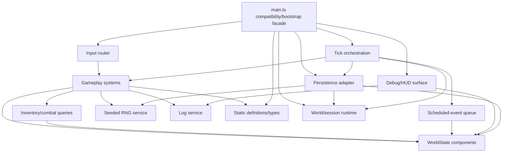

# B4-A0 — Ventralis Monolith Architecture Audit

## 1. State map

Comparison route: same owner rubric and characterization suite; candidate route is a modular hybrid architecture, not ECS-only.

| Current binding | Classification after migration | Notes |
|---|---|---|
| `tickCount` | Component data | `TimeState`; serialized/restored. |
| `hp` | Component data | `HealthState`; serialized/restored. |
| `maxHp` | Component data | `HealthState`; serialized/restored. |
| `wood` | Component data | Retain as legacy resource mirror; must remain distinct from inventory. |
| `stone` | Component data | Retain as legacy resource mirror; must preserve double-drop behavior. |
| `inventory` | Component data | `InventoryState`; authoritative for carry/crafting checks. |
| `equippedWeapon` | Component data | `EquipmentState`; serialized/restored. |
| `attackBonus` | Component data | Combat modifier; crafting torch mutates it. |
| `torchBuffTicks` | Component data | Temporary combat modifier; serialized/restored. |
| `alive` | Component data | `LifeState`; gates actions. |
| `log` | Component data | Event/history state; log length affects spawning and must remain serialized. |
| `worldRef` | Retained runtime state | Session/runtime adapter reference; never serialized. |
| `rngState` | Retained runtime state | Seeded random-source state; serialized/restored for replay. |
| `pendingEvents` | Retained runtime state | Scheduled-event queue owned by runtime scheduler; not a component. |
| `saveCounter` | Retained runtime state | Persistence bookkeeping; displayed and written into save payload, but not gameplay component data. |
| exported `monsters` array | Component data | `MonsterState`; externally exposed for compatibility and serialized/restored. |

Derived-on-read values are `totalWeight`, `carryCapacity`, and the formatted debug dump. No current binding is dead/redundant. The apparent no-op mutations (`wood -= 0`, `inventory.stone -= 0`, etc.) are retained as compatibility markers and must not be “cleaned up” without characterization proof.

## 2. Function map

| Function | Proposed destination |
|---|---|
| `lcgNext` | Seeded RNG runtime service |
| `rollInt` | RNG service |
| `say` | Log/event service |
| `emit` | Debug/output surface adapter |
| `emitPanel` | Debug/HUD surface |
| `totalWeight` | Inventory/encumbrance query module |
| `carryCapacity` | Inventory/encumbrance query module |
| `canCarry` | Inventory/encumbrance query module |
| `attackRoll` | Combat system using injected RNG |
| `pickup` | Gathering/inventory system |
| `craft` | Crafting system |
| `consumeRation` | Consumable system |
| `equip` | Equipment system |
| `spawnMonster` | Monster entity factory plus monster state registration |
| `attack` | Combat system |
| `schedule` | Runtime event-queue service |
| `onKey` | Input/router system |
| `tick` | Tick orchestration system |
| `runTicks` | Retained bootstrap/runtime facade |
| `decideUseStorage` | Persistence adapter policy |
| `persist` | Persistence adapter |
| `snapshot` | Persistence serializer |
| `restore` | Persistence deserializer |
| `debugDump` | Debug/HUD presenter |
| `resetGame` | Retained bootstrap/session reset |
| `initGame` | Retained bootstrap |
| `gameLoop` export | Bootstrap facade export |
| `keys` export | Input facade export |
| `api` export | Compatibility facade |

Static definitions should move to type/data modules: item definitions, recipes, monster definitions, and public interfaces.

## 3. Side effects and dependencies

| Function | Reads | Writes | Output/storage | RNG/log coupling |
|---|---|---|---|---|
| `lcgNext` | `rngState` | `rngState` | None | RNG state mutation |
| `rollInt` | RNG service | RNG state indirectly | None | Consumes one RNG value |
| `say` | `tickCount` | `log` | None | Log length affects later spawn |
| `emit` | `worldRef` | `world.output` | Emits text | No RNG; runtime coupling |
| `emitPanel` | all debug state | `world.output` | Emits panel | Reads `debugDump` |
| `totalWeight` | `inventory`, item definitions | None | None | Derived |
| `carryCapacity` | `inventory.torch` | None | None | Derived |
| `canCarry` | inventory queries | None | None | Derived |
| `attackRoll` | equipment modifiers, RNG | RNG state indirectly | None | Combat/RNG coupling |
| `pickup` | alive, inventory, capacity | mirrors, inventory, log | Text output | Log/output |
| `craft` | recipes, inventory, capacity, alive | inventory, mirrors, torch buff, attack bonus, log | Text output | Secret resource side effects |
| `consumeRation` | alive, inventory, torch count, HP | inventory, HP, log | Text output | No RNG |
| `equip` | alive, inventory | equipped weapon, log | Text output | No RNG |
| `spawnMonster` | monster definitions | `monsters`, log | None | Log coupling |
| `attack` | alive, monsters, combat state | monsters, stone mirror, inventory, log | Text output | RNG consumption order |
| `schedule` | None | pending queue | None | Queue ownership |
| `onKey` | alive, equipment, inventory | Delegates to systems | Panel/text output | KeyH has re-equip side effect |
| `tick` | all runtime/component state | time, HP, buffs, queue, monsters, saves | Event output/storage | Ordering, log-length spawn, RNG |
| `runTicks` | None directly | Delegates to `tick` | Indirect | Tick ordering |
| `decideUseStorage` | `worldRef.storage` | None | None | Gates all periodic saves |
| `persist` | snapshot data, world, tick | save counter, storage | Storage write | Save bookkeeping |
| `snapshot` | nearly every component plus RNG/monsters | None | Returns serialized state | Persistence surface |
| `restore` | serialized payload | nearly every component plus monsters/RNG | Log entry | Restore mutates global state |
| `debugDump` | all displayed state | None | Returns HUD string | Exact formatting is observable |
| `resetGame` | seed | all resettable state | None | Resets RNG and monsters |
| `initGame` | world storage | session reference, restored state, log | Potential restore | Persistence boundary |
| exported facades | delegated state | delegated state | Compatibility API | Public contract |

## 4. Ownership and mutation boundaries

- The `WorldState` aggregate owns gameplay state: time, health, resources, inventory, equipment, buffs, life, log, and monsters.
- A runtime session owns the active `World` reference, clock, output sink, and seeded RNG service.
- The scheduler owns `pendingEvents`; scheduled events remain a runtime service concern rather than ECS entities.
- The persistence adapter owns storage access, save gating, serialization, restoration, and `saveCounter`.
- The debug surface owns formatting and output emission, but receives read-only state queries.
- Systems use controlled direct mutation through a single `WorldState`/session context. Returned command objects would add indirection without solving this small synchronous loop and would risk changing mutation order. Systems must nevertheless be isolated by ownership: no system may mutate persistence or debug internals directly.
- Tick orchestration preserves the exact current order: drain, buff decay, events, monster round, spawn, save.

## 5. Not-ECS list

- Persistence boundary: storage availability, save-key gating, JSON format, `savedAtTick`, and `saveCounter` are infrastructure policy, not gameplay entities.
- Debug/HUD surface: formatting and output emission are presentation concerns. The exact `debugDump` string remains a compatibility view.
- Scheduled-event queue: it is a time-indexed runtime service with execution ordering and filtering semantics, not durable entity state.
- Seeded RNG: it is an injected deterministic service. Treating RNG state as an entity component would obscure consumption order and make replay guarantees harder to reason about.
- Input routing: keyboard codes are an adapter concern; they should dispatch commands to systems.
- Static definitions and recipes: immutable data tables, not components.
- Clock/world adapter: external runtime dependency, not gameplay state.

## 6. Hidden-coupling register

| Coupling | Evidence | Preservation rule |
|---|---|---|
| Resource mirrors and inventory are double-accounted | `src/main.ts:155-167`, `169-203` | Pickup increments both; crafting generally consumes inventory but preserves mirror drift. |
| Torch craft changes unrelated combat state | `src/main.ts:189-197` | Preserve `attackBonus += 1` and `torchBuffTicks = 30`. |
| Ration craft secretly consumes mirror wood | `src/main.ts:198-203` | Preserve `wood -= 1`; mirror stone remains unchanged. |
| Monster kill double-drops stone | `src/main.ts:250-254` | Preserve both `stone += 2` and `inventory.stone += 2`. |
| RNG consumption order is observable | `src/main.ts:92-99`, `143-151`, `345-348` | One deterministic stream; do not add/reorder calls. Save/restore RNG state. |
| Log length affects spawn | `src/main.ts:345-348` | Preserve `log.length % 2 === 0` gate and all logging timing. |
| Periodic saves are gated by existing storage key | `src/main.ts:351-353`, `364-375` | Preserve `decideUseStorage`; no save key means tick-10 is a no-op. |
| `saveCounter` is runtime bookkeeping but observable | `src/main.ts:369-375`, `420-436` | Preserve increments, serialized `saveCounter`, and HUD display. |
| Snapshot/restore touch nearly all state | `src/main.ts:377-417` | Maintain field coverage and restore order, including monsters and RNG. |
| KeyH re-equips torch after panel emission | `src/main.ts:271-286` | Preserve panel-first output followed by `equip("torch")`. |
| Tick ordering affects death and output | `src/main.ts:303-354` | Preserve all six phases and their exact ordering. |
| Torch count affects healing | `src/main.ts:205-217` | Preserve `15 + inventory.torch`. |
| Carry capacity depends on torch count | `src/main.ts:126-141` | Preserve dynamic capacity `20 + inventory.torch * 2`. |
| Dead state blocks all actions | `src/main.ts:155`, `205`, `219`, `238`, `271` | Preserve early returns and no-output behavior where currently present. |
| Stalker death message differs from event/starvation death | `src/main.ts:329-340` | Preserve message and timing. |
| `worldRef` is shared by output and persistence | `src/main.ts:109-120`, `364-375`, `459-465` | Replace with one injected session context, not duplicated adapters. |

## 7. Proposed dependency graph



All arrows point from consumers to dependencies; there are no cycles. `main.ts` depends on both persistence and debug surfaces through facades, while those surfaces do not depend on `main.ts`.

## 8. Proposed file tree

Every migrated file should remain below 120 lines, with `main.ts` below approximately 80 lines.

```text
src/
  main.ts                  # compatibility exports/bootstrap, <=80 lines
  domain/
    types.ts               # public types and state interfaces
    definitions.ts         # item, recipe, monster constants
    state.ts               # WorldState and session state
  systems/
    pickup.ts
    crafting.ts
    consumables.ts
    equipment.ts
    combat.ts
    monsters.ts
    tick.ts
    input.ts
  runtime/
    session.ts
    scheduler.ts
    rng.ts
    clock.ts
  persistence/
    adapter.ts
    snapshot.ts
    restore.ts
  debug/
    dump.ts
    output.ts
  queries/
    inventory.ts
    combat.ts
```

## 9. Migration order

1. Freeze the current characterization baseline and record the 21-test green result. Do not edit `tests/characterization.test.ts`; it remains the acceptance oracle.
2. Extract type definitions and immutable tables without changing imports or behavior. Run tests and typecheck.
3. Introduce a `WorldState` container while keeping compatibility bindings in `main.ts`. Run tests.
4. Extract pure queries: weight, capacity, carry checks. Run tests.
5. Extract RNG and log services with identical call order and mutation semantics. Run tests.
6. Extract inventory/pickup, crafting, consumable, and equipment systems. Preserve mirror drift, secret wood consumption, torch effects, and output order. Run tests after each system.
7. Extract monster factory and combat system. Preserve RNG sequence and double stone drop. Run tests.
8. Extract scheduler and tick orchestration. Preserve exact six-phase order. Run tests.
9. Extract persistence serialization, restoration, storage gating, and save counter. Run tests, especially restore and tick-10 cases.
10. Extract debug/HUD formatting and output adapters. Preserve exact dump string and KeyH panel-before-re-equip ordering. Run tests.
11. Reduce `main.ts` to bootstrap and compatibility exports; verify line budgets.
12. Run final typecheck, characterization suite, `git diff --check`, and inspect status. Tests remain unedited throughout.

## 10. Risk and verification plan

The later implementation must use `tests/characterization.test.ts` as the acceptance oracle and must not edit it. Verification should include:

- Run the full characterization suite after every migration slice.
- Compare exact `api.dump()` strings, output-array ordering, log messages, storage payloads, save counters, and RNG-derived rolls.
- Add temporary non-committed diagnostic comparisons only outside the repository’s tracked source/test scope if needed; remove them before handoff.
- Confirm snapshot/restore round trips every serialized field, including RNG and monsters.
- Confirm no new RNG calls are introduced and no existing calls are reordered.
- Confirm line budgets and acyclic imports with typecheck and static inspection.
- Treat any failure involving output ordering, log length, save gating, mirror counters, KeyH behavior, or RNG values as a compatibility regression, not an opportunity to “fix” legacy behavior.

Abandon ECS for a concern when entity/component representation makes ownership less clear, changes mutation ordering, introduces extra allocations or indirection that alter observable behavior, or cannot preserve deterministic RNG, persistence, and scheduler semantics without infrastructure-specific exceptions. The proposed hybrid already rejects ECS treatment for persistence, debug output, scheduling, RNG, input, and static definitions.

## Handoff and verification

- Model/provider: GPT-5 / OpenAI Codex API agent.
- Session/thread ID: not exposed in this environment.
- Attempts: 1.
- Repairs: none required.
- Changed paths: none.
- Scope drift: none.
- Initial failures: none observed.
- Remaining blockers: none for the audit. Baseline metadata note: `git rev-parse HEAD` and `git rev-parse master` differed; no history was altered.

Verification results:

| Command | Exit code | Result |
|---|---:|---|
| `git status --short` | 0 | Clean; no output |
| `git diff --check` | 0 | Clean |
| `pnpm run test` | 0 | 21 tests passed |
| `pnpm run typecheck` | 0 | TypeScript check passed |

