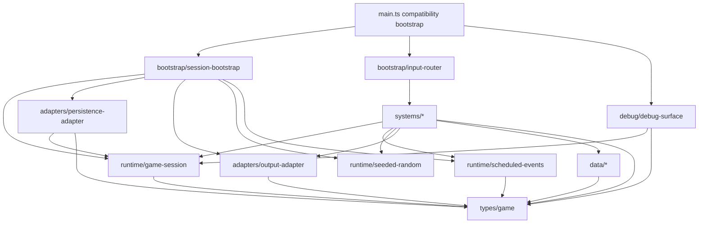

# Ventralis monolith architecture audit

Route: judgment/audit slice, B4 first candidate.  
Comparison route: both candidate arms are evaluated against the same owner rubric and the unchanged `tests/characterization.test.ts` oracle.

Recommendation: use a constrained hybrid, not pure ECS. Put player/monster gameplay state in typed component records; keep persistence, output/HUD, clock, seeded RNG, and scheduled-event timing as explicit runtime services. This preserves the owner’s isolation and line-budget goals without forcing unsuitable infrastructure concerns into ECS.

## 1. State map

| Module binding | Classification | Proposed owner |
|---|---|---|
| `tickCount` | Retained runtime state (world/session) | `GameSession.tick` |
| `hp` | Proposed Component data | `PlayerVitals.hp` |
| `maxHp` | Proposed Component data | `PlayerVitals.maxHp` |
| `wood` | Proposed Component data | `LegacyResourceMirror.wood` |
| `stone` | Proposed Component data | `LegacyResourceMirror.stone` |
| `inventory` | Proposed Component data | `Inventory.counts` |
| `equippedWeapon` | Proposed Component data | `Equipment.weapon` |
| `attackBonus` | Proposed Component data | `CombatStats.attackBonus` |
| `torchBuffTicks` | Proposed Component data | `TorchEffect.remainingTicks` |
| `alive` | Proposed Component data | `LifeState.alive` |
| `log` | Retained runtime state (world/session) | `GameSession.log` |
| `worldRef` | Retained runtime state (world/session) | bootstrap-owned `RuntimeServices.world` |
| `rngState` | Retained runtime state (world/session) | injected `SeededRandom` service |
| `pendingEvents` | Retained runtime state (world/session) | `ScheduledEventQueue` |
| `saveCounter` | Retained runtime state (world/session) | persistence runtime/session metadata |
| exported `monsters` array | Proposed Component data | entities with `MonsterIdentity` and `MonsterVitals`; preserve a compatibility projection if export identity is observable |

No binding is dead/redundant. In particular, the mirror counters look redundant but are deliberate observable legacy state.

## 2. Function map

| Function | Destination |
|---|---|
| `lcgNext` | `runtime/seeded-random.ts` |
| `rollInt` | `runtime/seeded-random.ts` |
| `say` | `runtime/game-log.ts` |
| `emit` | `adapters/output-adapter.ts` |
| `emitPanel` | `debug/hud.ts` |
| `totalWeight` | `systems/inventory-system.ts` |
| `carryCapacity` | `systems/inventory-system.ts` |
| `canCarry` | `systems/inventory-system.ts` |
| `attackRoll` | `systems/combat-system.ts` |
| `pickup` | `systems/inventory-system.ts` |
| `craft` | `systems/crafting-system.ts` |
| `consumeRation` | `systems/survival-system.ts` |
| `equip` | `systems/equipment-system.ts` |
| `spawnMonster` | `entities/monster-factory.ts` |
| `attack` | `systems/combat-system.ts` |
| `schedule` | `runtime/scheduled-events.ts` |
| `onKey` | `bootstrap/input-router.ts` |
| `tick` | `systems/tick-system.ts` coordinator |
| `runTicks` | retained bootstrap/API façade |
| `decideUseStorage` | `adapters/persistence-adapter.ts` |
| `persist` | `adapters/persistence-adapter.ts` |
| `snapshot` | `adapters/save-codec.ts` |
| `restore` | `adapters/save-codec.ts` |
| `debugDump` | `debug/debug-surface.ts` |
| `resetGame` | retained bootstrap/API façade |
| `initGame` | retained bootstrap/API façade |

Static types and definitions move to `types/game.ts`, `data/item-defs.ts`, `data/recipes.ts`, and `data/monster-defs.ts`.

## 3. Side effects and dependencies

| Function | Reads globals | Writes globals | External effects / coupling |
|---|---|---|---|
| `lcgNext` | `rngState` | `rngState` | consumes deterministic RNG state |
| `rollInt` | RNG via `lcgNext` | RNG via `lcgNext` | one RNG draw |
| `say` | `tickCount` | `log` | appends log |
| `emit` | `worldRef` | `worldRef.output` | text output |
| `emitPanel` | `worldRef`, debug state | `worldRef.output` | panel output; calls dump |
| `totalWeight` | `inventory`, `ITEM_DEFS` | — | — |
| `carryCapacity` | `inventory.torch` | — | — |
| `canCarry` | inventory/definitions through helpers | — | — |
| `attackRoll` | `attackBonus`, `torchBuffTicks` | RNG state | consumes RNG |
| `pickup` | `alive`, inventory, mirror counters | inventory, `wood`/`stone`, log | emits text |
| `craft` | `alive`, recipes, inventory, mirror counters | inventory, `wood`, `attackBonus`, `torchBuffTicks`, log | emits text |
| `consumeRation` | `alive`, inventory, `hp`, `maxHp` | inventory, `hp`, log | emits text |
| `equip` | `alive`, inventory | `equippedWeapon`, log | emits text |
| `spawnMonster` | monster definitions | `monsters`, log | — |
| `attack` | `alive`, monsters, combat stats, monster definitions | monsters, `stone`, inventory, log, RNG | emits text |
| `schedule` | — | `pendingEvents` | — |
| `onKey` | `alive`, equipment, inventory | delegated action mutations | KeyH panel output then possible re-equip output |
| `tick` | all survival/event/combat/spawn/persistence state | tick, hp, alive, buff, events, monsters, log, RNG, save counter/storage | event output, RNG spawn, periodic storage write |
| `runTicks` | — | delegated tick mutations | repeated ticks |
| `decideUseStorage` | `worldRef` | — | reads storage key |
| `persist` | `tickCount`, `saveCounter`, storage gate | `saveCounter`, storage | JSON storage write |
| `snapshot` | all save fields including monsters/RNG/log | — | copies state |
| `restore` | raw JSON | all save fields except events/world/saveCounter; clears/refills monsters; appends log | JSON parse |
| `debugDump` | gameplay state, event queue, save counter | — | textual debug/HUD contract |
| `resetGame` | — | session/gameplay state, monsters, RNG | notably leaves `worldRef` intact |
| `initGame` | `worldRef`, storage | `worldRef`, restored state, log | optional storage read/restore |

## 4. Ownership and mutation boundaries

`GameSession` owns all gameplay records, tick count, log, monster entities, and save counter. It receives immutable runtime services at initialization.

- The event queue is owned by `ScheduledEventQueue`, injected into the tick system.
- The persistence adapter owns storage protocol decisions and serialization I/O; it does not own gameplay state.
- The clock remains a `World` capability. It is currently unused and should stay injected rather than fabricated into a component.
- `SeededRandom` owns `rngState`; exactly one service instance exists per session/reset.
- Systems use controlled direct mutation through a narrow `MutableGameState` interface, rather than returned commands. The existing behavior depends on precise intra-tick ordering, immediate logs/output, and exact RNG consumption; a command queue would add ordering/flush semantics that are unnecessary migration risk.
- `main.ts` becomes a compatibility/bootstrap façade under ~80 lines: create session/services, export current API names, and route calls into modules.

## 5. Not-ECS list

- Persistence boundary: not a component/system. It is an I/O adapter with storage existence gating and a versionless legacy wire format.
- Debug/HUD surface: not gameplay state. It is a read-only formatter whose exact string and panel ordering are observable.
- Scheduled-event queue: retain as a session runtime service, not entity components. Events are temporal commands keyed by tick, not enduring entity attributes.
- Seeded RNG: retain as an injected service, not a component. Its draw sequence is globally load-bearing.
- Output transport: adapter, not component. The `World.output` array is an external observable sink.
- `World.canvas` and `World.clock`: runtime platform capabilities; neither is currently gameplay component data.

## 6. Hidden-coupling register

| Coupling to preserve | Evidence |
|---|---|
| Mirror counters and inventory are separately mutated; crafting intentionally drifts them. | `src/main.ts:161-162`, `185-200`; characterization tests “torch consumes inventory only” and “ration secretly eats one mirror wood.” |
| Torch crafting permanently raises attack bonus and starts a decaying buff. | `src/main.ts:190-192`; combat reads both at `143-150`. |
| Ration craft secretly consumes mirror wood but not mirror stone. | `src/main.ts:195-199`. |
| Monster death gives two stone to both mirror and bag. | `src/main.ts:253-254`. |
| Attack and wandering spawns share one LCG; any added/reordered roll changes replay behavior. | `src/main.ts:92-98`, `143-150`, `347-348`. |
| Spawn eligibility depends on log parity, so seemingly cosmetic logs alter entity creation and subsequent play. | `src/main.ts:346-348`. |
| Periodic saves only occur when the save key already exists. | `src/main.ts:351-352`, `364-374`. |
| Snapshots omit `pendingEvents` and `saveCounter`; restore also does not restore either. | `src/main.ts:377-394`, `397-417`. This omission must remain unless the owner explicitly approves a save-format change. |
| Restore appends “save restored” after loading log, changing log parity and therefore later spawn eligibility. | `src/main.ts:414-416`, `346-348`. |
| KeyH emits the panel before re-equipping a torch from fists, so its panel retains `weapon=fists`. | `src/main.ts:277-281`; pinned by the KeyH test. |
| `resetGame` intentionally does not reset `worldRef`; output routing survives resets until `initGame` replaces it. | `src/main.ts:441-457`. |
| Event due matching is exact equality, and events are removed after processing; overdue events never fire. | `src/main.ts:318-331`. |
| Crawler damage can reduce hp below zero without setting `alive=false`; only stalker/event/starvation paths check death. | `src/main.ts:333-342`. Preserve unless tests/owner redefine it. |
| HUD and persistence have different visibility: HUD includes events/saves, snapshot includes log/monsters/RNG but excludes events/saves/world. | `src/main.ts:377-394`, `420-437`. |
| `emitPanel` calls `debugDump` at emission time, not a supplied snapshot. | `src/main.ts:114-120`. |

## 7. Proposed dependency graph



The graph is acyclic: dependencies point inward toward types/session primitives; neither adapters nor debug import `main.ts`.

## 8. Proposed file tree

```text
src/
  main.ts                         # compatibility façade, target <80 lines
  types/
    game.ts
    components.ts
    runtime.ts
  data/
    item-defs.ts
    recipes.ts
    monster-defs.ts
  runtime/
    game-session.ts
    seeded-random.ts
    scheduled-events.ts
    game-log.ts
  entities/
    player-factory.ts
    monster-factory.ts
  systems/
    inventory-system.ts
    crafting-system.ts
    equipment-system.ts
    combat-system.ts
    survival-system.ts
    tick-system.ts
  adapters/
    output-adapter.ts
    persistence-adapter.ts
    save-codec.ts
  debug/
    debug-surface.ts
    hud.ts
  bootstrap/
    session-bootstrap.ts
    input-router.ts
```

Each module should remain below 120 lines; split codec types or tick phases further if needed rather than relaxing the budget.

## 9. Migration order

1. Add types/data modules with no behavior change; retain façade exports.
2. Introduce `GameSession` as a structural home for existing state while preserving the exported monster-array compatibility behavior.
3. Extract deterministic RNG and log helpers; run characterization suite.
4. Extract inventory, crafting, equipment, combat, and monster factory one at a time; run suite after every extraction.
5. Extract scheduled-event and survival/tick phases while retaining exact phase order.
6. Extract save codec/persistence adapter, preserving field omissions, key-existence gating, and restore logging.
7. Extract debug/HUD and input router, preserving KeyH output order.
8. Reduce `main.ts` to bootstrap/API forwarding façade; typecheck and run the unchanged characterization suite after each slice.

## 10. Risk and verification plan

`tests/characterization.test.ts` is the acceptance oracle and must not be edited. A later implementation must preserve its 21 current assertions and add no test edits as a substitute for behavior preservation.

For each migration slice:

- Run `pnpm run test` and `pnpm run typecheck`.
- Compare `api.dump()`, `api.snapshot()`, storage payloads, output order, and state after fixed input/tick scripts against the baseline implementation.
- Use fixed seeds and explicitly test RNG draw order around attacks and tick-20 spawning.
- Exercise persistence both with absent and preexisting save keys.
- Check restore’s log append and omitted event/save-counter fields.
- Keep legacy quirks as golden behavior: mirror drift, secret ration wood cost, permanent torch attack bonus, double stone drops, KeyH re-equip, log-parity spawning.

Abandon ECS for a concern if the concern is fundamentally singleton/session-scoped, externally effectful, or requires cross-system ordering that cannot be represented without leaking service internals. That applies here to persistence, output/debug, RNG, event queue, and bootstrap; they should remain explicit runtime services.

## Verification and handoff

- Model/provider: Codex / OpenAI.
- Session/thread ID: not visible in this environment.
- Attempts: 1.
- Repairs: none.
- Changed paths: none.
- Scope drift: none; no files created, edited, renamed, formatted, deleted, committed, reset, stashed, or cleaned.
- Initial failures: none.
- Remaining blockers: none.
- Baseline observation: `HEAD` was `727609cc0975c839c7a99ee6392d384cfc0be98e`; local `master` was `db804e1a188134210f1884cc850a42ecc37e7250`. Per operator authorization, HEAD was treated as authoritative.

| Verification command | Result |
|---|---|
| `git status --short` | Exit 0; no output (clean) |
| `git diff --check` | Exit 0; no output |
| `pnpm run test` | Exit 0; 1 test file passed, 21 tests passed |
| `pnpm run typecheck` | Exit 0; `tsc -p tsconfig.json --noEmit` completed cleanly |
| Final `git status --short` | Exit 0; no output (clean) |
| Final `git diff --check` | Exit 0; no output |