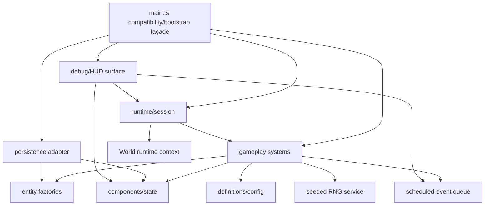

# B4-A0 — Ventralis Monolith Architecture Audit

## 1. State map

| Binding | Classification | Proposed ownership / notes |
|---|---|---|
| `tickCount` | Component data | `TimeState.tick`; serialized and restored. |
| `hp` | Component data | `HealthState.hp`; serialized and restored. |
| `maxHp` | Component data | `HealthState.maxHp`; serialized and restored. |
| `wood` | Component data | Legacy resource-mirror component; preserve separately from inventory. |
| `stone` | Component data | Legacy resource-mirror component; preserve separately from inventory. |
| `inventory` | Component data | `InventoryComponent`; remains distinct from resource mirrors. |
| `equippedWeapon` | Component data | `EquipmentComponent`. |
| `attackBonus` | Component data | `CombatModifierComponent`; crafting mutates it. |
| `torchBuffTicks` | Component data | `BuffComponent`; decays during ticks. |
| `alive` | Component data | `LifeState`. |
| `log` | Component data | `LogState`; log length affects spawning and therefore is behaviorally significant. |
| `worldRef` | Retained runtime state | Runtime session/context reference; not component data. |
| `rngState` | Retained runtime state | Owned by seeded RNG service; serialized for replay. |
| `pendingEvents` | Retained runtime state | Owned by scheduled-event queue service; serialized only if future persistence requires it, otherwise explicitly preserve current omission. |
| `saveCounter` | Retained runtime state | Persistence adapter/session metric; shown by debug output and written to saves, but not restored by `restore`. |
| exported `monsters` | Component data | `MonsterComponent` collection / entity store; preserve exported live-array compatibility or provide an adapter. |

Derived-on-read values include total inventory weight, carry capacity, attack roll, debug dump text, and serialized payload fields such as `savedAtTick`. No binding is dead or redundant: even the apparent no-ops (`wood -= 0`, `stone -= 0`, `inventory[...] -= 0`) document and preserve legacy behavior.

## 2. Function map

| Function | Proposed destination |
|---|---|
| `lcgNext` | Seeded RNG type/service module |
| `rollInt` | Seeded RNG service |
| `say` | Log system / log component adapter |
| `emit` | Output/debug surface adapter |
| `emitPanel` | Debug/HUD surface |
| `totalWeight` | Inventory component query |
| `carryCapacity` | Inventory component query |
| `canCarry` | Inventory system query |
| `attackRoll` | Combat system, using injected RNG |
| `pickup` | Gathering/inventory system |
| `craft` | Crafting system |
| `consumeRation` | Consumption/health system |
| `equip` | Equipment system |
| `spawnMonster` | Monster entity factory plus spawn system |
| `attack` | Combat system |
| `schedule` | Scheduled-event queue adapter |
| `onKey` | Input routing system |
| `tick` | Tick orchestration/bootstrap system |
| `runTicks` | Retained runtime/test façade |
| `decideUseStorage` | Persistence policy adapter |
| `persist` | Persistence adapter |
| `snapshot` | Persistence serialization adapter |
| `restore` | Persistence deserialization adapter |
| `debugDump` | Debug/HUD surface |
| `resetGame` | Runtime/bootstrap lifecycle |
| `initGame` | Runtime/bootstrap lifecycle |
| exported `gameLoop` | Public runtime façade |
| exported `keys` | Public input façade |
| exported `api` | Compatibility façade over systems and adapters |

## 3. Side effects and dependencies

| Function | Reads | Writes / side effects | Output / storage / RNG / logging |
|---|---|---|---|
| `lcgNext` | `rngState` | `rngState` | Consumes deterministic RNG |
| `rollInt` | RNG service | None directly | Consumes RNG |
| `say` | `tickCount` | `log` | Log coupling |
| `emit` | `worldRef` | `world.output` | Text output |
| `emitPanel` | `worldRef`, all debug state | `world.output` | Panel output; calls `debugDump` |
| `totalWeight` | `inventory`, `ITEM_DEFS` | None | None |
| `carryCapacity` | `inventory` | None | None |
| `canCarry` | inventory queries, item definitions | None | None |
| `attackRoll` | equipment modifiers, torch buff | None | Consumes RNG |
| `pickup` | `alive`, inventory, mirrors | inventory, `wood`/`stone` mirrors | Emits and logs |
| `craft` | `alive`, recipes, inventory, mirrors | inventory, `wood`, buffs, `attackBonus` | Emits and logs; preserves secret wood cost |
| `consumeRation` | `alive`, inventory, torch count, health | inventory, `hp` | Emits and logs |
| `equip` | `alive`, inventory | `equippedWeapon` | Emits and logs |
| `spawnMonster` | monster definitions | `monsters` | Logs |
| `attack` | `alive`, monsters, combat state | monster HP/list, stone mirror, inventory | Emits/logs; consumes RNG |
| `schedule` | None | `pendingEvents` | No output |
| `onKey` | `alive`, equipment, inventory | Delegates; may equip on `KeyH` | Panel/output/log through delegates |
| `tick` | all runtime state | tick, HP, alive, buffs, events, monsters, RNG, storage | Event/output/log; RNG spawn; periodic persistence |
| `runTicks` | None directly | Delegates to `tick` | Transitive effects |
| `decideUseStorage` | `worldRef.storage` | None | Controls persistence gating |
| `persist` | world, snapshot, tick, save counter | `saveCounter`, storage | Storage write |
| `snapshot` | Nearly every state binding | None | Serialization surface |
| `restore` | Parsed save | Nearly every persisted binding, monsters, log | Adds restore log entry |
| `debugDump` | All displayed state | None | Debug string; indirectly test-visible |
| `resetGame` | Seed argument | All resettable state, monsters | No output |
| `initGame` | World/storage | `worldRef`, possibly restored state, log | Storage read; no output on normal boot |
| `api.state` getters | Selected state | None | Public observation surface |

## 4. Ownership and mutation boundaries

- `World` owns canvas, storage, clock, and output emission infrastructure.
- A runtime session owns the world reference and lifecycle.
- The ECS-style world owns gameplay component state and monster entities.
- The scheduled-event queue owns pending events and exposes `schedule` plus due-event retrieval.
- The persistence adapter owns storage reads/writes, payload encoding, save counters, and the current `decideUseStorage` gating rule.
- The clock remains an injected runtime dependency. The current tick semantics are driven by explicit `runTicks`; the world clock must not silently replace that behavior.
- The seeded RNG is an injected service with serializable state.

Systems should use controlled direct mutation of their owned components, with narrow system APIs, rather than returning command lists. This preserves the current synchronous ordering and observable intermediate effects, especially output order, RNG consumption order, event ordering, and direct monster-array behavior. Commands could be introduced later at an external boundary, but a command-buffer rewrite would create unnecessary ordering risk.

## 5. Not-ECS list

- Persistence boundary: storage, JSON encoding, save gating, and save counters are infrastructure adapters, not gameplay components or systems.
- Debug/HUD surface: formatting and output projection should read state but must not become gameplay systems or components.
- Scheduled-event queue: it is infrastructure/runtime scheduling. Events may contain data, but queue ownership and due-event ordering should remain outside the component model.
- Seeded RNG: it is a deterministic service/resource. Its internal state is serializable, but random generation itself is not an entity component.
- `World` runtime context: canvas, storage, clock, and output are environment dependencies, not gameplay state.
- Static definitions (`ITEM_DEFS`, recipes, monster definitions): immutable type/configuration modules, not components.
- Public compatibility API: façade layer, not an ECS system.

## 6. Hidden-coupling register

| Coupling | Evidence | Migration requirement |
|---|---|---|
| Resource mirrors and inventory are double-accounted | `src/main.ts:164-166`, `src/main.ts:224-225` | Preserve separate mirror and inventory mutations. |
| Torch crafting mutates combat state | `src/main.ts:168-171` | Preserve `torchBuffTicks = 30` and `attackBonus += 1`. |
| Ration crafting secretly consumes mirror wood | `src/main.ts:174-177` | Preserve `wood -= 1`; do not “correct” it. |
| Stone drops into both mirror and bag | `src/main.ts:224-225` | Preserve double stone drop. |
| RNG consumption order is load-bearing | `src/main.ts:118-123`, `src/main.ts:229`, `src/main.ts:289` | Inject one RNG stream and preserve call order. |
| Log length controls wandering spawn | `src/main.ts:286-289` | Spawn system must read the same log state after the same preceding actions. |
| Periodic save is gated by `decideUseStorage` | `src/main.ts:295-297`, `src/main.ts:304-307` | Preserve no-op behavior when the save key is absent. |
| `saveCounter` is not restored but affects debug and saved payload | `src/main.ts:306-308`, `src/main.ts:318-334` | Preserve current lifecycle semantics. |
| Snapshot/restore cover almost all gameplay state but omit pending events and save counter | `src/main.ts:318-340` | Keep the same persistence schema unless deliberately versioned later. |
| Restore emits a log entry and therefore can affect future spawn parity | `src/main.ts:340-341`, `src/main.ts:286-289` | Preserve restore logging and timing. |
| KeyH emits panel before re-equipping | `src/main.ts:258-264` | Preserve panel-first then `equip("torch")` output order. |
| KeyH re-equips torch while fists are equipped | `src/main.ts:260-262` | Preserve legacy quirk. |
| Tick order is behaviorally significant | `src/main.ts:267-299` | Keep drain, buff decay, events, monster round, spawn, save ordering. |
| Dead state blocks actions but tick processing has its own behavior | `src/main.ts:142`, `src/main.ts:181`, `src/main.ts:267-299` | Preserve action guards and tick semantics separately. |
| Carry capacity depends on torch count, not equipped state | `src/main.ts:128-130` | Preserve query dependency. |
| Ration healing depends on torch count | `src/main.ts:183-185` | Preserve inventory-based healing modifier. |
| Static output is test-visible | `src/main.ts:103-108`, `src/main.ts:345-358` | Keep exact output strings and panel formatting. |

## 7. Proposed dependency graph



The graph is acyclic. `main.ts` coordinates and exports façades; persistence and debug surfaces depend on state but do not depend back on `main.ts`.

## 8. Proposed file tree

Every migrated source file should remain below 120 lines, with `main.ts` below approximately 80 lines.

```text
src/
  main.ts                         # bootstrap and compatibility exports
  types/
    game-types.ts                 # shared interfaces and unions
    definitions.ts                # item, recipe, monster definitions
  state/
    components.ts                 # gameplay component state
    world-state.ts                # world/session state container
  entities/
    monster-factory.ts            # MonsterInstance creation
  systems/
    inventory-system.ts
    crafting-system.ts
    combat-system.ts
    survival-system.ts
    event-system.ts
    input-system.ts
    spawn-system.ts
    tick-system.ts
  services/
    seeded-rng.ts
    event-queue.ts
    logger.ts
  adapters/
    persistence.ts
    world-adapter.ts
  debug/
    hud.ts
```

The split is intentionally hybrid: gameplay state and mutation are modularized, while infrastructure remains adapter/service code.

## 9. Migration order

1. Extract shared types and immutable definitions without changing behavior. Run characterization tests and typecheck.
2. Introduce a state container that mirrors all 15 bindings and the exported monster collection. Keep `main.ts` behavior unchanged through adapters. Run tests.
3. Extract seeded RNG and logger with identical call order and message timing. Run tests.
4. Extract inventory queries and `pickup`, preserving mirror counters and capacity rules. Run tests.
5. Extract crafting, including torch buffs, permanent attack bonus, secret wood cost, and no-op mutations. Run tests.
6. Extract consumption and equipment, preserving torch-count healing and exact output strings. Run tests.
7. Extract monster factory, spawn, and combat, preserving RNG order and double stone drops. Run tests.
8. Extract scheduled-event queue and tick phases without reordering phases. Run tests.
9. Extract persistence snapshot, restore, storage gating, save counter, and schema. Run tests.
10. Extract debug/HUD formatting and input routing, preserving KeyH panel/re-equip ordering. Run tests.
11. Reduce `main.ts` to bootstrap plus public compatibility exports. Run tests and typecheck.
12. Confirm `tests/characterization.test.ts` remains unchanged and is the acceptance oracle; it must not be edited.

## 10. Risk and verification plan

A follow-up implementer must use `tests/characterization.test.ts` as the acceptance oracle and must not edit it. After every migration slice:

- Run `pnpm run test`.
- Run `pnpm run typecheck`.
- Compare exact `api.dump()` strings and output-array ordering.
- Compare snapshots before and after save/restore.
- Exercise seeded attack sequences and wandering spawns.
- Verify storage remains untouched when no save key exists.
- Verify log length and restore logging preserve spawn parity.
- Inspect `git diff --check` and ensure only intended source changes exist.

The implementation should abandon ECS for a concern if componentization causes infrastructure leakage, makes ordering/RNG behavior implicit, requires broad mutable global access, or changes externally observable behavior. Persistence, debug formatting, scheduled-event scheduling, and RNG should remain services/adapters even if gameplay data is stored as components.

## Verification and handoff

- Model/provider: GPT-5 / Codex; provider not exposed in the session UI.
- Session/thread ID: not visible.
- Attempts: 1 audit pass.
- Repairs: none required.
- Changed paths: none.
- Scope drift: none.
- Initial failures: none.

Exact verification results:

| Command | Exit code | Result |
|---|---:|---|
| `git status --short` | 0 | Empty output; clean worktree |
| `git diff --check` | 0 | Clean |
| `pnpm run test` | 0 | 21 tests passed |
| `pnpm run typecheck` | 0 | TypeScript check passed |

The current `HEAD` and `master` hashes differ, but the operator instruction states that the dispatched `HEAD` is authoritative. No history or files were modified. Remaining blockers: none.