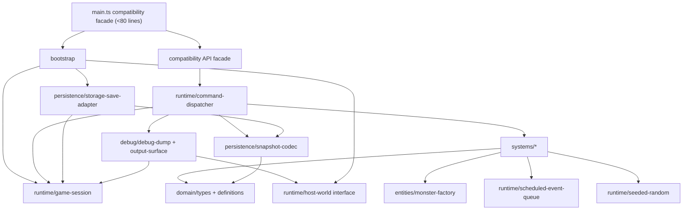

## Ventralis architecture audit and migration plan

This is an audit-only result. No files were edited or created. The characterization suite is the acceptance oracle and must not be edited.

### 1. State map

| Module binding | Classification | Migration ownership |
|---|---|---|
| `tickCount` | Retained runtime state (session) | `GameSession.tick` |
| `hp` | Proposed Component data | `PlayerVitals.hp` |
| `maxHp` | Proposed Component data | `PlayerVitals.maxHp` |
| `wood` | Proposed Component data | `LegacyResourceMirrors.wood` |
| `stone` | Proposed Component data | `LegacyResourceMirrors.stone` |
| `inventory` | Proposed Component data | `Inventory` |
| `equippedWeapon` | Proposed Component data | `Equipment` |
| `attackBonus` | Proposed Component data | `CombatStats.attackBonus` |
| `torchBuffTicks` | Proposed Component data | `TorchEffect.remainingTicks` |
| `alive` | Proposed Component data | `LifeState.alive` |
| `log` | Retained runtime state (session history) | `GameSession.log`; it affects spawning |
| `worldRef` | Retained runtime state (host/session) | Bootstrap-owned `GameSession.world` |
| `rngState` | Retained runtime state | `SeededRandom.state` |
| `pendingEvents` | Retained runtime state | `ScheduledEventQueue` |
| `saveCounter` | Retained runtime state | `PersistenceRuntime.saveCounter` |
| exported `monsters` | Proposed Component data | Monster entity records in `MonsterStore`; retain a compatibility array/view if its export remains public |

`RECIPES`, `MONSTER_DEFS`, and `ITEM_DEFS` are immutable definitions, not mutable state. `snapshot()` serializes all player/monster/RNG state above except `pendingEvents`, `saveCounter`, and `worldRef`; those omissions are legacy behavior to retain.

### 2. Function map

| Existing function | Destination |
|---|---|
| `lcgNext`, `rollInt` | `runtime/seeded-random.ts` |
| `say` | `systems/log-system.ts` |
| `emit`, `emitPanel` | `debug/output-surface.ts` |
| `totalWeight`, `carryCapacity`, `canCarry` | `systems/inventory-system.ts` |
| `attackRoll` | `systems/combat-system.ts` |
| `pickup` | `systems/inventory-system.ts` |
| `craft` | `systems/crafting-system.ts` |
| `consumeRation` | `systems/survival-system.ts` |
| `equip` | `systems/equipment-system.ts` |
| `spawnMonster` | `entities/monster-factory.ts` |
| `attack` | `systems/combat-system.ts` |
| `schedule` | `runtime/scheduled-event-queue.ts` |
| `onKey` | `bootstrap/input-router.ts` |
| `tick` | `systems/tick-system.ts` orchestration |
| `runTicks` | retained bootstrap/API compatibility facade |
| `decideUseStorage` | `persistence/storage-save-adapter.ts` |
| `persist` | `persistence/storage-save-adapter.ts` |
| `snapshot` | `persistence/snapshot-codec.ts` |
| `restore` | `persistence/snapshot-codec.ts` |
| `debugDump` | `debug/debug-dump.ts` |
| `resetGame` | retained bootstrap/API compatibility facade |
| `initGame` | retained bootstrap/API compatibility facade |
| `gameLoop`, `keys` aliases | retained entry-point exports |
| `api.run`, `api.pickup`, `api.craft`, `api.consumeRation`, `api.equip`, `api.spawn`, `api.schedule`, `api.dump`, `api.snapshot`, `api.restore` | compatibility facade delegating to the systems above |
| `api.state` factory and its `tick`, `hp`, `alive`, `wood`, `stone` getters | compatibility state-view module |

### 3. Side effects and dependencies

| Function(s) | Reads | Writes / output / external effects |
|---|---|---|
| `lcgNext` | `rngState` | writes `rngState`; consumes one RNG value |
| `rollInt` | arguments | consumes RNG through `lcgNext` |
| `say` | `tickCount` | appends `log` |
| `emit` | `worldRef` | appends text output to `worldRef.output` |
| `emitPanel` | `worldRef`, `debugDump` | appends panel output |
| `totalWeight`, `carryCapacity`, `canCarry` | `inventory`, `ITEM_DEFS` | no writes |
| `attackRoll` | `attackBonus`, `torchBuffTicks` | consumes RNG through `rollInt` |
| `pickup` | `alive`, capacity helpers, defs | mutates mirrors/inventory; logs; emits |
| `craft` | `alive`, recipes, inventory, capacity | mutates inventory, mirror wood, buff, bonus; logs; emits |
| `consumeRation` | `alive`, inventory, `hp`, `maxHp` | mutates inventory/hp; logs; emits |
| `equip` | `alive`, inventory | writes equipment; logs; emits |
| `spawnMonster` | monster definitions | appends `monsters`; logs |
| `attack` | `alive`, `monsters`, defs, combat values | consumes RNG; mutates monster/stone mirror/inventory; logs; emits |
| `schedule` | arguments | appends `pendingEvents` |
| `onKey` | `alive`, equipment/inventory | routes actions; KeyH emits panel then may equip/log/emit |
| `tick` | all session/player/monster state, queue, log, RNG, `worldRef` | advances tick, mutates survival/effect/events/monsters; may consume RNG and spawn; persistence call |
| `runTicks` | count | repeatedly invokes `tick` |
| `decideUseStorage` | `worldRef`, `worldRef.storage` | no writes; gates persistence |
| `persist` | world, storage gate, `tickCount`, `saveCounter` | increments counter and writes serialized storage entry |
| `snapshot` | player fields, log, monsters, RNG | clones/returns data; no writes |
| `restore` | serialized input | writes restored fields and monsters/RNG; appends `"save restored"` to log |
| `debugDump` | player/session fields, monsters, queue, save counter | produces string only |
| `resetGame` | seed | resets most state and monster collection/RNG; deliberately does not clear `worldRef` |
| `initGame` | world/storage | writes `worldRef`; may restore; appends wake log |
| API state getters | current singleton state | read-only compatibility view |

### 4. Ownership and mutation boundaries

Use a hybrid architecture: ECS-style entity data for player and monsters, plus explicit session services for the parts that are naturally singular.

`GameSession` owns the world/session aggregate: tick, player entity, monster store, log, scheduled queue, seeded random source, persistence runtime, and current host `World`. Bootstrap owns installation/replacement of the host `World`; systems never retain it independently.

Systems return ordered domain commands, rather than directly mutating shared module variables. A single `applyCommands(session, commands)` reducer performs controlled mutation. This preserves order-sensitive behavior—especially log-before-output sequences, KeyH panel-before-equip behavior, RNG draw timing, and tick phase ordering—while making each mutation boundary explicit. The compatibility API dispatches commands synchronously, so its observable behavior remains unchanged.

The persistence adapter owns only storage transport and save gating. It receives a snapshot plus explicit runtime metadata; it does not inspect ECS stores directly. The clock remains host-owned through `World.clock`; it is currently unused and should remain injected rather than invented as a component.

### 5. Not-ECS list

- Persistence boundary: not a component/system. It is infrastructure with a storage capability and legacy gating semantics.
- Debug/HUD surface: not a component/system. It is a read-only formatter/output adapter over session state.
- Scheduled-event queue: not an entity/component. It is temporal infrastructure keyed by tick, and exact removal-after-processing semantics are clearer as a queue service.
- Seeded RNG: not a component. It is a stateful deterministic service; draw order is part of the behavioral contract.
- `World` host object: not entity data. Canvas, output sink, storage, and clock are environment capabilities.
- Log: retain as session history rather than component data because it is global timeline state and its length affects spawn eligibility.
- Recipes and definitions: immutable catalog data, not components.

Abandon ECS for player/monster state if preserving the legacy exported mutable `monsters` identity or singleton API would require leaky bidirectional synchronization. In that case, use typed aggregate records (`PlayerState`, `MonsterState[]`) behind the same command reducer; the essential isolation and strict interfaces remain intact.

### 6. Hidden-coupling register

| Coupling | Evidence | Preservation requirement |
|---|---|---|
| Resource mirrors and inventory are independently mutable | `src/main.ts:162-164`, `186-199`, `253-254` | Keep mirror counters distinct from inventory; never derive one from the other. |
| Torch craft consumes only inventory material and preserves mirror drift | `src/main.ts:186-194`; pinned at `tests/characterization.test.ts:66-75` | Preserve `wood -= 0`, unchanged stone mirror, `torchBuffTicks = 30`, and permanent `attackBonus += 1`. |
| Ration craft secretly consumes mirror wood | `src/main.ts:195-201`; pinned at tests `77-83` | Preserve `wood -= 1` and `inventory.stone -= 0`. |
| Monster death double-drops stone | `src/main.ts:251-255`; pinned at tests `147-157` | Add two to both mirror and inventory. |
| Combat and wandering spawns share one RNG sequence | `src/main.ts:92-99`, `143-148`, `345-348`; seed pin at tests `139-145` | Preserve exact RNG consumption order; no pre-rolls, logging draws, or random-service replacement. |
| Spawn eligibility depends on history length | `src/main.ts:345-347` | Retain `log.length % 2 === 0`, including logs caused by prior gameplay and restore/init. |
| Tick phase order is load-bearing | `src/main.ts:303-353` | Preserve drain, buff decay, events, monsters, spawn, then periodic persistence in that order. |
| Exact-tick events are removed only after their due pass | `src/main.ts:319-329` | Process every event where `at === tickCount`, then remove those entries. |
| Periodic save is gated by existing save-key presence | `src/main.ts:364-375`; pinned at tests `160-176` | At tick ten, do nothing unless `ventralis:save` already exists. |
| Save payload has runtime-only metadata not in snapshots | `src/main.ts:372-374` | Preserve `savedAtTick` and incrementing `saveCounter`; do not serialize queue/counter in normal snapshots. |
| Restore appends a log entry after assigning the saved log | `src/main.ts:397-414` | Preserve the `"save restored"` append and its later influence on log-length spawning. |
| Initialization restores before appending wake log | `src/main.ts:459-466` | Keep restore-before-`"you wake..."`; neither log entry emits output. |
| Reset does not clear host world reference | `src/main.ts:441-457` | Preserve externally observable singleton lifecycle unless explicitly versioned; document it as a compatibility constraint. |
| KeyH emits panel before re-equipping | `src/main.ts:279-284`; pinned at tests `201-220` | Preserve panel snapshot with fists, then torch re-equip/output when eligible. |
| HUD/debug formatting is externally observable | `src/main.ts:420-435`; pinned at tests `25-45` | Preserve exact field order, delimiters, and omitted log/RNG details. |
| Dead actions must have no state changes | `src/main.ts:155`, `169`, `205`, `219`, `238`, `272`; pinned at tests `112-122` | Gate action commands before logging/output/mutation. |
| Crawler damage does not perform a death transition | `src/main.ts:332-343` | Preserve this asymmetry; do not “fix” crawler-induced zero HP behavior without new requirements. |

### 7. Proposed dependency graph



All arrows point from higher-level orchestration toward lower-level dependencies. `main.ts` depends on bootstrap/API, while persistence and debug depend on typed session/host abstractions and never import `main.ts`.

### 8. Proposed file tree

```text
src/
  main.ts                              ~65 lines
  domain/
    game-types.ts                      ~95
    definitions.ts                     ~55
    snapshot-types.ts                  ~45
  entities/
    player-factory.ts                  ~45
    monster-factory.ts                 ~45
  runtime/
    game-session.ts                    ~100
    command-types.ts                   ~90
    command-dispatcher.ts              ~115
    seeded-random.ts                   ~35
    scheduled-event-queue.ts           ~60
    host-world.ts                      ~30
  systems/
    inventory-system.ts                ~110
    crafting-system.ts                 ~105
    equipment-system.ts                ~50
    combat-system.ts                   ~110
    survival-system.ts                 ~75
    log-system.ts                      ~35
    tick-system.ts                     ~115
  persistence/
    snapshot-codec.ts                  ~115
    storage-save-adapter.ts            ~75
  debug/
    debug-dump.ts                      ~60
    output-surface.ts                  ~55
  bootstrap/
    game-bootstrap.ts                  ~105
    input-router.ts                    ~75
    compatibility-api.ts               ~110
```

No migrated file exceeds 120 lines; the entry point remains below approximately 80 lines.

### 9. Migration order

1. Establish typed domain/session interfaces and immutable definitions without changing exports or behavior.
2. Extract seeded RNG, event queue, log, snapshot codec, and debug formatter behind compatibility wrappers; run characterization tests.
3. Extract inventory/crafting/equipment systems, explicitly retaining mirror drift and craft side effects; run tests.
4. Extract monster factory and combat system, preserving shared RNG draw timing and double stone drop; run tests.
5. Extract survival and tick orchestration, copying the six current phases exactly; run tests.
6. Extract storage adapter and bootstrap/input routing, preserving save-key gating and KeyH ordering; run tests and typecheck.
7. Reduce `main.ts` to export-compatible composition root and compatibility facade; run the full characterization suite and typecheck after this final slice.

Every slice keeps existing public imports/exports available and leaves `tests/characterization.test.ts` unchanged.

### 10. Risk and verification plan

A follow-up implementation should use the unchanged characterization suite as the primary acceptance oracle, run after every slice. Add no test edits. It should additionally compare pre/post traces generated through existing public APIs for:

- `api.dump()` at every tick and after each action;
- exact `world.output` sequence and panel placement;
- snapshots and restored runs;
- storage contents at ticks 9, 10, and 20;
- seeded combat/spawn sequences across several seeds;
- queue processing with multiple equal-tick events;
- dead-player no-op behavior.

The highest-risk changes are singleton lifecycle (`worldRef`), implicit log/RNG interactions, snapshot omissions, and output ordering. ECS should be rejected for a concern when it forces hidden synchronization, changes entity/order semantics, obscures the legacy compatibility boundary, or makes the exact command order less legible than a small typed session service.

## Handoff record

| Item | Result |
|---|---|
| Model/provider | Codex / OpenAI |
| Session/thread ID | Not visible in this environment |
| Attempts | 1 audit pass |
| Repairs | None |
| Changed paths | None |
| Scope drift | None |
| Initial failures | None |
| Baseline note | Worktree `HEAD` was `727609cc0975c839c7a99ee6392d384cfc0be98e`; local `master` resolved to `db804e1a188134210f1884cc850a42ecc37e7250`. Per operator authorization, HEAD was treated as authoritative. |
| `git status --short` | Exit 0; no output |
| `git diff --check` | Exit 0; no output |
| `pnpm run test` | Exit 0; 1 test file passed, 21 tests passed |
| `pnpm run typecheck` | Exit 0 |
| Remaining blockers | None |