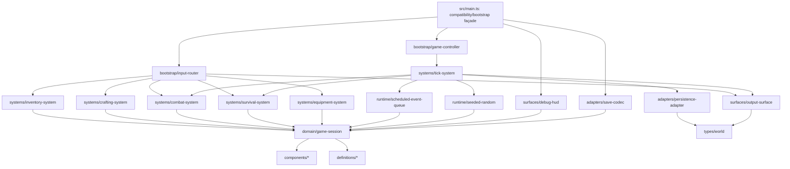

# Ventralis architecture audit and migration plan

Recommendation: use a small, strict TypeScript hybrid architecture: ECS-style components and systems for player/monster gameplay state, with a `GameSession` aggregate retaining time, seeded RNG, scheduled events, persistence session metadata, and the runtime `World` binding. This preserves the observable legacy behavior without forcing infrastructure into ECS.

`tests/characterization.test.ts` is the acceptance oracle and must not be edited.

## 1. State map

| Module binding | Classification | Proposed owner / representation |
|---|---|---|
| `tickCount` (72) | Retained runtime state | `GameSession.tick` |
| `hp` (73) | Proposed Component data | `Vitality.current` on player |
| `maxHp` (74) | Proposed Component data | `Vitality.max` on player |
| `wood` (75) | Proposed Component data | `LegacyResourceMirror.wood`; deliberately distinct from inventory |
| `stone` (76) | Proposed Component data | `LegacyResourceMirror.stone`; deliberately distinct from inventory |
| `inventory` (77) | Proposed Component data | `Inventory.counts` on player |
| `equippedWeapon` (78) | Proposed Component data | `Loadout.weapon` on player |
| `attackBonus` (79) | Proposed Component data | `CombatStats.attackBonus` on player |
| `torchBuffTicks` (80) | Proposed Component data | `TorchBuff.remainingTicks` on player |
| `alive` (81) | Proposed Component data | `Vitality.alive` on player |
| `log` (82) | Proposed Component data | `EventLog.entries` on player/session state; not discardable because its length controls spawning and its tail is serialized |
| `worldRef` (83) | Retained runtime state | `GameSession.world: World \| null` |
| `rngState` (84) | Retained runtime state | `SeededRandom.state`; serialized as part of the gameplay save |
| `pendingEvents` (85) | Retained runtime state | `ScheduledEventQueue.events`; owned by session, not serialized under current behavior |
| `saveCounter` (86) | Retained runtime state | `PersistenceSession.saveCounter`; intentionally not included in snapshot/restore |
| exported `monsters` array (297) | Proposed Component data | Monster entities, each with `Monster`/`Vitality`/`CombatStats`; retain an ordered encounter collection to preserve “first monster is attacked” behavior and exported compatibility |

No mutable binding is genuinely dead or safely derivable. In particular, the mirror counters are redundant by design but externally observable; they must not be consolidated with inventory.

## 2. Function map

| Current function | Destination |
|---|---|
| `lcgNext`, `rollInt` | `runtime/seeded-random.ts` |
| `say` | `systems/log-system.ts` |
| `emit`, `emitPanel` | `surfaces/output-surface.ts` |
| `totalWeight`, `carryCapacity`, `canCarry` | `rules/inventory-rules.ts` |
| `attackRoll` | `systems/combat-system.ts` |
| `pickup` | `systems/inventory-system.ts` |
| `craft` | `systems/crafting-system.ts` |
| `consumeRation` | `systems/survival-system.ts` |
| `equip` | `systems/equipment-system.ts` |
| `spawnMonster` | `entities/monster-factory.ts` |
| `attack` | `systems/combat-system.ts` |
| `schedule` | `runtime/scheduled-event-queue.ts` |
| `onKey` | `bootstrap/input-router.ts` |
| `tick` | `systems/tick-system.ts` coordinator |
| `runTicks` | `bootstrap/game-controller.ts` |
| `decideUseStorage`, `persist` | `adapters/persistence-adapter.ts` |
| `snapshot`, `restore` | `adapters/save-codec.ts` |
| `debugDump` | `surfaces/debug-hud.ts` |
| `resetGame`, `initGame` | retained `main.ts` bootstrap façade |
| exported `gameLoop`, `keys`, `api` | retained `main.ts` compatibility façade |
| `api.state` getters | `surfaces/state-view.ts`, called by façade |

Types and immutable definitions move to `types/`, `definitions/`, and `components/`.

## 3. Side effects and dependencies

Legend: R/W are session/component state; “output” is `World.output`; RNG means consumption advances the seeded sequence.

| Function | R/W globals | Output/storage | RNG | Log coupling |
|---|---|---|---|---|
| `lcgNext` | R/W `rngState` | — | consumes | — |
| `rollInt` | indirect R/W `rngState` | — | consumes | — |
| `say` | R `tickCount`; W `log` | — | — | appends |
| `emit` | R `worldRef` | W output text | — | — |
| `emitPanel` | R `worldRef`, indirect full debug state | W panel | — | reads dump |
| `totalWeight` | R `inventory` | — | — | — |
| `carryCapacity` | R `inventory.torch` | — | — | — |
| `canCarry` | R inventory/static item definitions | — | — | — |
| `attackRoll` | R `attackBonus`, `torchBuffTicks`; indirect RNG | — | consumes | — |
| `pickup` | R `alive`, inventory; W inventory and wood/stone mirrors | text on success/failure | — | appends |
| `craft` | R `alive`, inventory; W inventory, `wood`, `attackBonus`, `torchBuffTicks` | text on success/failure | — | appends |
| `consumeRation` | R `alive`, inventory, `hp`, `maxHp`; W inventory, `hp` | text | — | appends |
| `equip` | R `alive`, inventory; W `equippedWeapon` | text | — | appends |
| `spawnMonster` | W `monsters` | — | — | appends |
| `attack` | R `alive`, monsters, bonus/buff; W monster HP/list, `stone`, inventory stone | text | consumes via roll | appends |
| `schedule` | W `pendingEvents` | — | — | — |
| `onKey` | R `alive`, weapon, inventory; dispatches mutators | panel/text indirectly | indirect | indirect |
| `tick` | R/W tick, HP/alive, buff, events, monsters, log, world/session | periodic storage indirectly; event text | consumes only on eligible spawn | reads length; appends |
| `runTicks` | invokes tick repeatedly | indirect | indirect | indirect |
| `decideUseStorage` | R `worldRef` | reads storage key | — | — |
| `persist` | R `worldRef`, tick; W `saveCounter` | W storage only when gated | — | — |
| `snapshot` | R all serialized gameplay state | — | — | serializes final 20 entries |
| `restore` | W serialized gameplay state and monster contents | reads supplied JSON | restores state | appends “save restored” after loading |
| `debugDump` | R gameplay/session debug fields | returns text | — | does not show log, but exposes event/save counts |
| `resetGame` | W all reset state except `worldRef` | — | reseeds | clears |
| `initGame` | W `worldRef`; may restore | reads storage; no output | restored indirectly | appends wake log |
| `api.state` getters | R selected state | — | — | — |

## 4. Ownership and mutation boundaries

`GameSession` owns the player entity, ordered monster encounter, component stores, tick number, event queue, runtime `World`, seeded random source, and persistence-session counter.

Systems receive a narrow `MutableGameState` capability and mutate it directly through controlled methods, rather than returning commands. This is the safer choice here because the exact ordering of mutations, log entries, emissions, and RNG draws is observable. A command queue would introduce another ordering layer and a high risk of accidentally changing behavior.

- World state: owned by `GameSession`; systems cannot replace it.
- Event queue: owned by `GameSession`; only scheduling and tick-event operations can add/remove entries.
- Persistence adapter: owns storage I/O only; it receives serialized data and never owns gameplay state.
- Clock: retained on the injected `World`, though currently unused. Do not invent clock reads during migration.
- Random source: owned by `GameSession` as a `SeededRandom`; only combat and wandering-spawn code receive access.

## 5. Not-ECS list

- Persistence boundary: not a component or system. It is an adapter around `World.storage`, with the legacy “existing key required” policy.
- Debug/HUD surface: not a component. It is a read-only formatter over session state whose exact string is an API contract.
- Scheduled-event queue: retain as a session-owned ordered queue. Events are temporal commands, not enduring entity attributes; preserve exact-tick processing and removal.
- Seeded RNG: not a component. It is a stateful runtime service whose call order is part of replay behavior and save compatibility.
- `World`/canvas/output/clock: injected runtime platform boundary, not gameplay entity data.
- Static item, recipe, and monster definitions: immutable definitions, not components.
- Input routing and public `api`: bootstrap/compatibility surfaces, not gameplay systems.

## 6. Hidden-coupling register

| Coupling to preserve | Evidence | Migration control |
|---|---|---|
| Resource mirror and inventory intentionally drift | Pickup updates both only for wood/stone (162–164); torch consumes inventory but does `wood -= 0` (186–193); ration secretly decrements mirror wood (195–199) | Separate `LegacyResourceMirror` from `Inventory`; prohibit normalization. |
| Crafting changes combat/buff state | Torch sets buff to 30 and permanently increments bonus (191–193) | Craft system must call the same controlled mutation path, in the same order. |
| Ration has hidden resource rule | Ration recipe consumes listed inventory materials but additionally decrements mirror wood (187–199) | Preserve as an explicit legacy rule with a regression test already supplied. |
| Monster death double-drops stone | Death adds two to mirror and two to bag (251–255) | Preserve separate writes; do not derive either value. |
| KeyH is both HUD and equipment action | Panel emits before conditional re-equip (279–283) | Input router preserves this exact branch and output order. |
| RNG is order-dependent | LCG mutates state (92–95); attacks consume it via roll (97–98, 245–246); spawn consumes it only when its gate passes (345–348) | One injected stateful RNG; no precomputed values or extra draws. |
| Spawn depends on log length | Tick-20 spawn gate reads `log.length % 2` (345–347) | Keep event log in state and execute prior tick stages before this gate. |
| Tick stage order is behavioral | Drain, buff decay, due events, monster round, spawn, save are sequenced (303–353) | Single coordinator with stages preserved verbatim. |
| Periodic saving is conditional on a storage key | Gate checks key existence (364–367); tick 10 calls persist (350–352) | Adapter policy must not create first save automatically. |
| Save counter is session-only | Incremented/persisted in payload (372–374), visible in HUD (433), omitted by snapshot/restore (380–394, 397–413) | Keep outside serialized game snapshot. |
| Snapshot omits pending events and save counter | Snapshot fields end at `rngState` (380–394); restore does not write events/counter (397–413) | Preserve omission, even if it appears incomplete. |
| Restore appends to loaded log | Loaded log is assigned, then `say("save restored")` runs (409–413) | Preserve post-restore append and current tick attribution. |
| Init restore then wake log | Storage restore occurs before wake message (459–465) | Preserve ordering; boot has no output because `say` does not emit. |
| Reset leaves `worldRef` intact | Reset assigns all listed state but not `worldRef` (441–457) | Preserve unless owner explicitly authorizes a behavior change. |
| HUD is an exact public format | Field ordering and semicolon layout (420–435); panel calls dump (114–119) | Retain formatter contract byte-for-byte. |
| Combat ignores `MonsterInstance.attack` | Monster round hardcodes crawler/stalker damage (332–342), despite instance attack field (291–295) | Do not “fix” combat to use the instance field. |
| Dead blocks actions but not ticking | Action functions early-return on `alive` (155, 170, 206, 220, 239, 272); `tick` has no early return (303 onward) | Preserve this asymmetry. |
| Due events are equality-only and all due events run | `e.at === tickCount`, then filter removes only equal ticks (319–329) | Do not use `<=`, sorting, or a priority queue that changes semantics. |
| Carry capacity includes torches in bag | Capacity is `20 + inventory.torch * 2` (135–137) | Use current inventory count, including newly crafted torches. |
| Persistence serializes only log tail | `log.slice(-20)` (391) | Preserve truncation precisely. |

## 7. Proposed dependency graph



The graph is acyclic: lower-level components, definitions, and types have no dependency on systems, surfaces, adapters, or `main.ts`.

## 8. Proposed file tree

Every migrated implementation file should remain under 120 lines; `src/main.ts` should be approximately 60–75 lines.

```text
src/
  main.ts
  types/
    game.ts
    world.ts
    save.ts
  definitions/
    items.ts
    recipes.ts
    monsters.ts
  components/
    vitality.ts
    inventory.ts
    combat.ts
    legacy-resource-mirror.ts
    event-log.ts
    monster.ts
  domain/
    game-session.ts
    player-factory.ts
    monster-factory.ts
  runtime/
    seeded-random.ts
    scheduled-event-queue.ts
  rules/
    inventory-rules.ts
  systems/
    log-system.ts
    inventory-system.ts
    crafting-system.ts
    equipment-system.ts
    survival-system.ts
    combat-system.ts
    tick-system.ts
  adapters/
    save-codec.ts
    persistence-adapter.ts
  surfaces/
    output-surface.ts
    debug-hud.ts
    state-view.ts
  bootstrap/
    input-router.ts
    game-controller.ts
```

## 9. Migration order

1. Establish a no-behavior-change compatibility façade in `main.ts`; retain current exports and run the characterization suite.
2. Extract types and immutable definitions only. Verify tests and typecheck.
3. Introduce `GameSession` with a one-to-one representation of all state, including mirrors, log, RNG, event queue, and save counter. Keep old public behavior delegated through façade functions.
4. Extract pure inventory rules and seeded RNG. Verify fixed seed attack behavior.
5. Extract logging/output/debug read surfaces without changing strings or output ordering.
6. Extract inventory, crafting, equipment, survival, monster factory, and combat systems one at a time. Run the suite after every extraction.
7. Extract scheduled queue and tick coordinator, preserving the six existing tick stages and their sequence.
8. Extract save codec and persistence adapter, specifically preserving storage-key gating, snapshot omissions, and restore-log behavior.
9. Reduce `main.ts` to bootstrap and compatibility exports; verify all tests/typecheck and inspect source-line budgets.

## 10. Risk and verification plan

A later implementer proves preservation by running the unchanged characterization suite after every migration slice, then running `pnpm run typecheck`. They should additionally use API-level differential checks against the baseline for seeded action/tick sequences, comparing:

- `api.dump()` exactly;
- `World.output` ordering and contents;
- storage JSON, including `savedAtTick` and `saveCounter`;
- `api.snapshot()` shape and values;
- RNG-sensitive attack and tick-20 spawn sequences.

Abandon ECS for a concern when entity/component representation adds indirection without an ownership benefit, especially persistence, output/HUD formatting, runtime clock/RNG, scheduled events, and public compatibility APIs. The selected hybrid already makes that decision.

## Verification and handoff

- Model/provider: Codex, GPT-5 / OpenAI. Concrete session/thread ID was not visible.
- Attempts: 1 read-only audit pass.
- Repairs: none.
- Changed paths: none.
- Scope drift: none; no files were created, edited, renamed, deleted, formatted, committed, reset, stashed, or cleaned.
- Initial failures: none.

| Command | Exit code | Exact result |
|---|---:|---|
| `git status --short` | 0 | No output; worktree clean. |
| `git diff --check` | 0 | No output; clean. |
| `pnpm run test` | 0 | `1 passed` test file; `21 passed` tests. |
| `pnpm run typecheck` | 0 | `tsc -p tsconfig.json --noEmit` completed cleanly. |

Remaining blockers: none.